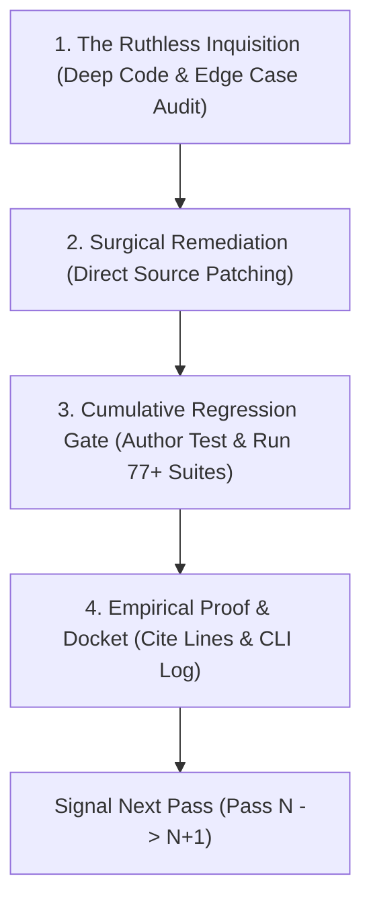

# Nugget Forensic Pace & Supreme Tri-Phase Protocol (Siklus V)

## Overview
`nugget-forensic-pace` defines the rigorous, single-pass sequential forensic inspection and surgical remediation workflow for Nugget Nihongo. It eliminates "vibe-coded" superficial checks by requiring microscopic empirical verification, direct implementation hardening, terminal test execution, and continuous cumulative regression verification before closing any pass.

---

## Core Invariants

### 1. Strict Single-Pass Execution (One Pass per Turn)
- **NEVER** bundle, jump, or leapfrog multiple passes in a single turn (e.g., jumping from Pass 1 to Pass 5).
- Even when invoked under long-running directives (e.g. `/goal`), execute and report **exactly ONE single pass per turn**.
- Solicit or announce the transition to the next sequential pass (Pass $N \rightarrow N+1$) without skipping numbers.

### 2. The Supreme Forensic Tri-Phase Architecture
Every pass must execute the 4-phase sequence:

- **Phase 1: The Ruthless Inquisition (Audit & Critique)**:
  - Deep-dive into source files line-by-line using `read_file`.
  - Probe edge cases aggressively: `null`, `undefined`, `0`, `NaN`, offline disconnect, network drop, 320px iPhone SE screen, multi-tab concurrency, 1000+ item loop.
  - Openly document flaws, architectural smells, type gaps, and UX friction.
- **Phase 2: Surgical Remediation (Direct Code Patching)**:
  - Fix identified defects directly in implementation files (`edit_file` / `write_file`).
  - Maintain 100% backward compatibility and strict TypeScript typing.
- **Phase 3: Cumulative Regression Gate**:
  - Author a dedicated test suite (`tests/test-s5-passX-*.js`).
  - Register as a new suite in `tests/master-regression-orchestrator.js`.
  - Execute orchestrator: all historical suites (77 suites + new suite) must pass 100% GREEN (Exit Code 0).
- **Phase 4: Empirical Proof & Docket**:
  - Record verified line ranges before/after, exact file paths, and terminal execution logs.

---

## 15 Comprehensive Functional Clusters (100% Codebase Scope)

The audit covers 100% of Nugget Nihongo across 15 distinct functional clusters:

1. **Cluster 1: Core Mathematical & Adaptive Engines**:
   - FSRS v4.5 Forgetting Curve ($R(t,S)=(1+0.19\cdot t/S)^{-0.5}$), stability, difficulty ($1 \le D \le 10$), lapse recovery.
   - CAT IRT 3PL Adaptive Placement ($P(\theta)$, Fisher Information $I(\theta)$, $SEM \le 0.35$, stopping rule).
2. **Cluster 2: Lexical & Grammatical Canonical Matrix**:
   - 28,500+ vocabulary corpus, modified Hepburn, search indexer.
   - 850+ grammar points, conjugation engine (Godan, Ichidan, Kuru, Suru, te, ta, nai, ba, tara).
3. **Cluster 3: SSW Vocational & K3 Gemba Workplaces**:
   - 19 SSW Tokutei Ginou sectors (Kaigo, Gaishoku, Kensetsu, Nogyo, Zousen, Seizogyo, Shukuhaku, Butsuryu, etc.).
   - 190 Gemba skits and official Japanese K3 safety/emergency commands.
4. **Cluster 4: Contrastive L1 Interference & Nuance Diagnostics**:
   - 300+ nuance comparison pairs, false friends, *wa* vs *ga*, Indonesian "adalah" error patterns.
5. **Cluster 5: Jalur 9 Buku Teks Pendamping (Latent Module)**:
   - `public/data/books/`: Minna no Nihongo I & II, Irodori A1, A2-1, A2-2, Nihongo Sou Matome N4 & N3, Grammar Lens adapters.
6. **Cluster 6: Audio, Phonetics & Listening Immersion**:
   - Tokyo Pitch Accent (OJAD/Wadoku: Atamadaka, Nakadaka, Odaka, Heiban).
   - HVPT Player (`HVPTPlayer.tsx`, minimal pairs sokuon, chouon, R vs L).
   - Choukai listening player, auto-pause drills, Kokoro/Pocket TTS/Web Speech fallbacks, ZzFX procedural audio.
7. **Cluster 7: Interactive Kanji Writing & Touch Recognition**:
   - KanjiCanvas Retina buffer, pointer capture, KanjiVG vector normalizer (109×109 px), Discrete Fréchet Distance ($\ge 80\%$), Goukaku seal (合格), HTML5 Canvas share cards.
8. **Cluster 8: Exam Simulations & Interactive Drills**:
   - CBT Prometric/JLPT 15-minute exam runner, Google BudouX Star Scramble, Dokkai split-pane LMS, 4-stage lesson study player, Arena Quiz engine.
9. **Cluster 9: Specialized Cultural & Pragmatic Dojo Modules**:
   - Japanese Counters (助数詞) euphonic shifts (onbin), Keigo sociopragmatic analyzer (Uchi/Soto), Kotowaza traditional proverbs, interactive Kana Chart.
10. **Cluster 10: Gamification & Cognitive Pacing**:
    - Kebun Kata (Kanji Growth Garden), Streak shields, Badges modal (`BadgesModal.tsx`), Heatmap calendar (`HeatmapCalendar.tsx`), Micro-session pacing (`microSessionEngine.ts`).
11. **Cluster 11: Local-First Storage, Multi-Tab Sync & Cloud Bridge**:
    - TinyBase IndexedDB persistence, storage eviction recovery (`StorageEvictionRecoveryModal.tsx`), BroadcastChannel multi-tab sync daemon (`broadcastSync.ts`, `syncDaemon.ts`), CRDT vector clocks, Supabase delta sync.
12. **Cluster 12: UI Design System & Editorial Aesthetics**:
    - Warm Editorial Hybrid theme (Washi Wash `#F7F4EE`, Pure Milk White `#FFFFFF`, Warm Sumi `#121110`, Makie Gold `#F59E0B`, 8 Nippon tokens).
    - Typography: BIZ UDGothic, DM Sans, Google BudouX semantic line-breaker, RubyText Furigana WCAG AAA contrast.
13. **Cluster 13: Multi-Device Responsive Layouts & Modal Stacking**:
    - 320px–1920px viewports (iPhone SE to desktop), touch targets $\ge 40\times 40$ px, safe area padding `pb-[calc(5.5rem+env(safe-area-inset-bottom))]`, `useModalStore` stacking and focus traps.
14. **Cluster 14: Two-Wing Institutional Architecture & External Portals**:
    - AboutPage, MethodologyPage (CC BY-SA 4.0, APA 7th / BibTeX sitasi).
    - CommunityHubModal, Tantangan Kanji Harian, verified portals (𝕏 `@NuggetNihongo`, Trakteer, email `nuggetnihongo@gmail.com`), anti-hallucination guard.
15. **Cluster 15: Production Hardening, Swarm QA & Zenith Synthesis**:
    - 200 Indonesian learner personas swarm simulation across all 4 pillars and device profiles.
    - Security audit: Supabase RLS policies, input sanitization, CSP headers.
    - Production Vite build and bundle budgeting.
    - Grand Master Synthesis & Release v24.0.0 (*Zenith & Shin-Nihongo*).

---

## Common Anti-Patterns to Strictly Prohibit
- **Bundling Passes**: Combining multiple passes into one turn destroys forensic granularity.
- **Skipping Inquisitions**: Declaring a pass green without performing extreme edge-case inquisition.
- **Bypassing Cumulative Tests**: Disabling or commenting out any historical test suite to make a new test pass.
- **POSIX Syntax in PowerShell**: Using `&&` in Windows PowerShell commands causes syntax errors; always use `;`.
