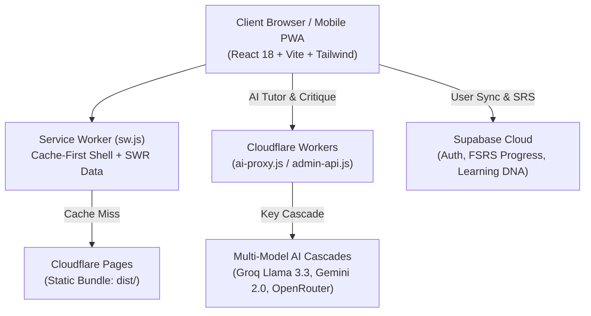
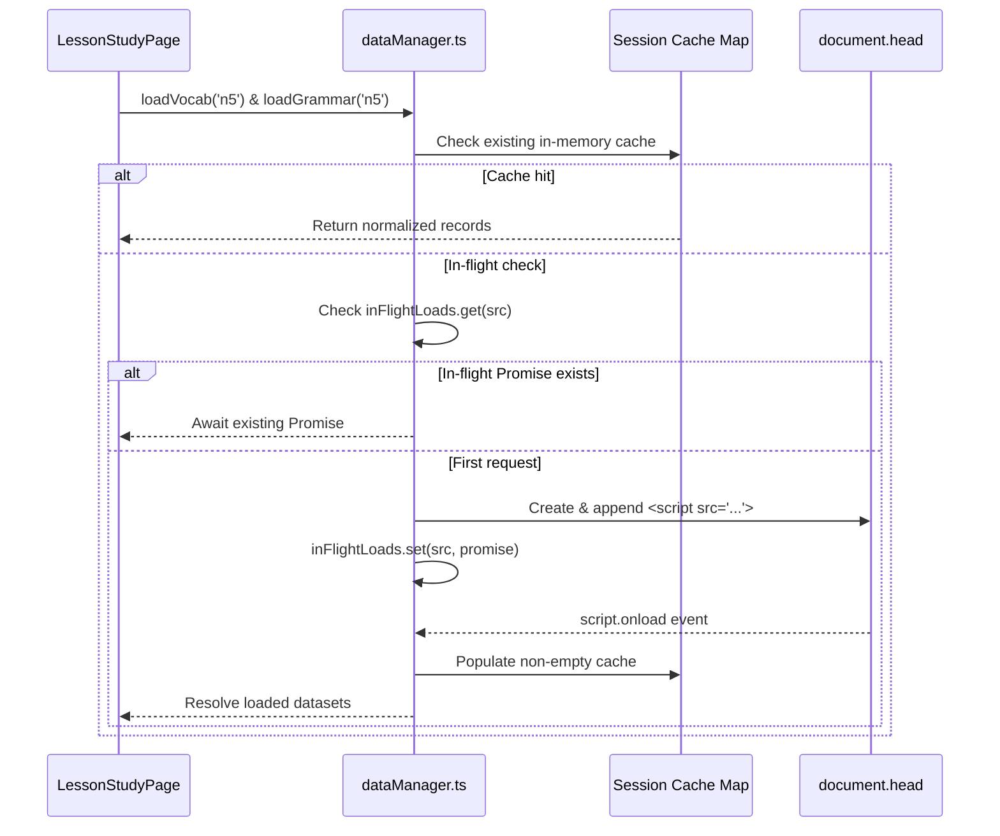

# Nugget Nihongo — System Architecture (v18.1.0)

## 1. Overview

Nugget Nihongo is an ultra-fast, offline-capable Progressive Web Application (PWA) tailored for Indonesian learners of Japanese across all JLPT levels (N5–N1) and Tokutei Ginou (SSW) vocational sectors.

Key Architectural Tenets:
- **Modern Hybrid Frontend:** React 18 + Vite + TypeScript with Tailwind CSS and Zustand store architecture.
- **Strict Multi-Device Responsive Design:** Guaranteed 0px horizontal overflow across iPhone SE (320px–375px), modern smartphones (390px–430px), tablets (640px–1024px), and wide monitors (1920px+).
- **Asynchronous Chunk Loading with Concurrency Protection:** Dynamic script-based loader with deduplicated in-flight Promise mapping (`inFlightLoads`) to prevent race conditions and permanent cache poisoning.
- **Pedagogical Sentence-Extraction & Slot-Filling Engine:** Zero malformed synthetic utterances. Offline micro-drills dynamically extract verified authentic examples and generate category-matched distractors.
- **Offline-First PWA:** Dual-tier Service Worker (Cache-First Core Shell, Stale-While-Revalidate Canonical Data) with LocalStorage and IndexedDB synchronization.
- **Edge Security & AI Routing:** Multi-model AI proxy on Cloudflare Workers (Groq 70B, Gemini 2.0 Flash, OpenRouter cascade) with IP-anchored rate limiting and UTF-8 safe promotion pipeline.

---

## 2. Deployment Architecture



---

## 3. Technology Stack

| Layer | Technology | Purpose |
|---|---|---|
| **Frontend Framework** | React 18, TypeScript, Vite | High-performance SPA with strict typing and tree shaking |
| **Styling & Design System** | Tailwind CSS, Lucide React, Custom Dark Palette | Fluid typography, safe-area navigation padding, 40px+ touch targets |
| **State Management** | Zustand (`useAppStore`, `useCurriculumStore`) | Unidirectional state flow with persisted local storage |
| **Spaced Repetition (SRS)** | FSRS Algorithm (`ts-fsrs`) | Optimized spaced repetition calibrated for Indonesian L1 interference |
| **Offline Runtime** | Service Worker (`public/sw.js`) | Pre-caches core app shell and canonical corpora |
| **Edge Serverless** | Cloudflare Workers (`workers/ai-proxy.js`) | AI proxy with IP rate limiting, KV caching, and multi-model failover |
| **Admin & Promotion** | Cloudflare Worker (`workers/admin-api.js`) | Secure GitHub API integration with UTF-8 base64 encoding |
| **Database & Auth** | Supabase (`@supabase/supabase-js`) | Cloud backup, cross-device sync, anonymous auth upgrade |
| **Automated Testing** | Node.js Test Suite (`npm test`, `tests/`) | Over 41,000 automated assertions verifying data integrity and semantics |

---

## 4. Directory Structure

```
nugget-nihongo/
├── src/                                 # React + TypeScript Source Code
│   ├── components/                      # Modular UI Components
│   │   ├── curriculum/player/           # Lesson stages: Dialogue, Explanation, Drills, CanDo
│   │   ├── layout/                      # Header, Sidebar, BottomNav, MobileDrawer
│   │   ├── navigation/                  # Responsive navigation pills, track selectors
│   │   └── shared/                      # Button, Card, FuriganaText, Modal, Toast
│   ├── lib/                             # Core Business Engines
│   │   ├── curriculum/                  # lessonContentAdapter (Sentence-Extraction Engine)
│   │   ├── data/                        # dataManager (Promise Map concurrency loader)
│   │   ├── fsrs/                        # FSRS spaced repetition scheduler
│   │   └── supabase/                    # Supabase client with sanitized URL validation
│   ├── pages/                           # Router Page Views
│   │   ├── HomePage.tsx                 # Dashboard, streak tracker, quick resume
│   │   ├── LessonStudyPage.tsx          # 4-stage interactive lesson player & 404 guard
│   │   ├── MateriHubPage.tsx            # Syllabus browser across JLPT, Books & SSW
│   │   ├── QuizPage.tsx                 # 9 quiz modes with instant feedback
│   │   ├── SenseiPage.tsx               # AI tutor conversational interface
│   │   └── KebunPage.tsx                # Vocabulary garden & SRS review deck
│   ├── stores/                          # Zustand State Stores
│   ├── types/                           # Universal TypeScript Definitions
│   ├── App.tsx                          # Root component with routing orchestrator
│   └── main.tsx                         # DOM entry point
│
├── public/                              # Static Assets & Canonical Corpora
│   ├── data/
│   │   ├── vocab/                       # 4,839+ JLPT vocab + 72 SSW specialist terms
│   │   ├── grammar/                     # 859 JLPT grammar points (N5 to N1)
│   │   ├── curriculum/                  # 7 Compiled tracks (N5–N1, SSW Construction, Food, Kaigo)
│   │   ├── books/                       # Textbook lenses (Minna I/II, Irodori, Soumatome)
│   │   └── fallback/                    # Real-world fallback drills (vocab-drills, grammar-drills)
│   ├── fonts/                           # Subsetted WOFF2 web fonts (DM Sans, BIZ UDGothic)
│   └── sw.js                            # PWA Service Worker (Cache-first + SWR)
│
├── workers/                             # Cloudflare Edge Workers
│   ├── ai-proxy.js                      # Multi-model AI proxy with IP-anchored rate limits
│   └── admin-api.js                     # Secure admin promotion pipeline (UTF-8 safe)
│
├── scripts/                             # Master Compilers & Data Tools
│   ├── build-curriculum-all.js          # Master compiler for JLPT & SSW curriculum tracks
│   ├── merge-grammar.js                 # Reassembles split grammar subfiles into master sets
│   ├── dedupe-books.js                  # Deduplicates textbook chapter arrays
│   └── count-data.js                    # Authoritative corpus metric counter
│
└── tests/                               # Comprehensive Automated Test Suites
    ├── run.js                           # Master test runner
    ├── test-fallback-integrity.js       # Validates 100% 1:1 match for offline drills
    └── test-curriculum-semantics.js     # Validates SSW uniqueness and taxonomy tags
```

---

## 5. Data Flow & Concurrency Engine



---

## 6. Security & Edge Policies

1. **Edge Rate Limiting:** All `/chat`, `/generate-quiz`, and `/critique` requests are strictly rate-limited against a daily budget using `CF-Connecting-IP` as an immutable edge identity anchor.
2. **Promotion Pipeline Safety:** `admin-api.js` utilizes `TextEncoder` and byte array base64 encoding to serialize Japanese Kanji and Kana without `InvalidCharacterError`. Promotion writes are file-type aware (`.json` array appending, `.md` markdown headings, `.js` bracket insertion).
3. **Client Configuration Sanitization:** URL query parameter overrides for backend connections (`sb_url`, `sb_key`) are strictly validated against HTTPS and legitimate Supabase domains, and immediately stripped from browser history via `replaceState` to prevent token leakage.
