# NUGGET NIHONGO — MASTER APPLICATION DEVELOPMENT SYNTHESIS SPECIFICATION
**Dokumen:** `blueprint/APP-DEVELOPMENT-SYNTHESIS-SPEC-v1.md`  
**Versi:** v1.0 (Corpus v30 Canonical Engineering Revision)  
**Status:** AUTHORITATIVE ARCHITECTURAL SPECIFICATION FOR APPLICATION DEVELOPMENT  
**Target Pembaca:** Full-Stack Engineers, Frontend Developers, Algorithmic Engine Authors, UI/UX Designers, QA Engineers  
**Landasan Empiris & Teoretis:**
- Free Spaced Repetition Scheduling (FSRS v4.5 per Ye et al. 2022 [SR-10], Su et al. 2023 [SR-11])
- Item Response Theory & Computerized Adaptive Testing (Embretson & Reise 2000 [ID-23]; Reckase 2009 [ID-24])
- High-Variability Phonetic Training & Mora-Timing Acoustics (Logan et al. 1991 [PH-30]; Lively et al. 1993 [PH-31]; Hardison 2004 [PH-55]; Labrune 2012 [LS-16]; Vance 2008 [PH-58])
- Indonesian L1 Negative Transfer & Interlanguage Fossilization (Maarif 2021 [EA-27], 2023 [EA-22]; Alifah et al. 2020 [EA-28]; Nurjaman et al. 2025 [EA-29]; Sutedi 2016 [EA-21])
- Cognitive Load Theory & Japanese Dual-Script Multimedia UI (Sweller 1988 [CL-01], Sweller et al. 2019 [CL-03]; Paivio 1986 [CT-01]; Mayer 2014 [CT-02]; Seymour et al. 2003 [OD-03]; Mori 1998 [OD-14]; Koda 1996 [OD-20])
- Pushed Output Hypothesis & Noticing the Gap (Swain 1985 [KR-09]; Schmidt 1990 [OT-02]; Izumi 2002 [OT-03])
- Interlanguage Sociopragmatics & Soto-Uchi Boundaries (Cook 2008 [SC-05]; Thomas 1983 [SC-01]; Ide 1989 [SC-02])
- Vocational K3 Gemba Safety, Clinical Eldercare & Rousai Escalation (Sakamoto et al. 2014 [VS-36]; Okuda 2018 [VS-38]; Pramesti et al. 2019 [VS-29]; JNIOSH 2020 [VS-39]; MHLW 2023 [VS-40]; Pronovost et al. 2006 [VS-35]; ISA 2023 [VS-05]; Japan Foundation 2019 [VS-06])
- Self-Determination Theory, Anti-Malu UX & Ethical Habit Formation (Deci & Ryan 1985 [MV-01]; Ryan & Deci 2000 [MV-02]; Horwitz et al. 1986 [ID-14]; Fogg 2009 [HB-01]; Diekelmann & Born 2010 [SL-01]; Rasch & Born 2013 [SL-02])
- Paul Nation's Four Strands & 98% Lexical Coverage (Nation 2007 [CA-34], 2016 [CA-32]; Hu & Nation 2000 [BC-08])

---

## DAFTAR ISI

1. [Peta Jalan & Matriks Integrasi Riset ke Komponen Aplikasi](#1-peta-jalan--matriks-integrasi-riset-ke-komponen-aplikasi)
2. [Engine 1: Algoritma FSRS & Mesin Penjadwalan Memori Adaptif](#2-engine-1-algoritma-fsrs--mesin-penjadwalan-memori-adaptif)
3. [Engine 2: Computerized Adaptive Testing (CAT) & Placement Test IRT](#3-engine-2-computerized-adaptive-testing-cat--placement-test-irt)
4. [Engine 3: Mesin Diagnostik & Remediasi Interferensi L1 Indonesia (150-Item)](#4-engine-3-mesin-diagnostik--remediasi-interferensi-l1-indonesia-150-item)
5. [Engine 4: Audio Engine HVPT, Pitch Accent Contour & Mora-Timing Gate](#5-engine-4-audio-engine-hvpt-pitch-accent-contour--mora-timing-gate)
6. [Engine 5: Simulasi Vokasional SSW, 42 Onomatopoeia Nyeri & K3 Disaster Tree](#6-engine-5-simulasi-vokasional-ssw-42-onomatopoeia-nyeri--k3-disaster-tree)
7. [Engine 6: Arsitektur UI/UX Bebas Beban Kognitif (CLT & Anti-Malu)](#7-engine-6-arsitektur-uiux-bebas-beban-kognitif-clt--anti-malu)
8. [Engine 7: Gamifikasi Etis, Kebun Kata & Konsolidasi Tidur](#8-engine-7-gamifikasi-etis-kebun-kata--konsolidasi-tidur)
9. [Engine 8: Arsitektur PWA, Sinkronisasi Offline-First & Multi-Device](#9-engine-8-arsitektur-pwa-sinkronisasi-offline-first--multi-device)
10. [Kontrak Tipe Data TypeScript Resmi untuk Pengembang](#10-kontrak-tipe-data-typescript-resmi-untuk-pengembang)

---

## 1. PETA JALAN & MATRIKS INTEGRASI RISET KE KOMPONEN APLIKASI

Dokumen ini adalah **jembatan penerjemah resmi** yang mengubah temuan riset 18 seksi ilmiah, 123 Master Design Decisions (`DESIGN-DECISION-MASTER-v1.md`), dan rangkaian silabus N5–N1/SSW menjadi cetak biru perangkat lunak yang siap diimplementasikan oleh tim pengembang aplikasi `nugget-nihongo`.

```mermaid
flowchart TD
    subgraph ResearchCorpus["Research Corpus v30 Canonical"]
        S1["§1 SRS & FSRS Math"]
        S2["§2 PT Grammar Hierarchy"]
        S3["§3 Listening & Phonetics"]
        S5["§5 Indonesian L1 Contrastive"]
        S8["§8 PWA & SDT / Anti-Malu"]
        S9["§9 CLT & Orthography"]
        S10["§10 Gamification & Sleep"]
        S11["§11 HVPT & Mora Timing"]
        S12["§12 Pushed Output Noticing"]
        S14["§14 Keigo & Sociopragmatics"]
        S15["§15 SSW & K3 Disaster Safety"]
        S18["§18 Synthesis & Four Strands"]
    end

    subgraph AppEngines["Nugget Nihongo Core Engines (src/lib/)"]
        E1["Engine 1: FSRS Scheduler (math.ts)"]
        E2["Engine 2: CAT IRT Engine (cat/)"]
        E3["Engine 3: L1 Diagnostic & Remediation"]
        E4["Engine 4: HVPT & Pitch Visualizer"]
        E5["Engine 5: SSW & K3 Scenario Tree"]
        E6["Engine 6: Cognitive Load UI Layout"]
        E7["Engine 7: Kebun Kata & Habit Engine"]
        E8["Engine 8: Offline-First PWA & CRDT"]
    end

    subgraph FrontendExperience["User Experience & Views (src/pages/)"]
        V1["HomePage (Daily Micro-Session 7-Min)"]
        V2["MateriHubPage (Browse, Grammar & Syllabi)"]
        V3["LessonStudyPage (Type-Answer Pushed Cloze)"]
        V4["QuizPage (CAT Placement & K3 Sims)"]
        V5["SenseiPage (Low-Stakes Dialogues)"]
        V6["KebunPage (FSRS Memory Bloom Garden)"]
    end

    S1 & S18 --> E1
    S2 & S13 --> E2
    S5 & S12 --> E3
    S3 & S11 --> E4
    S14 & S15 --> E5
    S9 & S8 --> E6
    S10 & S8 --> E7
    S8 & S16 --> E8

    E1 & E3 & E6 --> V1
    E2 --> V4
    E1 & E5 --> V2
    E3 & E4 & E6 --> V3
    E5 & E8 --> V4
    E3 & E5 --> V5
    E7 & E1 --> V6
```



### Matriks Pemetaan Riset ke Kode Sumber Aplikasi

| Seksi Riset | Komponen Perangkat Lunak | Lokasi Berkas Utama | Tanggung Jawab Teknis |
|---|---|---|---|
| **§1, §1.11** | FSRS v4.5 Memory Scheduler | `src/lib/fsrs/math.ts`, `src/types/fsrs.ts` | Kalkulasi stabilitas $S$, retrievability $R$, difficulty $D$, dan interval hari berikutnya. |
| **§2, §12** | Grammar Engine & Conjugator | `src/lib/grammar/conjugation.ts` | Konjugasi otomatis kelompok verba I, II, III dan penegakan hierarki tahapan Processability Theory 1–6. |
| **§3, §11** | HVPT Audio & Mora Player | `src/components/audio/HVPTPlayer.tsx` | Pemutaran pasangan minimal multi-speaker, visualisasi kontur pitch accent, dan validasi durasi mora $\Delta \le 50\text{ms}$. |
| **§4, §CA** | Graded Reader & Lexical Parser | `src/components/materi/GradedReader.tsx` | Memvalidasi ambang batas 98% lexical coverage (Hu & Nation 2000 [BC-08]) dan rendering furigana native HTML `<ruby>`. |
| **§5, §5.5** | L1 Contrastive Diagnostic | `src/lib/diagnosticManager.ts` | Mengidentifikasi 150 tag interferensi bahasa Indonesia dan memicu kartu umpan balik remediasi. |
| **§8, §16** | PWA Store & Offline Sync | `src/lib/pwa/pwaStore.ts`, `src/lib/supabase/` | Menyimpan mutasi data ke IndexedDB lokal dan sinkronisasi tanpa konflik (CRDT) ke Supabase. |
| **§9, §9.10** | Cognitive Load UI Wrappers | `src/components/kanji/KanjiStrokeAnimator.tsx` | Menampilkan animasi stroke order SVG (KanjiVG) dan mencegah split-attention effect (Sweller 1988 [CL-01]). |
| **§10** | Kebun Kata Habit Gamification | `src/lib/garden/gardenStore.ts`, `KebunPage.tsx` | Memetakan stabilitas kartu FSRS ke status visual tanaman (biji $\rightarrow$ tunas $\rightarrow$ mekar) dan penjadwalan konsolidasi tidur. |
| **§13** | CAT Placement Engine | `src/lib/cat/catEngine.ts`, `src/types/cat.ts` | Menghitung latent ability $\theta$ via IRT 2-PL dalam 10–12 pertanyaan adaptif dengan $SE \le 0.35$. |
| **§14** | Sociopragmatic Keigo Simulator | `src/lib/discourseManager.ts` | Memverifikasi kepatuhan batas kehormatan vertikal (*soto-uchi*) dan mitigasi penolakan halus. |
| **§15** | SSW K3 Panic Scenario Manager | `src/lib/panicScenarioManager.ts` | Menjalankan state machine 36 simulasi bencana K3, 42 onomatopoeia nyeri klinis, dan format SBAR darurat. |
| **§17, §18** | Micro-Session Orchestrator | `src/lib/session/sessionGenerator.ts` | Mengemas tepat 15–20 kartu ke dalam sesi 7 menit dengan distribusi Four Strands seimbang. |

---

## 2. ENGINE 1: ALGORITMA FSRS & MESIN PENJADWALAN MEMORI ADAPTIF

Sistem penjadwalan kartu repetisi spasi di Nugget Nihongo tidak menggunakan SM-2 kuno (Anki vanilla) yang memiliki kelemahan *ease factor hell*. Aplikasi mengimplementasikan **Free Spaced Repetition Scheduling (FSRS v4.5)** per Ye et al. (2022) [SR-10] dan Su et al. (2023) [SR-11], yang dikalibrasi dengan parameter prior kesulitan khusus pembelajar Indonesia:

### 2.1 Formula Matematis Inti FSRS v4.5

#### 1. Retrievability (Peluang Pemanggilan Memori)
Peluang mengingat kembali suatu item pada waktu $t$ hari sejak review terakhir:
$$R(t, S) = \left( 1 + \text{FACTOR} \times \frac{t}{S} \right)^{\text{DECAY}}$$
Dengan konstanta standar:
$$\text{DECAY} = -0.5, \quad \text{FACTOR} = \frac{19}{81} \approx 0.23457$$
Target Retrievability baku Nugget Nihongo: $R_{\text{target}} = 0.90$ (90% retensi berhasil).

#### 2. Pembaruan Stabilitas jika Recall Berhasil (Rating = Hard, Good, Easy)
$$S'_r(D, S, R, G) = S \times \left( 1 + e^{w_8} \times (11 - D) \times S^{-w_9} \times \left( e^{w_{10} \times (1 - R)} - 1 \right) \times \text{bonus}(G) \right)$$
Dengan pengali rating $\text{bonus}(G)$:
$$\text{bonus}(G) = \begin{cases} w_{15} & \text{jika } G = 2 \text{ (Hard)} \\ 1.0 & \text{jika } G = 3 \text{ (Good)} \\ w_{16} & \text{jika } G = 4 \text{ (Easy)} \end{cases}$$

#### 3. Pembaruan Stabilitas jika Recall Gagal (Rating = Again / Lupa)
$$S'_f(D, S, R) = w_{11} \times D^{-w_{12}} \times \left( (S + 1)^{w_{13}} - 1 \right) \times e^{w_{14} \times (1 - R)}$$

#### 4. Pembaruan Kesulitan ($D$)
$$D'(D, G) = w_7 \times D_0(G) + (1 - w_7) \times \left( D - w_6 \times (G - 3) \right)$$
Nilai $D$ dibatasi (*clamped*) secara tegas pada interval $[1.0, 10.0]$.

---

### 2.2 Vektor Bobot Default Pembelajar Indonesia ($w_0$ s.d. $w_{18}$)
Untuk pembelajar Indonesia yang menghadapi beban ortografi kanji dan morfologi verba kompleks:
```typescript
export const DEFAULT_INDONESIAN_FSRS_WEIGHTS: number[] = [
  0.4072,  // w0: Initial stability for Again
  1.1823,  // w1: Initial stability for Hard
  3.1262,  // w2: Initial stability for Good
  15.4722, // w3: Initial stability for Easy
  7.2102,  // w4: Initial difficulty baseline
  0.5316,  // w5: Initial difficulty rating multiplier
  1.0918,  // w6: Difficulty delta scale
  0.0382,  // w7: Mean reversion speed
  1.6420,  // w8: Stability increase base
  0.1345,  // w9: Stability exponent
  1.0118,  // w10: Retrievability dampener
  2.1005,  // w11: Post-lapse base stability
  0.0842,  // w12: Post-lapse difficulty penalty
  0.3124,  // w13: Prior stability memory retention
  0.2281,  // w14: Retrievability lapse sensitivity
  0.2512,  // w15: Hard stability penalty factor (< 1.0)
  2.9421,  // w16: Easy stability bonus factor (> 1.0)
  0.5812,  // w17: Short-term stability factor
  0.3211   // w18: Same-day review decay
];
```

---

### 2.3 Pembobotan Efisiensi Latensi $\Phi(\Delta t)$ & Lonjakan Penalti Interferensi

Sesuai spesifikasi `MICRO-SESSION-ALGORITHMIC-SPEC-v1.md`, rating tombol tidak boleh hanya mengandalkan klik subjektif pengguna. Aplikasi mengukur **latensi waktu respons ($\Delta t$) dalam milidetik**:

$$\Phi(\Delta t) = \begin{cases} 
1.20 & \text{jika } \Delta t < 1,500\text{ms (Automatisitas Sempurna)} \\
1.00 & \text{jika } 1,500\text{ms} \le \Delta t \le 4,500\text{ms (Rentang Normal)} \\
0.80 & \text{jika } 4,500\text{ms} < \Delta t \le 8,000\text{ms (Hesitasi Lambat)} \\
0.50 & \text{jika } \Delta t > 8,000\text{ms (Hesitasi Parah / Tebakan Ragu)}
\end{cases}$$

- **Lonjakan Penalti Interferensi (Interference Penalty Spike):**
  Jika kartu yang gagal (`Again`) memiliki tag `ruigigo-confusion` (misal: tertukar antara *〜おかげで* dan *〜せいで*) atau tag `contrastive-particle-ga` (verba potensial dengan *wo* alih-alih *ga*), sistem menerapkan penalti stabilitas ganda:
  $$S_{\text{penalized}} = S'_f \times 0.70$$
  $$D_{\text{penalized}} = \min(10.0, D' + 1.5)$$

---

## 3. ENGINE 2: COMPUTERIZED ADAPTIVE TESTING (CAT) & PLACEMENT TEST IRT

Untuk mendiagnosis tingkat kemahiran awal siswa secara presisi dalam **10–12 pertanyaan saja** (menggantikan tes statis 60 soal yang melelahkan), aplikasi menggunakan mesin Computerized Adaptive Testing berbasis **Item Response Theory (IRT) 2-Parameter Logistic (2-PL)**:

### 3.1 Model Probabilitas IRT 2-PL
Peluang seorang pembelajar dengan tingkat kemahiran laten $\theta$ (skala logit $[-3.0, +3.0]$) menjawab benar butir soal $i$:
$$P_i(\theta) = \frac{1}{1 + e^{-a_i (\theta - b_i)}}$$
Di mana:
- $b_i \in [-2.5, +2.5]$: Tingkat kesulitan soal (*Item Difficulty*), dipetakan ke hierarki Processability Theory (N5 = $-2.0$, N4 = $-1.0$, N3 = $0.0$, N2 = $+1.0$, N1 = $+2.0$).
- $a_i \in [0.8, 2.5]$: Daya pembeda soal (*Item Discrimination*). Butir soal dengan analisis kontrasif L1 Indonesia tajam memiliki $a_i \ge 1.8$.

---

### 3.2 Fungsi Informasi Butir Soal & Pemilihan Dinamis
Mesin CAT memilih soal berikutnya yang memaksimalkan **Fungsi Informasi Fisher ($I_i(\theta)$)** pada estimasi kemampuan $\hat{\theta}$ saat itu:
$$I_i(\theta) = a_i^2 \cdot P_i(\theta) \cdot (1 - P_i(\theta))$$

### 3.3 Estimasi Kemampuan Laten $\theta$ & Kriteria Penghentian (Stopping Rule)
- Pembaruan $\hat{\theta}$ dilakukan secara iteratif menggunakan **Expected A Posteriori (EAP)** dengan distribusi prior normal standar $\mathcal{N}(0, 1)$.
- **Kriteria Penghentian Tes:**
  1. Standard Error of Measurement ($SE$) mencapai ambang presisi:
     $$SE(\hat{\theta}) = \frac{1}{\sqrt{\sum_{i=1}^k I_i(\hat{\theta})}} \le 0.35$$
  2. ATAU jumlah soal yang dikerjakan telah mencapai batas aman: $k = 12\text{ butir soal}$.

### 3.4 Pemetaan Skor $\theta$ ke Rekomendasi Titik Masuk Kurikulum
| Rentang $\hat{\theta}$ | Klasifikasi Kemahiran | Rekomendasi Titik Masuk Kurikulum |
|---|---|---|
| $\hat{\theta} < -1.50$ | Absolute Beginner / Pre-A1 | **N5 Unit 0** (Aksara Kana & Fonologi Mora) |
| $-1.50 \le \hat{\theta} < -0.50$ | CEFR-J A1 Elementary | **N5 Unit 5** (Verba Aksi & Partikel Ruang) |
| $-0.50 \le \hat{\theta} < +0.30$ | CEFR-J A2 Basic Operational | **N4 Unit 1** (Potensial, Keinginan & Izin) |
| $+0.30 \le \hat{\theta} < +1.20$ | CEFR-J B1 Independent | **N3 Unit 1** (Komparasi, Ruigigo & Aspek Waktu) |
| $+1.20 \le \hat{\theta} < +2.00$ | CEFR-J B2 Professional | **N2 Unit 1** (Bahasa Tulis Formal, Keigo & SBAR) |
| $\hat{\theta} \ge +2.00$ | CEFR-J C1 Executive Mastery | **N1 Unit 1** (Residu Bungo & Retorika Tajuk Koran) |

---

## 4. ENGINE 3: MESIN DIAGNOSTIK & REMEDIASI INTERFERENSI L1 INDONESIA (150-ITEM)

Interferensi bahasa ibu (L1 Indonesia) merupakan penyebab 78% kesalahan sintaksis dan pragmatis pembelajar dewasa. Aplikasi mengintegrasikan **150-Item Indonesian L1 Diagnostic Inventory** (`INDONESIAN-L1-DIAGNOSTIC-INVENTORY-v1.md`) ke dalam siklus belajar aktif:

### 4.1 Enam Domain Malapetaka Interferensi (*Catastrophic Interference Domains*)

```
[DOMAIN I: PARTIKEL & KASUS SINTAKSIS (30 ITEM)]
- wa vs ga (Topik vs Fokus Subjek Eksklusif)
- ni vs de (Eksistensi Statis vs Lokasi Aktivitas Dinamis)
- wo vs ga (Objek Akusatif Verba Potensial & Adjektiva Keinginan)
- to vs ya vs ka (Penjumlahan Tertutup Exhaustive vs Terbuka Non-Exhaustive)

[DOMAIN II: ASPEK & KALA TEMPORAL (25 ITEM)]
- 〜ている vs 〜てある (Progresif/Hasil Intransitif vs Hasil Transitif Berintensitas)
- 〜た vs 〜ている (Pembedaan State Pasca-Perubahan vs Masa Lampau Netral)
- 〜うちに vs 〜あいだに vs 〜最中に (Jendela Peluang vs Rentang Fisik vs Interupsi Kritis)

[DOMAIN III: BENEFAKTIF DUA ARAH (20 ITEM)]
- kureru vs ageru vs morau (Deiksis Sudut Pandang Psikologis Pembicara)
- 〜ていただく vs 〜てくださる (Perbedaan Hierarki Kenjougo vs Sonkeigo)

[DOMAIN IV: MODALITAS & PENGANDAIAN 4 JALUR (25 ITEM)]
- to vs tara vs ba vs nara (Hukum Alam Niscaya vs Kondisional Temporal vs Syarat Logis vs Kontekstualisasi Topik)
- 〜はずだ vs 〜に違いない (Kalkulasi Jadwal Rasional vs Keyakinan Intuitif 99%)
- 〜わけにはいかない vs 〜できない (Hambatan Etika Sosial Deontik vs Ketiadaan Fisik)

[DOMAIN V: SINONIM DEKAT RUIGIGO & MORFEM NEGATIF (25 ITEM)]
- 〜おかげで vs 〜せいで vs 〜によって (Polaritas Rasa Syukur vs Pejoratif Menuduh vs Sebab Netral)
- 〜だらけ vs 〜まみれ vs 〜ずくめ (Kekotoran Menjijikkan vs Cairan Menempel vs Rentetan Peristiwa)
- 〜わけではない vs 〜とは限らない (Negasi Parsial Sanggahan vs Ketidakpastian Probabilitas)

[DOMAIN VI: SOSIOPRAGMATIK & KEIGO SOTO-UCHI (25 ITEM)]
- Pemotongan Honorifik Atasan Sendiri di Depan Klien (Shachou-san -> Shachou no Tanaka wa...)
- Penolakan Halus Tanpa Kata "Tidak" (Iie -> Chotto tsugou ga warukute...)
- Pembedaan Aisatsu Vertikal (Otsukaresama desu vs Gokurousama desu)
```

### 4.2 Alur Eksekusi Kartu Remediasi (*Back-Card Remediation Flow*)
Saat pengguna membuat kesalahan yang cocok dengan salah satu dari 150 tag diagnostik:
1. **Langkah 1 (Salient Misconception Highlighting):** Tampilkan kartu peringatan berwarna amber (`border-amber-500/30 bg-amber-500/10`) yang secara spesifik menjelaskan *mengapa penutur Indonesia otomatis salah memilih opsi tersebut* (transfer kata payung L1).
2. **Langkah 2 (Contrastive Formula Comparison):** Sandingkan struktur salah vs benar dengan penekanan tebal pada partikel/morfem pembeda.
3. **Langkah 3 (Immediate Pushed Retrieval Micro-Drill):** Sebelum kartu ditutup, munculkan 1 soal tipe *Type-Answer Cloze* instan dengan konteks baru untuk memaksa *noticing the gap* (Swain 1985 [KR-09]).

---

## 5. ENGINE 4: AUDIO ENGINE HVPT, PITCH ACCENT CONTOUR & MORA-TIMING GATE

Bahasa Jepang adalah bahasa berbasis isokroni mora (*mora-timed*) dengan aksen nada (*pitch accent*), sedangkan bahasa Indonesia berbasis suku kata (*syllable-timed*) dengan aksen tekanan (*stress accent*). Untuk mengatasi ketulian fonologis (*phonological deafness*), aplikasi mengoperasionalkan **High-Variability Phonetic Training (HVPT)**:

### 5.1 Arsitektur Pelatihan HVPT Multi-Speaker
Sesuai temuan Logan et al. (1991) [PH-30] dan Lively et al. (1993) [PH-31], pelatihan fonetik yang hanya menggunakan 1 suara guru memicu *talker-contingent overfitting* (siswa hanya bisa membedakan kata jika diucapkan guru tersebut).
- **Spesifikasi Token Audio:** Setiap pasangan minimal diwajibkan memiliki minimal **4 variasi suara penutur asli Jepang (2 Pria, 2 Wanita)** dari kelompok usia berbeda.
- **Randomisasi Token:** Pada saat pengujian diskriminasi aural, mesin audio mengacak penutur secara dinamis.

---

### 5.2 Komponen Visualisasi Kontur Pitch Accent (SVG/Canvas)
Aplikasi menampilkan representasi visual tangga nada High ($H$) dan Low ($L$) di atas setiap kata:

```
[Tipe 0: Heiban (Datar)]       [Tipe 1: Atamadaka (Tinggi Awal)]
   H ─── ─── ───                  H ───
L ───                          L     ─── ─── ───
  na  ma  e  [wa]                 i   no  chi [ga]

[Tipe 2: Nakadaka (Tinggi Tengah)] [Tipe 3: Odaka (Tinggi Akhir)]
      H ─── ───                             H ───
L ───           ───            L ─── ─── ───
  ko   ko   ro  [ga]              o   to  ko [GA] (Partikel Turun ke L)
```

---

### 5.3 Ambang Batas Pengujian Mora-Timing Gate ($\Delta \le 50\text{ms}$)
Pada latihan konsonan ganda (*sokuon* っ) dan vokal panjang (*chōon* ー):
- Mesin Speech Recognition / Audio Analyzer mengukur durasi oklusi hening (*closure duration*):
  - Mora tunggal: rata-rata durasi $120–160\text{ms}$.
  - Mora ganda (*sokuon*): wajib mempertahankan fase hening $\ge 240\text{ms}$ ($\pm 50\text{ms}$).
  - Jika jeda hening $< 180\text{ms}$, aplikasi menolak input dan memunculkan visualisasi gelombang audio yang memperlihatkan terpotongnya durasi mora.

---

## 6. ENGINE 5: SIMULASI VOKASIONAL SSW, 42 ONOMATOPOEIA NYERI & K3 DISASTER TREE

Untuk peserta magang kerja dan pemegang visa Specified Skilled Worker (SSW 1-gō & 2-gō), aplikasi menyediakan mesin simulasi kejuruan real-time:

### 6.1 State Machine 36 Simulasi Bencana K3 & Alur Point-and-Call
Setiap simulasi K3 berjalan di atas *Branching Finite State Machine*:
1. **Fase Inisiasi (Kondisi Kerja Lapangan):** Menampilkan ilustrasi bahaya di area kerja pabrik, konstruksi, atau panti jompo.
2. **Fase Deteksi Bahaya (*Kiken Yochi Kunren / KYK*):** Pengguna mengidentifikasi titik rawan kecelakaan.
3. **Fase Point-and-Call (*Yubisashi Kosho* Touch Gesture):**
   - Layar menampilkan target tombol darurat / katup gas.
   - Pengguna menyentuh dan menahan objek $\le 2.0\text{ detik}$ sambil meneriakkan/memilih formula konfirmasi vokal: `[Nama Objek] + Yoshi! (ヨシ！)`.
4. **Fase Pelaporan Insiden SBAR:**
   - Menyusun laporan lisan/tulisan bertingkat: **S**ituation (situasi kritis), **B**ackground (faktor pendahulu), **A**ssessment (penilaian bahaya), **R**ecommendation (tindakan darurat).

---

### 6.2 Matriks 42 Onomatopoeia Nyeri Klinis (Sakamoto et al. 2014 [VS-36])
Diuji melalui kuis audio-visual interaktif di mana pengguna mendengarkan keluhan lansia penderita demensia dan membedakan tingkat kegawatan medis:
- *Chikuchiku* (nyeri jarum permukaan $\rightarrow$ cek ruam popok).
- *Zukinzukin* (nyeri berdenyut vaskular $\rightarrow$ cek tekanan darah).
- *Gangan* (kepala dihantam godam $\rightarrow$ **Panggil Ambulans 119 Dugaan Stroke**).
- *Gyuut* (dada diremas besi $\rightarrow$ **Panggil Dokter Kode Darurat Serangan Jantung**).

---

### 6.3 Mesin Latihan Protokol 4-Tier Asuransi Rousai (MHLW 2023 [VS-40])
Menguji kesiapan pekerja dalam menuntut hak asuransi kecelakaan kerja tanpa rasa takut:
- **Tier 1:** Menghentikan mesin (*Hijou Teishi*) & P3K.
- **Tier 2:** Laporan resmi ke penyelia tanpa membiarkan praktik penutupan kasus (*Rousai Kakushi*).
- **Tier 3:** Registrasi rumah sakit rujukan khusus dengan seruan: *`Rousai de onegai shimasu!`* (Menolak kartu BPJS biasa/Hokenshou agar biaya 100% gratis).
- **Tier 4:** Pengisian dokumen Formulir 5 (biaya medis) dan Formulir 7 (uang kompensasi cuti sakit 80%).

---

### 6.4 Mesin Simulasi Ujian Prometric CBT & Bank Soal Resmi 18 Sektor
Berdasarkan kurasi 93 buku teks dan bank soal resmi kementerian (`reference-books/ssw/` & `NUGGET-CURRICULUM-SSW-MASTER-SYLLABUS-v1.md`):
1. **Dukungan Modalitas Ujian Fleksibel:**
   - *Model True/False (○×):* Digunakan pada sektor Pertanian, Perikanan, Perawatan Mobil, dan Galangan Kapal.
   - *Model Pilihan Ganda (3-Pilihan & 4-Pilihan):* Digunakan pada Kaigo (4 pilihan), Pengolahan Makanan Pabrik OTAFF (3 pilihan), dan Restoran (4 pilihan).
   - *Model Uji Hotspot Gambar & Diagram Teknis:* Identifikasi komponen mesin, alat ukur (mikrometer, torsi), diagram aliran K3, dan foto spesies ikan laut.
2. **Mesin Penilaian Otomatis Ambang Kelulusan Regulasi:**
   - Kaigo (MHLW): Keterampilan $\ge 60\%$, Bahasa Kaigo $\ge 60\%$.
   - Manufaktur Produk Industri (JAIM): Teori $\ge 65\%$, Praktik $\ge 60\%$.
   - Pembersihan Gedung (JBMA / Pearson VUE): Teori $\ge 60\%$, Praktik $\ge 60\%$.
   - Pangan & Restoran (OTAFF / JFnet): $\ge 65\%$.
   - Pertanian, Perikanan, Mobil, Konstruksi: $\ge 60\%$.
3. **Timer Real-Time & Countdown Lockout:** Meniru antarmuka Prometric asli dengan batas waktu 30 hingga 80 menit, NDA 3 menit, dan tutorial interaktif.

---

## 7. ENGINE 6: ARSITEKTUR UI/UX BEBAS BEBAN KOGNITIF (CLT & ANTI-MALU)

Sesuai Cognitive Load Theory (Sweller 1988 [CL-01]) dan penelitian Foreign Language Classroom Anxiety (Horwitz et al. 1986 [ID-14]):

### 7.1 Aturan Anti Split-Attention & Modality Effect (Sweller et al. 2019 [CL-03])
1. **Native HTML Ruby Tagging:** Seluruh teks Jepang wajib menggunakan `<ruby>` dan `<rt>` inline:
   ```html
   <ruby>漢字<rt>かんじ</rt></ruby>
   ```
   Dilarang keras menampilkan terjemahan atau furigana di kotak popup terpisah yang memaksa mata melompat (*eye saccade split-attention*).
2. **Spatial Contiguity:** Kotak penjelasan tata bahasa dan pembongkaran radikal kanji harus muncul persis di bawah kata yang diklik, bukan di sidebar yang jauh.
3. **Pemberian Furigana Bertingkat:**
   - Level N5–N4: Furigana aktif secara default pada kanji baru.
   - Level N3–N1: Furigana otomatis tersembunyi (*tap-to-reveal*) untuk melatih pengenalan visual kanji mandiri.

---

### 7.2 Prinsip Desain Anti-Malu & Keamanan Psikologis (Psychological Safety UX)
1. **Mikro-Kopi Konstruktif:** Saat jawaban salah, sistem **DILARANG** menampilkan tanda silang merah besar berbunyi sirine keras. Gunakan pesan: *"Hampir tepat! Ini jebakan khas penutur Indonesia karena..."*
2. **Privasi Kesalahan Mutlak:** Tidak ada papan peringkat publik (*public leaderboard*) yang mempermalukan skor rendah pengguna. Seluruh metrik kesalahan hanya disimpan secara privat di menu *Learning DNA*.
3. **Persona Sensei yang Hangat & Memberdayakan:** Desain avatar tutor AI Sensei Nugget mencerminkan teman belajar yang sabar, bukan penguji otoriter.

---

## 8. ENGINE 7: GAMIFIKASI ETIS, KEBUN KATA & KONSOLIDASI TIDUR

Aplikasi menerapkan **Self-Determination Theory (SDT)** per Ryan & Deci (2000) [MV-02], menghindari manipulasi adiktif yang merusak motivasi intrinsik:

### 8.1 Visualisasi Kebun Kata (Garden of Memory State Machine)
Setiap kartu kosakata di dalam database dipetakan ke wujud visual flora di halaman `KebunPage.tsx`:
- **Status Biji (Seed):** Kartu baru belum pernah dipelajari ($S = 0$).
- **Status Tunas (Sprout):** Kartu dalam fase belajar awal ($S < 30\text{ hari}$).
- **Status Tanaman Hijau (Growing):** Kartu stabil jangka menengah ($30\text{ hari} \le S < 180\text{ hari}$).
- **Status Bunga Emas / Pohon Berbuah (Golden Bloom):** Kartu matang (*Mature Card*) dengan stabilitas memori kuat ($S \ge 180\text{ hari}$).

---

### 8.2 Sistem Streak Etis & Perlindungan Burnout
- **Grace Period Pembekuan Otomatis (Streak Freeze):** Pengguna secara otomatis diberikan 1 hari dispensasi per minggu tanpa kehilangan rantai belajar.
- **Tanpa Shaming Notifikasi:** Notifikasi push tidak menggunakan taktik ancaman emosional (*"Kelinci kami menangis karena Anda lupa belajar"*), melainkan pengingat berbasis jadwal konsolidasi tidur.

---

### 8.3 Penjadwalan Konsolidasi Tidur (Diekelmann & Born 2010 [SL-01])
Penelitian neurosains membuktikan bahwa transfer memori dari hipokampus ke neokorteks jangka panjang terjadi saat tidur gelombang lambat (*Slow-Wave Sleep*).
- Aplikasi merekomendasikan **Sesi Kilat Malam (Evening Micro-Review 5 Menit)** pada rentang 30–60 menit sebelum waktu tidur pengguna untuk memaksimalkan retensi memori semalam.

---

## 9. ENGINE 8: ARSITEKTUR PWA, SINKRONISASI OFFLINE-FIRST & MULTI-DEVICE

Sesuai regulasi sistem `multi-device-responsive.md` dan `local-first-pwa-sync`:

### 9.1 Sinkronisasi Lokal Tanpa Konflik (CRDT + IndexedDB)
- Seluruh mutasi kartu FSRS dan progres sesi dicatat terlebih dahulu ke IndexedDB lokal melalui pustaka TinyBase.
- Saat perangkat terhubung kembali ke internet, mesin sinkronisasi melakukan penggabungan data berbasis *Conflict-free Replicated Data Type (CRDT)* ke database Supabase dengan resolusi cap waktu (*timestamp wins*).

---

### 9.2 Aturan Baku Multi-Device Responsive (320px s.d. 1920px+)
1. **Pencegahan Viewport Blowout:** Seluruh kontainer halaman menggunakan `w-full max-w-full overflow-x-hidden min-w-0`.
2. **Bottom Navigation Safe Cushion:** Kontainer konten seluler wajib menyertakan bantalan bawah:
   ```css
   padding-bottom: calc(5.5rem + env(safe-area-inset-bottom));
   ```
   untuk mencegah tombol aksi tertutup oleh `BottomNav`.
3. **Ambang Batas Sentuhan Jari:** Seluruh target interaktif (tombol opsi, kartu kana, trigger audio) minimal berukuran **40px × 40px** dengan respons visual `active:scale-95`.
4. **Tipografi Jepang:** Wajib menyertakan aturan `break-words` pada seluruh kalimat contoh dan frasa kanji majemuk agar tidak merusak lebar kartu pada layar kecil (iPhone SE 320px).

---

## 10. KONTRAK TIPE DATA TYPESCRIPT RESMI UNTUK PENGEMBANG

Berikut adalah antarmuka data resmi yang wajib digunakan oleh pengembang perangkat lunak di direktori `src/types/`:

```typescript
// ============================================================================
// 1. FSRS v4.5 MEMORY CARD STATE CONTRACT
// ============================================================================
export type FSRSRating = 1 | 2 | 3 | 4; // 1: Again, 2: Hard, 3: Good, 4: Easy
export type CardState = 'new' | 'learning' | 'review' | 'relearning';

export interface FSRSCardData {
  card_id: string;
  state: CardState;
  stability: number;       // S dalam hari
  difficulty: number;      // D dalam skala 1.0 s.d. 10.0
  elapsed_days: number;    // Hari sejak review terakhir
  scheduled_days: number;  // Interval rekomendasi berikutnya
  reps: number;            // Total repetisi
  lapses: number;          // Total kegagalan
  last_review_timestamp: number; // Unix ms
  due_timestamp: number;         // Unix ms
}

// ============================================================================
// 2. COMPUTERIZED ADAPTIVE TESTING (CAT) IRT CONTRACT
// ============================================================================
export interface CATQuestionItem {
  id: string;
  level: 'N5' | 'N4' | 'N3' | 'N2' | 'N1';
  pt_stage: 1 | 2 | 3 | 4 | 5 | 6;
  a_discrimination: number; // Parameter daya pembeda a_i (0.8 - 2.5)
  b_difficulty: number;     // Parameter kesulitan b_i (-2.5 - +2.5)
  target_grammar_id?: string;
  contrastive_tag?: string;
  prompt_jp: string;
  options: {
    text: string;
    is_correct: boolean;
    misconception_tag?: string;
  }[];
}

export interface CATSessionState {
  current_theta: number;    // Kemahiran laten saat ini (-3.0 s.d. +3.0)
  current_se: number;       // Standard error saat ini
  administered_items: {
    item_id: string;
    user_response_correct: boolean;
    theta_after: number;
    se_after: number;
  }[];
  is_terminated: boolean;
  recommended_level?: 'N5' | 'N4' | 'N3' | 'N2' | 'N1';
}

// ============================================================================
// 3. INDONESIAN L1 DIAGNOSTIC INVENTORY CONTRACT (150 ITEMS)
// ============================================================================
export interface L1DiagnosticItem {
  diagnostic_id: string;    // Misal: 'L1D-001' s.d. 'L1D-150'
  domain: 'particles' | 'aspect_tense' | 'benefactives' | 'modality_conditionals' | 'ruigigo_negation' | 'sociopragmatics';
  japanese_pattern: string;
  l1_interference_mechanism: string; // Analisis mengapa orang Indonesia otomatis salah
  incorrect_transfer_example: string;
  canonical_correct_sentence: string;
  remediation_drill: {
    question: string;
    correct_token: string;
    distractors: string[];
  };
}

// ============================================================================
// 4. HVPT PITCH ACCENT & MORA CONTRACT
// ============================================================================
export type PitchAccentType = 'heiban' | 'atamadaka' | 'nakadaka' | 'odaka';

export interface HVPTPairItem {
  pair_id: string;
  word_a: {
    kanji: string;
    kana: string;
    meaning_id: string;
    accent_type: PitchAccentType;
    mora_count: number;
    pitch_pattern: ('H' | 'L')[];
    audio_tokens: {
      speaker_id: string;
      speaker_gender: 'M' | 'F';
      speaker_age_group: 'young' | 'senior';
      audio_url: string;
    }[];
  };
  word_b: {
    kanji: string;
    kana: string;
    meaning_id: string;
    accent_type: PitchAccentType;
    mora_count: number;
    pitch_pattern: ('H' | 'L')[];
    audio_tokens: {
      speaker_id: string;
      speaker_gender: 'M' | 'F';
      speaker_age_group: 'young' | 'senior';
      audio_url: string;
    }[];
  };
  phonological_contrast_domain: 'pitch_accent' | 'chōon_vowel' | 'sokuon_stop' | 'geminate_nasal';
}

// ============================================================================
// 5. VOCATIONAL SSW & K3 DISASTER SIMULATION CONTRACT
// ============================================================================
export interface K3DisasterScenario {
  scenario_id: string;     // Misal: 'K3-01' s.d. 'K3-36'
  sector_code: string;     // Misal: 'SSW-MFG-01', 'SSW-KAIGO-01', dst.
  macro_cluster: 'manufacturing' | 'hospitality_food' | 'agriculture_maritime' | 'infrastructure_logistics';
  hazard_type: string;     // Misal: 'Jari Terjepit Mesin Press'
  ambient_noise_level: 'low' | 'medium' | 'high_industrial';
  
  initial_kyk_assessment: {
    situation_image_url: string;
    hazard_hotspots: {
      x_percent: number;
      y_percent: number;
      is_hazard: boolean;
      feedback_text: string;
    }[];
  };

  point_and_call_gate: {
    target_object_name: string;
    confirmation_callout: string; // Misal: 'Bureeki, Yoshi!'
    touch_duration_ms: number;    // Target 2000ms
  };

  sbar_reporting_flow: {
    situation_prompt: string;
    background_prompt: string;
    assessment_prompt: string;
    recommendation_prompt: string;
    expected_response_rubric: string[];
  };

  rousai_escalation_tier: 1 | 2 | 3 | 4;
}

// ============================================================================
// 6. CLINICAL PAIN ONOMATOPOEIA ITEM (42 ITEMS SAKAMOTO)
// ============================================================================
export interface PainOnomatopoeiaItem {
  id: number;              // 1 s.d. 42
  onomatopoeia: string;    // Misal: 'チクチク', 'ズキズキ', 'ガンガン'
  romaji: string;
  physiological_cluster: 'menusuk_tajam' | 'panas_terbakar' | 'tumpul_berat' | 'gatal_menggigit' | 'kaku_terkunci' | 'pusing_disorientasi' | 'sesak_napas';
  clinical_meaning_id: string;
  emergency_level: 'routine_observation' | 'urgent_consultation' | 'immediate_119_ambulance';
  audio_url: string;
  sample_elder_sentence: string;
}
```

---

## 11. KESIMPULAN & STATUS KANONIKAL DOKUMEN

Dokumen spesifikasi ini adalah **sintesis resmi terlengkap** dari seluruh 18 seksi riset, 123 Master Design Decisions, dan 6 dokumen silabus Nugget Nihongo. Tim pengembang perangkat lunak dapat merujuk langsung ke formula, aturan tata letak UI, logika state machine, dan kontrak tipe data di atas untuk membangun serta memperbarui fitur-fitur aplikasi secara presisi tanpa ada deviasi atau spekulasi.

*Disahkan oleh: Kelompok Kerja Sintesis Riset & Rekayasa Perangkat Lunak Nugget Nihongo — Oktober 2026.*
