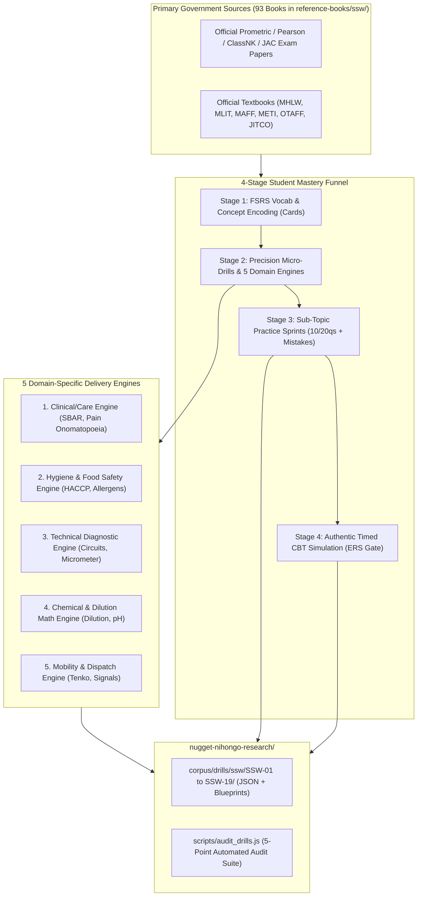
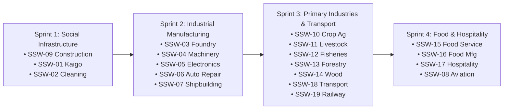

# Master Research & Implementation Plan: SSW Quiz, CBT Simulation, and Exercise Battery Enrichment (19 Sectors)

> **Document Version:** 2.0.0-REVISED  
> **Target Branch:** `research/curriculum-sla-matrix` (`nugget-nihongo-research`)  
> **Pedagogical Benchmark:** [`Nugget-Nihongo-SSW-Konstruksi`](https://github.com/nuggetenak/Nugget-Nihongo-SSW-Konstruksi) (100% Student Pass Rate)  
> **Source Corpus:** 93 Official Japanese Government Textbooks & Exam Papers in [`reference-books/ssw/`](file:///c:/Users/Timedoor/Downloads/nugget%20nihonggo%20project/reference-books/ssw/) cataloged in [`CATALOG_SSW_OFFICIAL.md`](file:///c:/Users/Timedoor/Downloads/nugget%20nihonggo%20project/reference-books/ssw/CATALOG_SSW_OFFICIAL.md)  
> **Master Syllabi:** [`corpus/sections/synthesis/syllabi/ssw/`](file:///c:/Users/Timedoor/Downloads/nugget%20nihonggo%20project/nugget-nihongo-research/corpus/sections/synthesis/syllabi/ssw/) (`SSW-01` to `SSW-19`)

---

## Goal Description

The objective is to enrich the entire SSW curriculum across all **19 Specified Skilled Worker sectors** in Nugget Nihongo with an exhaustive, authentic, and pedagogically grounded battery of exercises, micro-drills, domain-specific interactive delivery mechanisms, and full timed CBT exam simulations.

This enrichment builds directly upon:
1. **The proven 100% pass-rate methodology** of the standalone repository [`Nugget-Nihongo-SSW-Konstruksi`](https://github.com/nuggetenak/Nugget-Nihongo-SSW-Konstruksi) created by the user (which propelled the creator and 4 juniors to pass the official JAC exam flawlessly through active recall, statutory number drills, trap pair recognition, and realistic exam simulation).
2. **Primary Source Grounding**: Complete extraction from the **93 official Japanese regulatory textbooks and official sample exam papers** stored in [`reference-books/ssw/`](file:///c:/Users/Timedoor/Downloads/nugget%20nihonggo%20project/reference-books/ssw/).
3. **Statutory Sector Alignment**: Rigorous replication of official exam formats (Prometric CBT, Pearson VUE CBT, ClassNK, JTOA, RMA), dual-paper pass gates (e.g. Kaigo Care Skills + Care Japanese), sector timers (60–100 min), and passing thresholds (60%–70%).

---

## User Review Required

> [!IMPORTANT]
> **Key Architecture Decisions Aligned in `/grill-me`**:
> 1. **5 Domain-Specific Delivery Engines**: Rather than generic multiple choice, questions will be routed through 5 domain engines:
>    - **Clinical / Care Engine** (Kaigo): SBAR handovers, 42-item pain onomatopoeia diagnostic matrix, transfer mechanics.
>    - **Hygiene & Food Safety Engine** (Gaishoku, Food Mfg): HACCP CCP temperature timers, 7 Big Allergen verification, sanitation protocols.
>    - **Technical Diagnostic Engine** (Auto, Manufacturing, Shipbuilding): Circuit diagrams, micrometer/caliper readings, LOTO, defect morphology.
>    - **Chemical & Dilution Math Engine** (Agriculture, Cleaning, Forestry): Chemical dilution formulas, pH scale matching, chainsaw felling angles.
>    - **Mobility & Dispatch Engine** (Transport, Railway, Aviation): Pre-trip roll-call (*Tenko*) zero-alcohol verification, signal aspects, marshaling gestures.
> 2. **4-Stage Mastery Funnel with Exam Readiness Score (ERS)**:
>    - Stage 1: FSRS Flashcard Encoding (Vocabulary & Statutory Concepts).
>    - Stage 2: Precision Micro-Drills (`Angka Kunci`, `Soal Jebak`, `Confusion Pairs`, Domain Engines).
>    - Stage 3: Sub-Topic Practice Sprints (10/20 question batches with instant mistake banking).
>    - Stage 4: Authentic Timed CBT Simulation (strict exam conditions, dual-paper gating).
> 3. **Strict Exam Fidelity vs Practice Scaffolding**:
>    - Stages 1–3: Full Indonesian scaffolding (hints, translations, deep explanations).
>    - Stage 4 (Simulasi CBT): 100% Japanese with authentic furigana (no in-test Indonesian crutches), unlocking complete Indonesian explanations and mistake analytics only on the Result Screen.
> 4. **Strict Repository Boundary**:
>    - All work is executed exclusively inside `nugget-nihongo-research/` on branch `research/curriculum-sla-matrix`.
>    - Main application `nugget-nihongo/` remains 100% untouched.

---

## Open Questions

None remaining. All design choices (archetypes, delivery engines, scaffolding, storage format, sprint ordering) have been resolved via interactive `/grill-me` alignment.

---

## Proposed Changes



---

### Component 1: Data Architecture & Storage Schema (`corpus/drills/ssw/`)

Each sector will have its own dedicated directory in `corpus/drills/ssw/` containing modular JSON datasets and a comprehensive Markdown test blueprint:

```
nugget-nihongo-research/
└── corpus/
    └── drills/
        └── ssw/
            ├── SSW-01-KAIGO/
            │   ├── ssw01-blueprint.md             # Pedagogical test specification & scoring rules
            │   ├── ssw01-official-exam.json       # 100% harvest from MHLW sample papers
            │   ├── ssw01-mockup-cbt.json          # Dual-paper full timed mock exam battery
            │   ├── ssw01-subtopic-drills.json     # Drills mapped 1-to-1 to syllabus topics
            │   ├── ssw01-angka-kunci.json         # Vital numbers, angles & vital sign criteria
            │   ├── ssw01-soal-jebak.json          # Nursing traps & medical confusion pairs
            │   └── ssw01-clinical-sbar.json       # SBAR handovers & 42-item pain onomatopoeia
            ├── SSW-02-CLEANING/                   # Pearson VUE format + pH Chemical Engine
            ├── SSW-03-FOUNDRY/                    # JSTAC format + Molten Metal Safety
            ├── ...
            └── SSW-19-RAILWAY/                    # JTOA/RMA format + Signals & Dasha-kensa
```

#### [NEW] `corpus/drills/ssw/SSW-09-CONSTRUCTION/ssw09-mockup-cbt.json`
Porting and standardizing the 300 JAC Mockup questions (`jac-mockup-sets.js`) from the standalone repository into the unified JSON schema.

#### [NEW] `corpus/drills/ssw/SSW-09-CONSTRUCTION/ssw09-angka-kunci.json`
Migrating the battle-tested 45 `ANGKA_KUNCI` items from the standalone repository with complete mnemonics and legal citations.

#### [NEW] `corpus/drills/ssw/SSW-09-CONSTRUCTION/ssw09-soal-jebak.json`
Migrating the verified `CONFUSION_PAIRS` and `DANGER_PAIRS` from the standalone repository.

---

### Component 2: The 5 Domain-Specific Interactive Delivery Engines

#### Engine 1: Clinical & Nursing Care Engine (SSW-01 Kaigo)
- **Interactive Delivery**:
  - **SBAR Structured Clinical Handovers**: Drag-and-drop or prompt sequencing for `S (状況)` -> `B (背景)` -> `A (評価)` -> `R (提案)`.
  - **42-Item Pain Onomatopoeia Diagnostic Matrix**: Audio listening and resident quote matching across 7 physiological trauma clusters (`ズキズキ`, `キリキリ`, `シクシク`, `チクチク`, `ガンガン`, `ヒリヒリ`, `ジンジン`).
  - **Body Mechanics Posture Inspector**: Identifying base of support (支持基底面) and center of gravity errors in transfer diagrams.

#### Engine 2: Hygiene & Food Safety Engine (SSW-15 Gaishoku, SSW-16 Food Mfg)
- **Interactive Delivery**:
  - **HACCP CCP Critical Limits & Temperature Timers**: Real-time evaluation of core heating (75°C for 1 min / 85°C for 90 sec) and cooling curves (60°C to 20°C in 30 min).
  - **7 Big Food Allergen Cross-Contamination Checker**: Auditing menu recipes against mandatory allergen declarations (えび, かに, 小麦, そば, 卵, 乳, 落花生).
  - **Handwashing 6-Step Visual Sequence**: Verifying procedural hygiene steps before entry to food handling zones.

#### Engine 3: Technical Diagnostic Engine (SSW-06 Auto Repair, SSW-03/04/05 Manufacturing, SSW-07 Shipbuilding)
- **Interactive Delivery**:
  - **Electrical Circuit Troubleshooting**: Multi-meter probes placed across schematic nodes to calculate Ohm's Law voltage drops and diagnose open circuits (断線) vs short circuits (短絡).
  - **Precision Vernier Caliper & Micrometer Simulator**: Reading analog scales down to 0.01 mm and comparing against statutory wear limits (e.g., brake pad minimum 1.0 mm, tire slip line 1.6 mm).
  - **Lockout / Tagout (LOTO) & Zero Energy Verification**: Sequence check before machine maintenance.

#### Engine 4: Chemical & Dilution Math Engine (SSW-02 Cleaning, SSW-10/11 Agriculture, SSW-13 Forestry)
- **Interactive Delivery**:
  - **Concentration & Dilution Math Calculator**: Interactive multi-step ratio calculation (e.g., preparing a 1000x pesticide dilution in a 20-liter spray tank: $20{,}000\text{ mL} / 1000 = 20\text{ mL}$).
  - **pH Scale & Detergent Chemistry Matching**: Acidic (pH < 6, removes urine stone/water scale) vs Neutral (pH 6–8) vs Alkaline (pH > 8, removes grease/wax stripping) vs surface material compatibility.
  - **Chainsaw Felling Notch & Safety Angle Checker**: Felling notch depth (1/4 to 1/5 tree diameter), back-cut height, and hinge wood safety margin.

#### Engine 5: Mobility & Dispatch Engine (SSW-18 Transport, SSW-19 Railway, SSW-08 Aviation)
- **Interactive Delivery**:
  - **Roll-Call (*Tenko* 点呼) Protocol Simulator**: Pre-trip alcohol breathalyzer check (strictly 0.00 mg/L), health check, and continuous driving hour limits (max 4h before 30m break).
  - **Railway Signal Aspect Recognition**: Interpreting colored aspect lamps (Blue, Yellow, Flashing Yellow, Red) and acoustic hammer-tap resonance (*Dasha-kensa* 打診検査).
  - **Aviation Ramp Safety & Marshaling Hand Signals**: Visual wand gesture recognition and FOD walk-down inspection.

---

### Component 3: Automated Integrity Audit Suite (`scripts/audit_drills.js`)

#### [NEW] `scripts/audit_drills.js`
An automated validator that enforces the **5-Point Audit Contract** across all drill files:
1. **Schema & Typo Integrity**: Balanced ruby markers `《...》`, non-empty explanations, valid answer indexes, matching array lengths between Japanese and Indonesian options.
2. **Sub-topic Cross-Reference**: Every drill item must reference a valid section in the sector's master syllabus (`corpus/sections/synthesis/syllabi/ssw/SSW-XX-*.md`).
3. **Statutory Parameter Agreement**: Pass percentages and timer budgets must match the official exam specifications (60% for Kaigo/Cleaning, 65% for Construction/Food/Mfg, 70% for Transport/Rail/Auto).
4. **Primary Source Provenance**: Every question must cite its source textbook or official sample exam paper in `reference-books/ssw/`.
5. **Option Uniqueness & Distractor Validity**: Options must be distinct, non-redundant, and free of ambiguous traps.

---

### Component 4: Phased Execution Roadmap (4 Sprints)



#### Sprint 1: Social Infrastructure & Proven Baseline
- **SSW-09 Construction**: Migrate and standardize the 1,075 questions, 45 Angka Kunci, and trap pairs from the standalone repo into the new modular JSON format.
- **SSW-01 Kaigo**: Harvest official MHLW care skill and care Japanese exam sets; author dual-paper CBT mockups, SBAR scenarios, and the 42-item clinical pain onomatopoeia drill bank.
- **SSW-02 Building Cleaning**: Author Pearson VUE 2025 standard mockups (20 Theory + 30 Practical Photo questions), chemical pH matrix, and equipment safety drills.
- **Deliverables**: Complete datasets in `corpus/drills/ssw/SSW-{01,02,09}/`, passing `node scripts/audit_drills.js`.

#### Sprint 2: Industrial Manufacturing & Automotive Cluster
- **SSW-03, SSW-04, SSW-05 Manufacturing**: JSTAC CBT mockups, tool reading, LOTO procedures.
- **SSW-06 Auto Repair**: JASPA CBT mockups, circuit schematics, vernier caliper measurements, OBD-II codes.
- **SSW-07 Shipbuilding**: ClassNK mockups, welding defect visual inspections, confined space safety.

#### Sprint 3: Primary Industries & Mobility Logistics
- **SSW-10 & SSW-11 Agriculture**: ASAT mockups, pesticide dilution math drills, tractor PTO safety.
- **SSW-12 Fisheries**: Suisankai SSW1 & SSW2 mockups, lifejacket and hypothermia protocols.
- **SSW-13 & SSW-14 Forestry & Wood**: Chainsaw felling angles, saw safety splitters.
- **SSW-18 Transport**: Commercial Class 2 rules, roll-call (*Tenko*) zero-alcohol verification, continuous driving limits.
- **SSW-19 Railway**: JTOA/RMA mockups, signal aspects, platform emergency stop buttons.

#### Sprint 4: Food, Beverage & Hospitality Services
- **SSW-15 Food Service**: OTAFF 45-question CBT mockups, customer service keigo, food allergy checks.
- **SSW-16 Food Manufacturing**: OTAFF 40-question CBT mockups, HACCP CCP core temperature calculations.
- **SSW-17 Hospitality**: Omotenashi etiquette, ryokan meal service protocols.
- **SSW-08 Aviation**: JAEA mockups, marshaling hand signals, FOD ramp inspection.

---

## Verification Plan

### Automated Tests
1. **Drill Suite Integrity Audit**:
   ```powershell
   node scripts/audit_drills.js
   ```
   *Asserts 0 errors across JSON schemas, balanced ruby brackets, syllabus cross-references, and statutory parameter agreement.*
2. **Syllabus Regression Audit**:
   ```powershell
   node scripts/audit_ssw.js
   ```
   *Asserts 0 broken links or missing citations in the 19 master syllabi.*

### Manual Verification
1. **Interactive Engine Logic Review**:
   - Inspect `corpus/drills/ssw/SSW-01-KAIGO/ssw01-clinical-sbar.json` to verify that all 42 pain onomatopoeia items match clinical definitions.
   - Inspect `corpus/drills/ssw/SSW-02-CLEANING/ssw02-mockup-cbt.json` to verify the 20 Theory + 30 Practical question split of the 2025 Pearson VUE format.
   - Inspect `corpus/drills/ssw/SSW-09-CONSTRUCTION/ssw09-mockup-cbt.json` to verify 100% parity with the standalone repository's proven questions.
