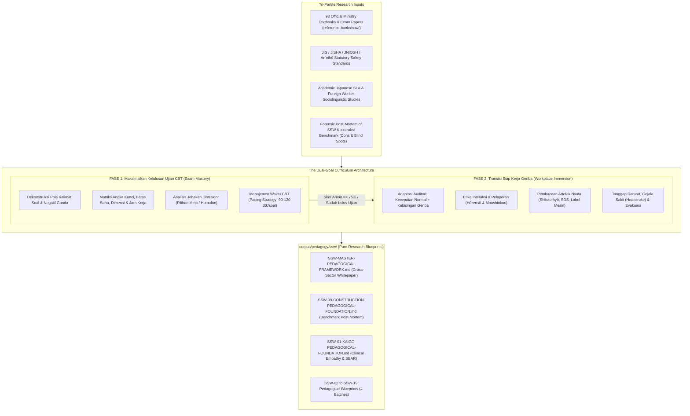

# Master Research Plan v3.2: SSW Pedagogical Foundation & Dual-Goal Delivery Methodology (19 Sectors)

> **Document Version:** 3.2.0-DUAL-GOAL-INTEGRATED  
> **Target Branch:** `research/curriculum-sla-matrix` (`nugget-nihongo-research`)  
> **Repository Domain:** Pure Pedagogical Research, Learning Sciences, Sociolinguistics & Curriculum Synthesis  
> **Benchmark Reference:** [`Nugget-Nihongo-SSW-Konstruksi`](https://github.com/nuggetenak/Nugget-Nihongo-SSW-Konstruksi) (Forensic Post-Mortem of Strengths, Real-World Failures & Gaps)  
> **Primary Source Corpus:** 93 Official Japanese Government Textbooks & Exam Papers in [`reference-books/ssw/`](file:///c:/Users/Timedoor/Downloads/nugget%20nihonggo%20project/reference-books/ssw/) cataloged in [`CATALOG_SSW_OFFICIAL.md`](file:///c:/Users/Timedoor/Downloads/nugget%20nihonggo%20project/reference-books/ssw/CATALOG_SSW_OFFICIAL.md)  
> **Curriculum Syllabi:** [`corpus/sections/synthesis/syllabi/ssw/`](file:///c:/Users/Timedoor/Downloads/nugget%20nihonggo%20project/nugget-nihongo-research/corpus/sections/synthesis/syllabi/ssw/) (`SSW-01` to `SSW-19`)  
> **Master Bibliography:** [`corpus/bibliography/MASTER-BIBLIOGRAPHY-FINAL.md`](file:///c:/Users/Timedoor/Downloads/nugget%20nihonggo%20project/nugget-nihongo-research/corpus/bibliography/MASTER-BIBLIOGRAPHY-FINAL.md)

---

## Goal Description

The definitive mission of this research is to establish the theoretical, empirical, and pedagogical foundation for a **Dual-Goal SSW Curriculum Architecture**:

```
┌────────────────────────────────────────────────────────┐
│  GOAL UTAMA KURIKULUM NUGGET NIHONGO SSW:              │
│                                                        │
│  1. FASE 1: MEMAKSIMALKAN PELUANG LULUS UJIAN SSW DULU │
│     (The Golden Gateway: Menguasai kisi-kisi resmi,   │
│      pola soal CBT Prometric/Pearson, angka kunci, dan │
│      meraih sertifikat kelulusan visa Tokutei Ginou)   │
│                                                        │
│                        ▼ (Transisi Terkendali)         │
│                                                        │
│  2. FASE 2: MEMPERSIAPKAN BEKERJA NYATA DI JEPANG      │
│     (The Survival & Retention Engine: Adaptasi         │
│      kecepatan & kebisingan genba, etika Hōrensō,      │
│      hierarki atasan-bawahan, artefak nyata, dan K3)   │
└────────────────────────────────────────────────────────┘
```

Without passing the official SSW exam in Phase 1, a candidate cannot secure their Certificate of Eligibility (COE) or visa, making workplace training obsolete before arrival. Conversely, relying solely on rote CBT pattern-matching causes severe culture and competency shock upon arrival in Japan. This research establishes the bridge between both horizons across all **19 SSW sectors**.

---

## User Review Required

> [!IMPORTANT]
> **Core Strategic Directives Finalized in Extended `/grill-me`**:
> 1. **Dual-Goal Sequential Architecture**:
>    - **Fase 1 (CBT Exam Mastery)**: 100% focused on maximizing the probability of passing the official Prometric/Pearson/ClassNK exams. Rigorously avoids misleading "100% guarantee" claims; instead relies on empirical deconstruction of official textbooks, question syntax, distractor logic, statutory numbers, and pacing strategies.
>    - **Fase 2 (Workplace Immersion & Survival)**: Pre-departure training in real-world auditory speed, ambient industrial/kitchen noise, reporting (*Hōrensō/Moushiokuri*), real shift rosters, and safety emergency reflexes.
> 2. **Flexible Guided Transition**:
>    - Default curricular progression guides learners through Phase 1 first (reaching a safe simulation score $\ge 75\%$).
>    - Phase 2 remains openly accessible for learners who already passed their SSW exams elsewhere and solely require pre-departure job-readiness training.
> 3. **Cognitive Load & Anti-Burnout Principles**:
>    - Bite-sized micro-sessions (15–20 minutes daily).
>    - Interleaving practice (rotating kanji, visual tools, and audio callouts).
>    - Zero abstract memorization (instant visual anchoring to genba situations).
>    - Low-anxiety error normalization (treating incorrect answers as diagnostic *Hiyari-Hatto* data).
> 4. **Strict Sector Distinctiveness (Anti-Generalization)**:
>    - Kaigo elder care empathy (prohibiting *meirei-kei* to prevent *gyakutai*) vs Food Service Omotenashi vs Manufacturing factory callouts vs Agricultural rural dialects.
> 5. **Tri-Partite Statutory & Academic Citation Hierarchy**:
>    - Official Ministry Textbooks + JIS/JISHA/An'eihō Standards + Academic SLA Research.
> 6. **Controlled Bi-Directional Syllabus Synchronization**:
>    - Surgical updates to Section 3 & 4 of sector syllabi, mirrored to Master Syllabus, maintaining 100% green status on `scripts/audit_ssw.js`.

---

## Open Questions

None remaining. All pedagogical priorities, phase transitions, citation hierarchies, and research methodologies have been completely resolved.

---

## Proposed Changes



---

### Component 1: Master Pedagogical Whitepaper

#### [NEW] `corpus/pedagogy/SSW-MASTER-PEDAGOGICAL-FRAMEWORK.md`
The foundational cross-sector academic whitepaper detailing:
1. **The Dual-Goal Framework**: Balancing high-yield CBT exam preparation with post-exam workplace survival.
2. **Cognitive Load & Anti-Burnout Architecture**:
   - Designing for 15–20 minute micro-learning intervals for working learners.
   - Dynamic interleaving of lexical, visual, and auditory tasks.
   - Low-anxiety error normalization (the *Hiyari-Hatto* educational model).
3. **The 4 Authentic Training Modalities**:
   - Visual photographic diagnosis, auditory ambient filtering, situational scenario simulation, and procedural/dilution calculations.
4. **Sociocultural Workplace Survival Protocols**:
   - The "Anti-Sindrom Hai" protocol, the Repeat-Back reflex (*Fukushō*), rapid reporting (*Hōrensō*), and polite task refusal (*Kotowarikata*).
5. **The 19-Sector Comparative Matrix**:
   - Explicit contrast of registers, authority structures, hazards, and sensory environments across all 19 sectors.

---

### Component 2: Dedicated Sector Pedagogical Blueprints (`corpus/pedagogy/ssw/`)

Each sector blueprint contains 6 mandatory academic chapters integrating both Phase 1 and Phase 2:

```
nugget-nihongo-research/
└── corpus/
    └── pedagogy/
        ├── SSW-MASTER-PEDAGOGICAL-FRAMEWORK.md
        └── ssw/
            ├── SSW-01-KAIGO-PEDAGOGICAL-FOUNDATION.md
            ├── SSW-02-CLEANING-PEDAGOGICAL-FOUNDATION.md
            ├── SSW-03-FOUNDRY-PEDAGOGICAL-FOUNDATION.md
            ├── SSW-04-MACHINERY-PEDAGOGICAL-FOUNDATION.md
            ├── SSW-05-ELECTRONICS-PEDAGOGICAL-FOUNDATION.md
            ├── SSW-06-AUTO-REPAIR-PEDAGOGICAL-FOUNDATION.md
            ├── SSW-07-SHIPBUILDING-PEDAGOGICAL-FOUNDATION.md
            ├── SSW-08-AVIATION-PEDAGOGICAL-FOUNDATION.md
            ├── SSW-09-CONSTRUCTION-PEDAGOGICAL-FOUNDATION.md
            ├── SSW-10-CROP-AGRICULTURE-PEDAGOGICAL-FOUNDATION.md
            ├── SSW-11-LIVESTOCK-AGRICULTURE-PEDAGOGICAL-FOUNDATION.md
            ├── SSW-12-FISHERIES-PEDAGOGICAL-FOUNDATION.md
            ├── SSW-13-FORESTRY-PEDAGOGICAL-FOUNDATION.md
            ├── SSW-14-WOOD-INDUSTRY-PEDAGOGICAL-FOUNDATION.md
            ├── SSW-15-FOOD-SERVICE-PEDAGOGICAL-FOUNDATION.md
            ├── SSW-16-FOOD-MANUFACTURING-PEDAGOGICAL-FOUNDATION.md
            ├── SSW-17-HOSPITALITY-PEDAGOGICAL-FOUNDATION.md
            ├── SSW-18-AUTOMOBILE-TRANSPORT-PEDAGOGICAL-FOUNDATION.md
            └── SSW-19-RAILWAY-PEDAGOGICAL-FOUNDATION.md
```

#### Mandatory 6-Chapter Blueprint Structure per Document:

- **Bab 1: Ekosistem Lapangan & Hierarki Komunikasi Otentik** (Authority structure, communication tone, and interpersonal dynamics).
- **Bab 2: Analisis Kritis Kons & Kegagalan Hafalan Buta** (Deconstruction of rote memorization pitfalls and practical failure points).
- **Bab 3: Pemetaan Hambatan Kognitif, Linguistik & Budaya Siswa Indonesia** (L1 interference, kanji load, sosiocultural modesty, and numerical traps).
- **Bab 4: Arsitektur Kurikulum Fase 1 — Maksimalkan Peluang Lulus Ujian CBT** (Official exam question syntax, Angka Kunci matrix, distractor deconstruction, and pacing).
- **Bab 5: Arsitektur Kurikulum Fase 2 — Transisi Siap Kerja Genba** (Auditory speed/noise adaptation, Hōrensō & Moushiokuri, real artifacts, and emergency safety).
- **Bab 6: 4 Modalitas Latihan Otentik, Scaffolding & Taksonomi Remedial** (Visual, auditory, scenario, and calculation exercises; progression from N5/N4 to exam pass to workplace readiness; Type L/C/M/P error remediation matrix).

---

### Component 3: Execution Roadmap (4 Industry Ecosystem Batches)

#### Batch 1: Social Infrastructure & Proven Benchmark Post-Mortem
- **SSW-09 Construction**: Deconstruct standalone repo benchmark, analyze 6 cons, formulate Phase 1 CBT exam mastery and Phase 2 site survival.
- **SSW-01 Kaigo Care Worker**: Clinical empathy, care manager-physician hierarchy, 42 onomatopoeia, SBAR handovers, body mechanics.
- **SSW-02 Building Cleaning**: Chemical pH safety, solo/pair cleaning, customer office privacy, machine hazard reflexes.
- **Deliverables**: Master Framework Whitepaper + 3 Comprehensive Sector Pedagogical Blueprints.

#### Batch 2: Industrial Manufacturing & Automotive Ecosystems
- `SSW-03 Foundry`, `SSW-04 Machinery`, `SSW-05 Electronics`, `SSW-06 Auto Repair`, `SSW-07 Shipbuilding`.

#### Batch 3: Food Service & Hospitality Ecosystems
- `SSW-15 Food Service`, `SSW-16 Food Manufacturing`, `SSW-17 Hospitality/Hotel`.

#### Batch 4: Primary Industries & High-Mobility Logistics
- `SSW-10 Crop Ag`, `SSW-11 Livestock Ag`, `SSW-12 Fisheries`, `SSW-13 Forestry`, `SSW-14 Wood`, `SSW-18 Transport`, `SSW-19 Railway`, `SSW-08 Aviation`.

---

## Verification Plan

### Automated Research Integrity Checks
1. **Citation & Markdown Integrity Audit**:
   - Verify that all primary sources cited in the pedagogical blueprints map 100% to authentic documents in `reference-books/ssw/CATALOG_SSW_OFFICIAL.md` and `corpus/bibliography/MASTER-BIBLIOGRAPHY-FINAL.md`.
2. **Cumulative Regression Integrity**:
   ```powershell
   node scripts/audit_ssw.js
   ```
   *Asserts 100% green status across all existing syllabi and statutory keys.*

### Qualitative & Pedagogical Verification
1. **Dual-Goal Balance Check**:
   - Verify that Chapter 4 provides concrete Prometric/Pearson test decoding and Chapter 5 provides concrete workplace survival protocols.
2. **Anti-Generalization Check**:
   - Verify that Kaigo, Food Service, and Agriculture blueprints do not import construction terminology, roles, or assumptions.
