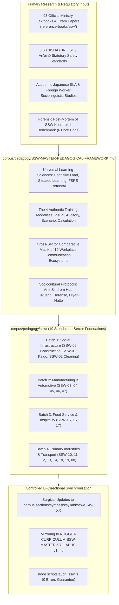

# Master Research Plan v3.1: SSW Pedagogical Foundation & Delivery Methodology (19 Sectors)

> **Document Version:** 3.1.0-PEDAGOGY-AUTHORITATIVE  
> **Target Branch:** `research/curriculum-sla-matrix` (`nugget-nihongo-research`)  
> **Repository Domain:** Pure Pedagogical Research, Learning Sciences, Sociolinguistics & Curriculum Synthesis  
> **Benchmark Reference:** [`Nugget-Nihongo-SSW-Konstruksi`](https://github.com/nuggetenak/Nugget-Nihongo-SSW-Konstruksi) (Forensic Post-Mortem of Strengths, Real-World Failures & Gaps)  
> **Primary Source Corpus:** 93 Official Japanese Government Textbooks & Exam Papers in [`reference-books/ssw/`](file:///c:/Users/Timedoor/Downloads/nugget%20nihonggo%20project/reference-books/ssw/) cataloged in [`CATALOG_SSW_OFFICIAL.md`](file:///c:/Users/Timedoor/Downloads/nugget%20nihonggo%20project/reference-books/ssw/CATALOG_SSW_OFFICIAL.md)  
> **Curriculum Syllabi:** [`corpus/sections/synthesis/syllabi/ssw/`](file:///c:/Users/Timedoor/Downloads/nugget%20nihonggo%20project/nugget-nihongo-research/corpus/sections/synthesis/syllabi/ssw/) (`SSW-01` to `SSW-19`)  
> **Master Bibliography:** [`corpus/bibliography/MASTER-BIBLIOGRAPHY-FINAL.md`](file:///c:/Users/Timedoor/Downloads/nugget%20nihonggo%20project/nugget-nihongo-research/corpus/bibliography/MASTER-BIBLIOGRAPHY-FINAL.md)

---

## Goal Description

The goal of this initiative is to research, formulate, and author the definitive **Landasan Teori, Pedagogi, dan Metodologi Pembelajaran** (Pedagogical Foundation & Delivery Methodology) across all **19 Specified Skilled Worker (SSW) sectors** in Nugget Nihongo.

Curriculum syllabi only specify *what* topics exist on the official syllabus. They do not teach *how* a human mind learns, internalizes, and reliably executes those competencies under high-stress Japanese workplace conditions. This research establishes:
1. **The Tri-Partite Statutory & Academic Citation Hierarchy**: Grounding every sector in official Japanese ministry textbooks, JIS/JISHA national industrial & safety standards, and peer-reviewed Japanese SLA (Second Language Acquisition) research.
2. **Forensic Post-Mortem of Rote Memorization Platforms**: Rigorously addressing the 6 critical failures observed in the creator's real-world benchmark platform (`Nugget-Nihongo-SSW-Konstruksi`).
3. **Strict Sector Distinctiveness (Anti-Generalization)**: Guaranteeing that no sector is forced into an unnatural "construction mold." Kaigo elder care empathy, restaurant Omotenashi, manufacturing factory protocols, and agricultural rural realities are treated as unique cultural-linguistic ecosystems.
4. **4 Authentic Training Modalities per Sector**: Formulating explicit research guidance on Visual, Auditory, Scenario Simulation, and Procedural/Calculation training.
5. **Controlled Bi-Directional Syllabus Synchronization**: Surgically updating any syllabus gaps uncovered during research to maintain 100% currency with Japanese standards.

All work remains strictly within the bounds of **educational research and learning science** inside `nugget-nihongo-research`. No application code, databases, or UI scripts will be created in this domain.

---

## User Review Required

> [!IMPORTANT]
> **Key Architecture Decisions Finalized via `/grill-me`**:
> 1. **Tri-Partite Citation Hierarchy**:
>    - **Tier 1 (Core Corpus)**: 93 Official Ministry Textbooks & Exam Papers in `reference-books/ssw/`.
>    - **Tier 2 (National Standards & Labor Law)**: Japanese Industrial Standards (JIS), Industrial Safety & Health Act (*Rōdō Anzen Eisei Hō* / 安衛法), and Japan Occupational Safety and Health Association (JISHA / 中央労働災害防止協会) guidelines.
>    - **Tier 3 (Academic SLA & Sociolinguistics)**: Japanese Second Language Acquisition studies (Society for Teaching Japanese as a Second Language / 日本語教育学会), JITCO foreign worker research, and clinical care communication papers.
> 2. **Strict Sector Distinctiveness (Zero Construction-Centric Bias)**:
>    - Construction communication (loud, imperative *meirei-kei*, foremen) is strictly confined to construction.
>    - Kaigo care workers learn gentle elder-directed speech (*keigo*, *aizuchi*), avoiding *meirei-kei* (which constitutes elder abuse / *gyakutai*).
>    - Food service learners master *Omotenashi* registers, allergen alerts, and HACCP kitchen calls.
>    - Agricultural learners master rural context, cooperative farming interactions, and pesticide dilution math.
> 3. **Controlled Bi-Directional Syllabus Synchronization**:
>    - When deep research uncovers missing real-world safety steps or jargon, Section 3 and Section 4 of the affected syllabus (`SSW-XX`) will be surgically updated and mirrored to `NUGGET-CURRICULUM-SSW-MASTER-SYLLABUS-v1.md`.
>    - The integrity script `scripts/audit_ssw.js` must remain 100% green with 0 errors.

---

## Open Questions

None. All strategic design, pedagogical pillars, citation hierarchies, and batch sequencing have been unanimously resolved through interactive `/grill-me` interview sessions.

---

## Proposed Changes



---

### Component 1: Master Pedagogical Whitepaper

#### [NEW] `corpus/pedagogy/SSW-MASTER-PEDAGOGICAL-FRAMEWORK.md`
The authoritative foundational whitepaper establishing:
- **Theoretical Foundations**: Cognitive Load Theory (Sweller), Situated Learning & Communities of Practice (Lave & Wenger), Form-Focused Instruction (Doughty & Williams), and Spaced Retrieval Optimization (FSRS).
- **Forensic Post-Mortem of Rote Memorization Platforms**: In-depth academic analysis of the 6 core failure modes identified in the standalone repository benchmark.
- **The Universal 4 Authentic Training Modalities**:
  1. *Modalitas Visual*: Authentic photographic inspection, schematic/blueprint reading, defect identification, ergonomic posture verification.
  2. *Modalitas Auditori*: Decoding rapid workplace speech, ambient industrial/kitchen noise filtering, dementia patient tone, emergency siren/callout recognition.
  3. *Modalitas Simulasi Skenario*: Situated problem-based learning, ethical dilemmas, near-miss incident management, cross-cultural customer/resident interaction.
  4. *Modalitas Prosedural & Kalkulasi*: Multi-step algorithmic SOPs, chemical dilution formulas, legal driving/rest hour constraints, structural load thresholds.
- **Sociocultural Survival Protocols for Indonesian Workers**:
  - The "Anti-Sindrom Hai" Protocol: Eradicating false assent; training assertive polite clarification (*Kikinaoshi* 聞き直し).
  - The Repeat-Back Reflex (*Fukushō* 復唱): Automatic repetition of critical parameters (noun + verb + number).
  - Rapid Reporting & Near-Miss Protocol (*Hōrensō* 報連相 & *Hiyari-Hatto* ヒヤリハット).
  - Polite Boundary-Setting & K3 Refusal (*Kotowarikata* 断り方).
- **The 19-Sector Comparative Matrix**: Systematic comparison of linguistic registers, authority structures, core hazards, and physical environments across all sectors.

---

### Component 2: Dedicated Sector Pedagogical Blueprints (`corpus/pedagogy/ssw/`)

Each of the 19 sector documents adheres to a strict 6-section academic blueprint:

```
nugget-nihongo-research/
└── corpus/
    └── pedagogy/
        ├── SSW-MASTER-PEDAGOGICAL-FRAMEWORK.md
        └── ssw/
            ├── SSW-01-KAIGO-PEDAGOGICAL-FOUNDATION.md
            ├── SSW-02-CLEANING-PEDAGOGICAL-FOUNDATION.md
            ├── SSW-03-FOUNDRY-PEDAGOGICAL-FOUNDATION.md
            ├── SSW-04-MACHINERY-PEDAGOGICAL-FOUNDATION.md
            ├── SSW-05-ELECTRONICS-PEDAGOGICAL-FOUNDATION.md
            ├── SSW-06-AUTO-REPAIR-PEDAGOGICAL-FOUNDATION.md
            ├── SSW-07-SHIPBUILDING-PEDAGOGICAL-FOUNDATION.md
            ├── SSW-08-AVIATION-PEDAGOGICAL-FOUNDATION.md
            ├── SSW-09-CONSTRUCTION-PEDAGOGICAL-FOUNDATION.md
            ├── SSW-10-CROP-AGRICULTURE-PEDAGOGICAL-FOUNDATION.md
            ├── SSW-11-LIVESTOCK-AGRICULTURE-PEDAGOGICAL-FOUNDATION.md
            ├── SSW-12-FISHERIES-PEDAGOGICAL-FOUNDATION.md
            ├── SSW-13-FORESTRY-PEDAGOGICAL-FOUNDATION.md
            ├── SSW-14-WOOD-INDUSTRY-PEDAGOGICAL-FOUNDATION.md
            ├── SSW-15-FOOD-SERVICE-PEDAGOGICAL-FOUNDATION.md
            ├── SSW-16-FOOD-MANUFACTURING-PEDAGOGICAL-FOUNDATION.md
            ├── SSW-17-HOSPITALITY-PEDAGOGICAL-FOUNDATION.md
            ├── SSW-18-AUTOMOBILE-TRANSPORT-PEDAGOGICAL-FOUNDATION.md
            └── SSW-19-RAILWAY-PEDAGOGICAL-FOUNDATION.md
```

#### Mandatory 6-Section Blueprint Structure per Document:

1. **Bab 1: Ekosistem Lapangan & Hierarki Komunikasi Otentik**
   - Pemetaan struktur organisasi, pembagian peran, dan figur otoritas industri.
   - Register bahasa otentik (tingkat kesopanan, gaya instruksi mandor vs keigo perawat/pelayan, jargon informal lapangan).
   - Protokol interaksi wajib: *Hōrensō*, *Fukushō*, penolakan halus, dan laporan darurat.
2. **Bab 2: Analisis Kritis Kons & Kegagalan Hafalan Buta (Lessons Learned)**
   - Deconstructive post-mortem pola belajar flashcard/kuis acak pada sektor terkait.
   - Analisis titik di mana siswa berisiko lulus ujian CBT namun mengalami culture/competency shock di tempat kerja.
   - Anti-pola kurikuler yang harus dicegah.
3. **Bab 3: Pemetaan Hambatan Kognitif, Linguistik & Budaya Siswa Indonesia**
   - Interferensi bahasa ibu (L1) terhadap istilah teknis sektor terkait.
   - Analisis beban kognitif kanji majemuk (*jukugo*) dan istilah konsep abstrak.
   - Hambatan sosiokultural (rasa segan bertanya, kepatuhan semu, takut dianggap lancang).
   - Jebakan angka, toleransi teknis, batas hukum, dan kalkulasi rasio spesifik sektor.
4. **Bab 4: 4 Pilar Kesiapan Kompetensi (Beyond CBT Pattern Matching)**
   - **Pilar 1: Kesiapan Pengetahuan (Knowledge / 知識)**: Inti materi esensial, filosofi regulasi, angka kunci wajib hafal.
   - **Pilar 2: Kesiapan Visual & Diagnostik (Visual / 実技判断)**: Metodologi membaca foto alat nyata, postur ergonomis, gambar skema, denah, gejala cacat fisik.
   - **Pilar 3: Kesiapan Auditori & Komunikasi Responsif (Listening / 聴解・発話)**: Pelatihan mendengar instruksi cepat di tengah kebisingan latar belakang, respons verbal instan, handover terstruktur.
   - **Pilar 4: Kesiapan Refleks K3 & Mitigasi Risiko (Hazard Reflex / 危険予知 KYT)**: Aplikasi KYT 4 putaran pada skenario risiko kematian dan kecelakaan tertinggi industri.
5. **Bab 5: 4 Modalitas Latihan Otentik & Scaffolding Pedagogis (N5/N4 ke Genba-Ready)**
   - Panduan spesifik perancangan latihan untuk: 1) Latihan Visual, 2) Latihan Auditori, 3) Latihan Simulasi Skenario, 4) Latihan Prosedural/Kalkulasi.
   - Tahapan scaffolding bertahap dari enkoding kosakata dasar hingga ujian simulasi ketat.
6. **Bab 6: Taksonomi Kesalahan & Matriks Remedial Terarah**
   - Klasifikasi kegagalan siswa ke dalam 4 tipe akar masalah:
     - Tipe L (Linguistic/Lexical Failure): Salah kanji, partikel, atau salah baca homofon.
     - Tipe C (Conceptual Misconception): Paham katanya, tetapi salah memahami prinsip teknis/hukum.
     - Tipe M (Mathematical/Tolerance Lapse): Gagal dalam hitungan rasio atau salah mengingat batas angka regulasi.
     - Tipe P (Procedural/Safety Ignorance): Mengabaikan urutan K3 atau SOP keselamatan wajib.
   - Matriks intervensi remedial pedagogis terarah untuk masing-masing tipe kesalahan.

---

### Component 3: Execution Roadmap (4 Industry Ecosystem Batches)

#### Batch 1: Social Infrastructure & Proven Benchmark Post-Mortem
- **SSW-09 Construction**: Deconstructing the standalone repo benchmark, extracting lessons learned, foreman-subcontractor hierarchy, safety law, and scaffolding math.
- **SSW-01 Kaigo Care Worker**: Clinical empathy, care manager-physician-caregiver hierarchy, resident dignity, 42-item pain onomatopoeia diagnostic, SBAR clinical handovers, body mechanics.
- **SSW-02 Building Cleaning**: Solitary vs pair cleaning, tenant office customer service etiquette, chemical pH chemistry, machine operation hazard reflexes.
- **Deliverables**: Master Framework Whitepaper + 3 Comprehensive Sector Pedagogical Blueprints.

#### Batch 2: Industrial Manufacturing & Automotive Ecosystems
- **SSW-03 (Foundry)**, **SSW-04 (Machinery)**, **SSW-05 (Electronics)**, **SSW-06 (Auto Repair)**, **SSW-07 (Shipbuilding)**.
- **Key Research Focus**: Plant hierarchy, shift handovers, ambient machine noise, LOTO, reading precision gauges (micrometer/vernier), electrical schematics, high-risk thermal & chemical vectors.

#### Batch 3: Food Service & Hospitality Ecosystems
- **SSW-15 (Food Service / Restaurant)**, **SSW-16 (Food & Beverage Mfg)**, **SSW-17 (Hospitality / Hotel)**.
- **Key Research Focus**: Customer service honorifics (*Keigo/Omotenashi*), kitchen calling protocols, HACCP CCP core temperatures, 7 Big Allergen triggers, guest complaint de-escalation.

#### Batch 4: Primary Industries & High-Mobility Logistics
- **SSW-10 (Crop Ag)**, **SSW-11 (Livestock Ag)**, **SSW-12 (Fisheries)**, **SSW-13 (Forestry)**, **SSW-14 (Wood)**, **SSW-18 (Transport)**, **SSW-19 (Railway)**, **SSW-08 (Aviation)**.
- **Key Research Focus**: Harsh outdoor meteorological exposure, biological safety, pesticide dilution mathematics, chainsaw safety mechanics, commercial driver roll-call (*Tenko*) zero-alcohol verification, railway signal aspect acoustics.

---

## Verification Plan

### Automated Research Integrity Checks
1. **Citation & Markdown Integrity Audit**:
   - Verify that all primary sources cited in the pedagogical blueprints map 100% to authentic documents in `reference-books/ssw/CATALOG_SSW_OFFICIAL.md` and `corpus/bibliography/MASTER-BIBLIOGRAPHY-FINAL.md`.
2. **Cumulative Regression Integrity**:
   ```powershell
   node scripts/audit_ssw.js
   ```
   *Asserts 100% green status across all existing syllabi and statutory keys.*

### Qualitative & Pedagogical Verification
1. **Cons & Pitfall Reality Check**:
   - Verify that Section 2 of every blueprint rigorously identifies genuine practical failure modes rather than generic disclaimers.
2. **Anti-Generalization Check**:
   - Verify that Kaigo, Food Service, and Agriculture blueprints do not import construction terminology, roles, or assumptions.
