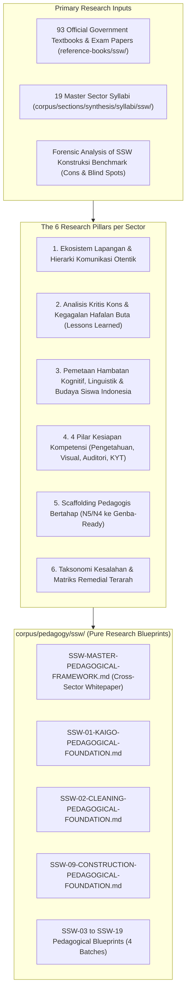
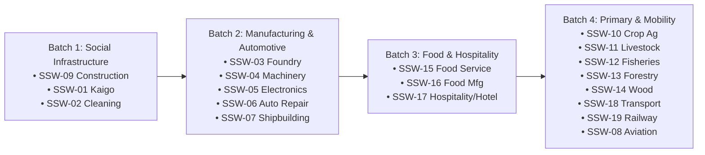

# Master Research Plan v3.0: SSW Pedagogical Foundation & Delivery Methodology (19 Sectors)

> **Document Version:** 3.0.0-PEDAGOGY-CORE  
> **Target Branch:** `research/curriculum-sla-matrix` (`nugget-nihongo-research`)  
> **Repository Domain:** Pure Pedagogical Research, Learning Sciences & Curriculum Synthesis  
> **Benchmark Reference:** [`Nugget-Nihongo-SSW-Konstruksi`](https://github.com/nuggetenak/Nugget-Nihongo-SSW-Konstruksi) (Forensic Analysis of Strengths, Failures & Gaps)  
> **Primary Source Corpus:** 93 Official Japanese Government Textbooks & Exam Papers in [`reference-books/ssw/`](file:///c:/Users/Timedoor/Downloads/nugget%20nihonggo%20project/reference-books/ssw/) cataloged in [`CATALOG_SSW_OFFICIAL.md`](file:///c:/Users/Timedoor/Downloads/nugget%20nihonggo%20project/reference-books/ssw/CATALOG_SSW_OFFICIAL.md)  
> **Curriculum Syllabi:** [`corpus/sections/synthesis/syllabi/ssw/`](file:///c:/Users/Timedoor/Downloads/nugget%20nihonggo%20project/nugget-nihongo-research/corpus/sections/synthesis/syllabi/ssw/) (`SSW-01` to `SSW-19`)

---

## Goal Description

The objective of this research initiative is to establish a rigorous, comprehensive, and evidence-based **Landasan Teori, Pedagogi, dan Metodologi Pembelajaran** (Pedagogical Foundation & Delivery Methodology) across all **19 Specified Skilled Worker (SSW) sectors** in Nugget Nihongo.

Currently, the research branch possesses comprehensive syllabi (`SSW-01` to `SSW-19`) containing granular topics, sub-topics, legal references, and technical lexicons. However, **curriculum syllabi alone do not teach**. They list *what* exists in the official textbooks, but do not provide:
1. Deep qualitative research into the **authentic workplace ecosystem, interpersonal hierarchies, and communication dynamics** of each industry in Japan.
2. A critical post-mortem of the **limitations, cognitive fatigue, and blind spots of rote-memorization platforms** (derived from the creator's real-world experience passing the SSW Construction exam with juniors).
3. A systematic mapping of the **specific cognitive, linguistic, and cultural bottlenecks** experienced by Indonesian learners.
4. An actionable **4-Pillar Competency Framework** (Knowledge, Visual/Tool competence, Auditory/Oral responsiveness, Risk reflex/KYT) designed to bridge the gap between passing a CBT exam on screen and being competent and safe on the job in Japan.
5. A staged **Pedagogical Scaffolding Methodology** guiding learners from N5/N4 foundations up to authentic workplace execution.
6. A **Root-Cause Error Taxonomy & Remediation Matrix** enabling targeted diagnostic interventions.

This project strictly stays within the boundaries of **pure educational research and learning science** inside `nugget-nihongo-research`. It does not write application code, databases, or UI scripts, but delivers authoritative academic-grade blueprints that software engineers and content creators will rely upon to build Nugget Nihongo.

---

## User Review Required

> [!IMPORTANT]
> **Strict Domain Boundary Enforcement**:
> - All work is strictly executed inside `nugget-nihongo-research/` on branch `research/curriculum-sla-matrix`.
> - The main application `nugget-nihongo/` remains 100% untouched.
> - No premature database authoring (`.json` question banks) or software engineering scripts will be created in this domain. Output is 100% pedagogical research documents.

> [!NOTE]
> **Core Cons of the SSW Konstruksi Benchmark Addressed in This Research**:
> The standalone SSW Construction platform achieved a 100% pass rate for the creator and 3 juniors, but exhibited 6 major pedagogical deficiencies that this research explicitly rectifies:
> 1. **Hafalan Buta (Pattern Matching)**: Rote memorization of answers without conceptual comprehension.
> 2. **CBT vs Genba Disconnect**: Passing on screen did not translate to reading real shop drawings, tool handling, or fast spoken instructions.
> 3. **Steep Learning Curve**: Unscaffolded leap from basic Japanese into dense technical kanji and labor law.
> 4. **Lack of Root-Cause Error Diagnosis**: Recording incorrect answers without distinguishing linguistic failure vs calculation error vs conceptual misconception.
> 5. **Auditory & Communication Neglect**: Heavy text bias leaving candidates deaf to ambient noise, harsh foreman accents, and fast commands.
> 6. **Missing Conceptual Teaching Modules**: A bank of quiz items without structured instructional treatises explaining the scientific and legal *why* behind Japanese SOPs.

---

## Open Questions

None. All strategic directions, research pillars, document architectures, and batch orderings have been fully aligned through interactive `/grill-me` sessions.

---

## Proposed Changes



---

### Component 1: Master Pedagogical Whitepaper

#### [NEW] `corpus/pedagogy/SSW-MASTER-PEDAGOGICAL-FRAMEWORK.md`
A foundational cross-sector academic whitepaper synthesizing:
- Learning science foundations: Cognitive Load Theory (Sweller), Situated Learning Theory (Lave & Wenger), Form-Focused Instruction (Doughty), and FSRS Spaced Retrieval.
- The 6 Fatal Traps of SSW Rote-Learning Platforms: Deconstructing why high-volume question dumping fails in workplace transfer.
- The Universal 4-Pillar Competency Model: Detailed definition of Knowledge, Visual/Diagnostic, Auditory/Oral Responsive, and KYT Hazard Reflex readiness.
- Multi-Tiered Language Scaffolding Strategy: Balancing Japanese immersion, furigana policies, and Indonesian pedagogical crutches.
- Comparative Matrix of the 19 Sector Ecosystems: Contrast of communication registers (e.g. Care Manager keigo vs Kitchen callouts vs Construction hand signals vs Maritime emergency shouts).

---

### Component 2: Dedicated Sector Pedagogical Blueprints (`corpus/pedagogy/ssw/`)

Each of the 19 sectors will receive an exhaustive, standalone pedagogical companion blueprint structured into 6 mandatory academic sections:

```
nugget-nihongo-research/
└── corpus/
    └── pedagogy/
        ├── SSW-MASTER-PEDAGOGICAL-FRAMEWORK.md
        └── ssw/
            ├── SSW-01-KAIGO-PEDAGOGICAL-FOUNDATION.md
            ├── SSW-02-CLEANING-PEDAGOGICAL-FOUNDATION.md
            ├── SSW-03-FOUNDRY-PEDAGOGICAL-FOUNDATION.md
            ├── SSW-04-MACHINERY-PEDAGOGICAL-FOUNDATION.md
            ├── SSW-05-ELECTRONICS-PEDAGOGICAL-FOUNDATION.md
            ├── SSW-06-AUTO-REPAIR-PEDAGOGICAL-FOUNDATION.md
            ├── SSW-07-SHIPBUILDING-PEDAGOGICAL-FOUNDATION.md
            ├── SSW-08-AVIATION-PEDAGOGICAL-FOUNDATION.md
            ├── SSW-09-CONSTRUCTION-PEDAGOGICAL-FOUNDATION.md
            ├── SSW-10-CROP-AGRICULTURE-PEDAGOGICAL-FOUNDATION.md
            ├── SSW-11-LIVESTOCK-AGRICULTURE-PEDAGOGICAL-FOUNDATION.md
            ├── SSW-12-FISHERIES-PEDAGOGICAL-FOUNDATION.md
            ├── SSW-13-FORESTRY-PEDAGOGICAL-FOUNDATION.md
            ├── SSW-14-WOOD-INDUSTRY-PEDAGOGICAL-FOUNDATION.md
            ├── SSW-15-FOOD-SERVICE-PEDAGOGICAL-FOUNDATION.md
            ├── SSW-16-FOOD-MANUFACTURING-PEDAGOGICAL-FOUNDATION.md
            ├── SSW-17-HOSPITALITY-PEDAGOGICAL-FOUNDATION.md
            ├── SSW-18-AUTOMOBILE-TRANSPORT-PEDAGOGICAL-FOUNDATION.md
            └── SSW-19-RAILWAY-PEDAGOGICAL-FOUNDATION.md
```

#### Mandatory 6-Section Blueprint Structure per Document:

1. **Bab 1: Ekosistem Lapangan & Hierarki Komunikasi Otentik**
   - Pemetaan struktur organisasi dan figur otoritas industri (siapa atasan langsung, rekan kerja, pihak eksternal/klien).
   - Register bahasa otentik (tingkat kesopanan, gaya instruksi mandor vs keigo perawat/pelayan, jargon informal lapangan).
   - Protokol interaksi wajib: *Hōrensō* (報連相), konfirmasi ulang (*Fukushō* 復唱), penolakan halus, dan laporan darurat.
2. **Bab 2: Analisis Kritis Kons & Kegagalan Hafalan Buta (Lessons Learned)**
   - Forensic breakdown kelemahan metode belajar flashcard/soal acak pada sektor terkait.
   - Poin-poin di mana siswa berisiko lulus ujian CBT di atas kertas namun mengalami "culture/competency shock" saat tiba di Jepang.
   - Anti-pola belajar yang harus dicegah secara kurikuler.
3. **Bab 3: Pemetaan Hambatan Kognitif, Linguistik & Budaya Siswa Indonesia**
   - Analisis interferensi bahasa ibu (L1 Indonesia/Jawa/Sunda) terhadap istilah teknis Jepang sektor terkait.
   - Analisis beban kognitif kanji majemuk (*jukugo*) dan istilah konsep abstrak.
   - Hambatan sosiokultural (misal: rasa segan bertanya saat instruksi tidak jelas, kepatuhan pasif tanpa konfirmasi).
   - Jebakan angka, toleransi teknis, batas hukum, dan kalkulasi rasio spesifik sektor.
4. **Bab 4: 4 Pilar Kesiapan Kompetensi (Beyond CBT Pattern Matching)**
   - **Pilar 1: Kesiapan Pengetahuan (Knowledge / 知識)**: Inti materi esensial, filosofi di balik regulasi, dan angka kunci wajib hafal.
   - **Pilar 2: Kesiapan Visual & Diagnostik (Visual / 実技判断)**: Metodologi membaca foto riil alat kerja, postur ergonomis, gambar skema, denah, dan gejala kerusakan fisik.
   - **Pilar 3: Kesiapan Auditori & Komunikasi Responsif (Listening / 聴解・発話)**: Pelatihan mendengar instruksi cepat di tengah kebisingan mesin/latar belakang, respons verbal instan, dan handover terstruktur.
   - **Pilar 4: Kesiapan Refleks K3 & Mitigasi Risiko (Hazard Reflex / 危険予知 KYT)**: Aplikasi metode KYT 4 putaran pada skenario risiko kematian dan kecelakaan tertinggi di industri tersebut.
5. **Bab 5: Scaffolding Pedagogis Bertahap (N5/N4 ke Genba-Ready)**
   - **Tahap 1: Cognitive Encoding & Morphological Priming**: Dekonstruksi kanji & istilah teknis bertahap dari pemahaman dasar.
   - **Tahap 2: Conceptual & Scientific Anchoring**: Memahami prinsip ilmiah dan regulasi di balik SOP kerja.
   - **Tahap 3: Situated Simulation & Problem-Based Learning (PBL)**: Studi kasus situasional, penanganan krisis, dan simulasi interaksi.
   - **Tahap 4: Authentic Exam Fidelity & Stress-Testing**: Panduan simulasi ujian riil dengan kondisi waktu ketat tanpa bantuan terjemahan instan.
6. **Bab 6: Taksonomi Kesalahan & Matriks Remedial Terarah**
   - Klasifikasi kegagalan siswa ke dalam 4 kategori akar masalah:
     - Tipe L (Linguistic/Lexical Failure): Salah kanji, partikel, atau salah baca homofon.
     - Tipe C (Conceptual Misconception): Paham kata-katanya, tetapi salah memahami prinsip teknis/hukum.
     - Tipe M (Mathematical/Tolerance Lapse): Gagal dalam hitungan rasio atau salah mengingat batas angka regulasi.
     - Tipe P (Procedural/Safety Ignorance): Mengabaikan urutan K3 atau SOP keselamatan wajib.
   - Matriks intervensi remedial pedagogis terarah untuk masing-masing tipe kesalahan.

---

### Component 3: Phased Research Roadmap (4 Industry Ecosystem Batches)



#### Batch 1: Social Infrastructure & Proven Benchmark Post-Mortem
- **SSW-09 Construction**: Deconstruct the Construction standalone repo's strengths, complete inventory of its cons/blind spots, foreman-subcontractor hierarchy, safety law, and scaffolding math.
- **SSW-01 Kaigo Care Worker**: Clinical empathy, care manager-physician-caregiver hierarchy, resident dignity, 42-item pain onomatopoeia diagnostic, SBAR clinical handovers, body mechanics.
- **SSW-02 Building Cleaning**: Solitary vs pair cleaning, tenant office customer service etiquette, chemical pH chemistry, machine operation hazard reflexes.
- **Deliverables**: Master Framework Whitepaper + 3 Comprehensive Sector Pedagogical Blueprints.

#### Batch 2: Industrial Manufacturing & Automotive Ecosystems
- **SSW-03 (Foundry / Sokeizai)**, **SSW-04 (Machinery)**, **SSW-05 (Electronics)**, **SSW-06 (Auto Repair)**, **SSW-07 (Shipbuilding)**.
- **Key Research Focus**: Plant hierarchy, shift handovers, ambient machine noise, LOTO, reading precision gauges (micrometer/vernier), electrical schematics, high-risk thermal & chemical vectors.

#### Batch 3: Food Service & Hospitality Ecosystems
- **SSW-15 (Food Service / Restaurant)**, **SSW-16 (Food & Beverage Mfg)**, **SSW-17 (Hospitality / Hotel)**.
- **Key Research Focus**: Customer service honorifics (*Keigo/Omotenashi*), kitchen calling protocols, HACCP CCP core temperatures, 7 Big Allergen triggers, guest complaint de-escalation.

#### Batch 4: Primary Industries & High-Mobility Logistics
- **SSW-10 (Crop Ag)**, **SSW-11 (Livestock Ag)**, **SSW-12 (Fisheries)**, **SSW-13 (Forestry)**, **SSW-14 (Wood)**, **SSW-18 (Transport)**, **SSW-19 (Railway)**, **SSW-08 (Aviation)**.
- **Key Research Focus**: Harsh outdoor meteorological exposure, biological safety, pesticide dilution mathematics, chainsaw safety mechanics, commercial driver roll-call (*Tenko*) zero-alcohol verification, railway signal aspect acoustics.

---

## Verification Plan

### Automated Research Integrity Checks
1. **Citation & Markdown Integrity Audit**:
   - Verify that all primary sources cited in the pedagogical blueprints map 100% to authentic documents in `reference-books/ssw/CATALOG_SSW_OFFICIAL.md` and `corpus/bibliography/MASTER-BIBLIOGRAPHY-FINAL.md`.
2. **Syllabus Cross-Reference Consistency**:
   - Verify that all pedagogical blueprints accurately link to their respective syllabi in `corpus/sections/synthesis/syllabi/ssw/`.
3. **Cumulative Regression Integrity**:
   ```powershell
   node scripts/audit_ssw.js
   ```
   *Asserts 100% green status across all existing syllabi and statutory keys.*

### Qualitative & Pedagogical Verification
1. **Cons & Pitfall Reality Check**:
   - Verify that Section 2 of every blueprint rigorously identifies genuine practical failure modes rather than generic disclaimers.
2. **Pedagogical Actionability**:
   - Ensure the 4 Readiness Pillars provide concrete, unambiguous guidance that downstream instructional designers and app developers can immediately operationalize into exercises and learning features.
