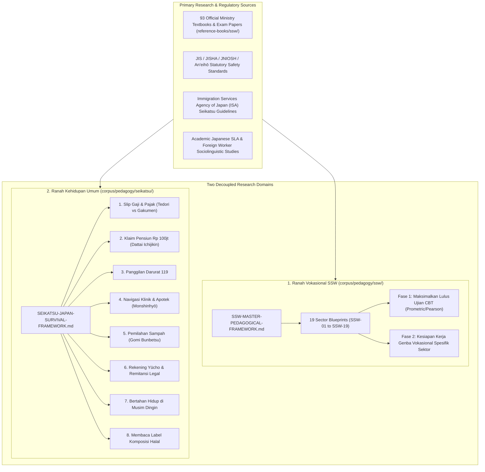
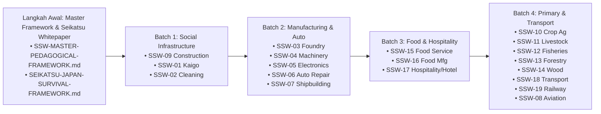

# Master Research Plan v4.0: SSW Vocational Pedagogy & Universal Living Orientation

> **Document Version:** 4.0.0-MODULAR-DOMAIN-ARCHITECTURE  
> **Target Branch:** `research/curriculum-sla-matrix` (`nugget-nihongo-research`)  
> **Repository Domain:** Pure Educational Research, Learning Sciences, Sociolinguistics & Curriculum Synthesis  
> **Benchmark Reference:** [`Nugget-Nihongo-SSW-Konstruksi`](https://github.com/nuggetenak/Nugget-Nihongo-SSW-Konstruksi) (Forensic Analysis of Strengths, Failures & Gaps)  
> **Primary Source Corpus:** 93 Official Japanese Government Textbooks & Exam Papers in [`reference-books/ssw/`](file:///c:/Users/Timedoor/Downloads/nugget%20nihonggo%20project/reference-books/ssw/) cataloged in [`CATALOG_SSW_OFFICIAL.md`](file:///c:/Users/Timedoor/Downloads/nugget%20nihonggo%20project/reference-books/ssw/CATALOG_SSW_OFFICIAL.md)  
> **Curriculum Syllabi:** [`corpus/sections/synthesis/syllabi/ssw/`](file:///c:/Users/Timedoor/Downloads/nugget%20nihonggo%20project/nugget-nihongo-research/corpus/sections/synthesis/syllabi/ssw/) (`SSW-01` to `SSW-19`)  
> **Master Bibliography:** [`corpus/bibliography/MASTER-BIBLIOGRAPHY-FINAL.md`](file:///c:/Users/Timedoor/Downloads/nugget%20nihonggo%20project/nugget-nihongo-research/corpus/bibliography/MASTER-BIBLIOGRAPHY-FINAL.md)

---

## Goal Description

The objective of this research plan is to establish the definitive, evidence-based **Landasan Teori, Pedagogi, dan Metodologi Pembelajaran** across Nugget Nihongo.

Following rigorous multi-round red-teaming, the curriculum architecture is cleanly decoupled into **two distinct, non-overlapping domains** perfectly mirroring the statutory framework of the Japanese Government:

```
┌────────────────────────────────────────────────────────────────────────┐
│                   ARSITEKTUR KURIKULUM NUGGET NIHONGO                  │
├────────────────────────────────────────────────────────────────────────┤
│ 1. RANAH VOKASIONAL SSW (100% SPESIFIK SEKTOR)                         │
│    Location: corpus/pedagogy/ssw/                                      │
│    Regulated by: MHLW, MLIT, MAFF, METI, Agency for Cultural Affairs   │
│    ├── FASE 1: Memaksimalkan Peluang Lulus Ujian CBT Prometric/Pearson │
│    └── FASE 2: Kesiapan Kerja Genba Vokasional Spesifik Sektor         │
├────────────────────────────────────────────────────────────────────────┤
│ 2. RANAH KEHIDUPAN UMUM & ORIENTASI JEPANG (100% UNIVERSAL)            │
│    Location: corpus/pedagogy/seikatsu/                                 │
│    Regulated by: Immigration Services Agency of Japan (ISA / 出入国在留管理庁) │
│    └── SEIKATSU-JAPAN-SURVIVAL-FRAMEWORK.md                            │
│        (Slip gaji, asuransi/pajak, 119, klinik, sampah, bank, cuaca)   │
└────────────────────────────────────────────────────────────────────────┘
```

This clean boundary prevents **scope drift** and eliminates repetitive clutter: the 19 SSW blueprints remain 100% focused on technical vocational competencies, while universal life in Japan is centralized into a single authoritative survival orientation whitepaper.

---

## User Review Required

> [!IMPORTANT]
> **Strict Domain Boundary Enforcement**:
> 1. **Ranah Vokasional SSW (`corpus/pedagogy/ssw/`)**:
>    - Contains `SSW-MASTER-PEDAGOGICAL-FRAMEWORK.md` and 19 dedicated sector blueprints (`SSW-01` to `SSW-19`).
>    - Every document is strictly confined to:
>      - **Fase 1**: Memaksimalkan peluang kelulusan ujian CBT (dekonstruksi soal Prometric/Pearson, angka kunci, jebakan distraktor, pacing waktu, tanpa klaim palsu 100% lulus).
>      - **Fase 2**: Kesiapan kerja genba teknis (alat kerja nyata, K3 nol-toleransi, hierarki kerja, dialek industri, sertifikasi statuter pasca-kedatangan).
> 2. **Ranah Kehidupan Umum Seikatsu (`corpus/pedagogy/seikatsu/`)**:
>    - Centralizes all horizontal survival knowledge common to all foreign workers in Japan into [`SEIKATSU-JAPAN-SURVIVAL-FRAMEWORK.md`](file:///c:/Users/Timedoor/Downloads/nugget%20nihonggo%20project/nugget-nihongo-research/corpus/pedagogy/seikatsu/SEIKATSU-JAPAN-SURVIVAL-FRAMEWORK.md):
>      - Slip gaji & potongan pajak/asuransi (*Tedori vs Gakumen*).
>      - Klaim pengembalian dana pensiun Rp 80–150 Juta (*Dattai Ichijikin*).
>      - Panggilan darurat medis & pemadam kebakaran 119.
>      - Navigasi klinik spesialis & apotek (*Monshinhyō*).
>      - Aturan pemilahan sampah kota (*Gomi Bunbetsu*).
>      - Rekening bank Yūcho & remitansi legal (anti-bank gelap).
>      - K3 musim dingin ekstrem (pencegahan gas CO & *akagire*).
>      - Literasi membaca label komposisi makanan halal (*Genzairyō-mei*).
> 3. **Koreksi Kualifikasi Statuter Pasca-Kedatangan (Bukan Hanya Konstruksi)**:
>    - Setiap sektor memiliki kualifikasi pasca-mendarat yang wajib dipetakan:
>      - *Kaigo*: Pelatihan Asuhan Awal (*Kaigo Shokuin Shoninsha Kenshū*) & sertifikasi hisap lendir (*Kakutan Kyūin*).
>      - *Restoran*: Sertifikasi Pengawas Sanitasi Makanan (*Shokuhin Eisei Sekininsha* / 食品衛生責任者).
>      - *Otomotif*: Sertifikasi K3 Penanganan Listrik Tegangan Rendah EV/Hybrid (*Teiatsu Denki*).
>      - *Transport*: Lisensi Komersial Kelas 2 (*Dai-ni-shu Menkyo*) & Uji Kelayakan *NASVA*.
>      - *Pembersihan*: Sertifikasi pembersih kaca gantung / gondola (*Buranko kōji*).
>      - *Konstruksi/Pabrik*: *Forklift*, *Tamagake*, las, *Kōsho Sagyōsha*.

---

## Open Questions

None remaining. All pedagogical priorities, domain boundaries, and sector-specific calibrations have been completely aligned.

---

## Proposed Changes



---

### Component 1: Universal Living Orientation Domain (`corpus/pedagogy/seikatsu/`)

#### [NEW] `corpus/pedagogy/seikatsu/SEIKATSU-JAPAN-SURVIVAL-FRAMEWORK.md`
The authoritative universal living guide covering all 9 civic and survival integration areas for any foreign worker in Japan:
1. **Literasi Finansial & Slip Gaji**: Pembacaan rincian slip gaji (*Gakumen* vs *Tedori*), komponen potongan asuransi kesehatan (*Kenkō Hoken*), pensiun (*Kōsei Nenkin*), pajak daerah (*Jūminzei*), dan sewa asrama.
2. **Klaim Pengembalian Uang Pensiun (*Dattai Ichijikin*)**: Hak hukum mencairkan kembali Rp 80–150 Juta tunai saat pulang ke Indonesia, batas waktu 2 tahun, dan penyimpanan buku pensiun (*Nenkin Techō*).
3. **Protokol Panggilan Darurat 119**: Skrip resmi menelepon ambulans dan damkar (membedakan *Kaji* vs *Kyūkyū*, pelafalan alamat lengkap, dan status korban).
4. **Navigasi Fasilitas Medis & Apotek**: Memilih klinik spesialis yang tepat (*Naika, Geka, Ganka, Hifuka, Jibikōka*), mengisi kuesioner medis *Monshinhyō*, dan aturan obat resep vs bebas.
5. **Etika Pemilahan Sampah Kota (*Gomi Bunbetsu*)**: Pemilahan sampah bakar (*moeru*), non-bakar (*moenai*), plastik (*pura*), botol PET, sampah besar (*sodai gomi*), dan jadwal pembuangan.
6. **Perbankan & Remitansi Legal**: Membuka rekening bank pos (*Yūcho Ginkō*), kartu transportasi pintar (*Suica/Pasmo/Teikiken*), dan remitansi legal berizin (menghindari bahaya *Chika Ginkō*).
7. **K3 Iklim Musim Dingin Ekstrem**: Ventilasi rutin pemanas minyak tanah (*tōyu sutōbu*) anti-keracunan gas CO, perawatan kulit pecah (*akagire*), dan pencegahan syok termal (*heat shock*).
8. **Literasi Belanja Makanan Halal**: Pemindaian kanji bahan turunan babi (*butaniku, rādo, zerachin, pōku ekisu*) dan alkohol masak (*mirin, ryōrishu*) pada label *Genzairyō-mei*.
9. **Kesehatan Mental & Hotline Ketenagakerjaan**: Ekspresi bahasa Jepang saat stres/lemas, pencegahan isolasi sosial musim dingin, dan nomor kontak resmi pengaduan tenaga kerja MHLW.

---

### Component 2: Dedicated Vocational SSW Pedagogy Domain (`corpus/pedagogy/ssw/`)

```
nugget-nihongo-research/
└── corpus/
    └── pedagogy/
        └── ssw/
            ├── SSW-MASTER-PEDAGOGICAL-FRAMEWORK.md
            ├── SSW-01-KAIGO-PEDAGOGICAL-FOUNDATION.md
            ├── SSW-02-CLEANING-PEDAGOGICAL-FOUNDATION.md
            ├── SSW-03-FOUNDRY-PEDAGOGICAL-FOUNDATION.md
            ├── SSW-04-MACHINERY-PEDAGOGICAL-FOUNDATION.md
            ├── SSW-05-ELECTRONICS-PEDAGOGICAL-FOUNDATION.md
            ├── SSW-06-AUTO-REPAIR-PEDAGOGICAL-FOUNDATION.md
            ├── SSW-07-SHIPBUILDING-PEDAGOGICAL-FOUNDATION.md
            ├── SSW-08-AVIATION-PEDAGOGICAL-FOUNDATION.md
            ├── SSW-09-CONSTRUCTION-PEDAGOGICAL-FOUNDATION.md
            ├── SSW-10-CROP-AGRICULTURE-PEDAGOGICAL-FOUNDATION.md
            ├── SSW-11-LIVESTOCK-AGRICULTURE-PEDAGOGICAL-FOUNDATION.md
            ├── SSW-12-FISHERIES-PEDAGOGICAL-FOUNDATION.md
            ├── SSW-13-FORESTRY-PEDAGOGICAL-FOUNDATION.md
            ├── SSW-14-WOOD-INDUSTRY-PEDAGOGICAL-FOUNDATION.md
            ├── SSW-15-FOOD-SERVICE-PEDAGOGICAL-FOUNDATION.md
            ├── SSW-16-FOOD-MANUFACTURING-PEDAGOGICAL-FOUNDATION.md
            ├── SSW-17-HOSPITALITY-PEDAGOGICAL-FOUNDATION.md
            ├── SSW-18-AUTOMOBILE-TRANSPORT-PEDAGOGICAL-FOUNDATION.md
            └── SSW-19-RAILWAY-PEDAGOGICAL-FOUNDATION.md
```

#### Mandatory 6-Chapter Structure per Sector Blueprint:

- **Bab 1: Ekosistem Lapangan & Hierarki Komunikasi Otentik**
  - Struktur peran industri, figur otoritas (care manager vs chef/tencho vs supervisor pabrik vs nōka petani).
  - Register bahasa otentik (keigo empati vs calling pesanan dapur vs instruksi presisi tim).
  - Protokol interaksi wajib: *Hōrensō*, *Fukushō*, penolakan halus *Kotowarikata*, dan mitigasi rasa sungkan (*Anti-Inpei*).
- **Bab 2: Analisis Kritis Kons & Kegagalan Hafalan Buta**
  - Forensic breakdown kelemahan metode hafalan buta flashcard pada sektor terkait.
  - Poin risiko culture/competency shock di tempat kerja.
- **Bab 3: Pemetaan Hambatan Kognitif, Linguistik & Budaya Siswa Indonesia**
  - Analisis kebutuhan belajar berdasarkan 3 Persona (Ex-Magang vs Fresh LPK vs Jurusan Terkait).
  - Interferensi tata bahasa (Head-Final SOV vs SVO Indonesia, dekoding negasi di ujung kalimat).
  - Jebakan distorsi Katakana & Wasei-Eigo teknis.
  - Standar ukuran genba (konvensi milimeter mm vs cm, rasio pelarutan mental tanpa kalkulator).
- **Bab 4: Arsitektur Kurikulum Fase 1 — Maksimalkan Peluang Lulus Ujian CBT**
  - Jembatan tata bahasa N4/JFT-Basic ke teks teknis.
  - Dekonstruksi pola kalimat soal resmi Prometric/Pearson.
  - Matriks angka kunci & batas regulasi statuter (tervalidasi aturan pasca-2024).
  - Dekonstruksi jebakan pilihan pengecoh (soal jebak).
  - Manajemen waktu & ergonomi kognitif layar kaku Prometric/Pearson.
  - SOP Hari-H Ujian Prometric Anti-Diskualifikasi Check-in.
  - Pemecahan morfem kanji majemuk (*morpheme-first chunking* anti-leech FSRS).
  - Metode pelepasan terjemahan bertahap (*desirable difficulties* anti-ilusi paham).
- **Bab 5: Arsitektur Kurikulum Fase 2 — Kesiapan Kerja Genba Vokasional**
  - Pelatihan adaptasi auditori progresif (*Progressive SNR Audio*: kebisingan pabrik, dapur, suara lemah lansia).
  - Matriks penyelamat dialek daerah genba (Kansai-ben, Kyushu-ben, Tohoku-ben).
  - Kinesika & etika non-verbal (kontak mata saat ditegur, derajat membungkuk *ojigi*).
  - Penjangkaran sensori-kinestetik & onomatopoeia taktil (kunci torsi, uji getar martil *dashin*, kekakuan sendi).
  - Izin psikologis & hak K3 menghentikan pekerjaan bahaya (*Sagyō Teishi Ken*).
  - Peta Kualifikasi Statuter Pasca-Kedatangan Spesifik Sektor (*Shokuhin Eisei Sekininsha, Kakutan Kyuin, Teiatsu Denki, Dai-ni-shu, Forklift/Tamagake*).
  - Jembatan promosi karir jangka panjang menuju visa permanen SSW-2 (*Eijūken*).
- **Bab 6: 4 Modalitas Latihan Otentik, Scaffolding & Taksonomi Remedial**
  - Panduan spesifik perancangan latihan untuk: 1) Latihan Visual, 2) Latihan Auditori, 3) Latihan Simulasi Skenario, 4) Latihan Prosedural/Kalkulasi.
  - Scaffolding bertahap dari pemahaman dasar hingga simulasi ujian dan kesiapan lapangan.
  - Matriks remedial terarah berbasis 4 tipe akar kesalahan (Tipe L, C, M, P).
  - Tabel Parameter Desain Kurikuler konkret (waktu, rasio soal, passing threshold) di akhir bab.

---

### Component 3: Execution Roadmap (Master Framework + 4 Batches)



---

## Verification Plan

### Automated Research Integrity Checks
1. **Citation & Markdown Integrity Audit**:
   - Verify that all primary sources cited map 100% to authentic documents in `reference-books/ssw/CATALOG_SSW_OFFICIAL.md` and `corpus/bibliography/MASTER-BIBLIOGRAPHY-FINAL.md`.
2. **Cumulative Regression Integrity**:
   ```powershell
   node scripts/audit_ssw.js
   ```
   *Asserts 100% green status across all existing syllabi and statutory keys.*

### Qualitative & Pedagogical Verification
1. **Domain Boundary Verification**:
   - Ensure `corpus/pedagogy/ssw/` contains zero generic life orientation material (waste sorting, banking, taxes).
   - Ensure `SEIKATSU-JAPAN-SURVIVAL-FRAMEWORK.md` contains comprehensive universal life survival instructions.
2. **Post-Arrival Credential Verification**:
   - Ensure each sector's Bab 5 cites authentic statutory certifications under the respective ministry act (e.g. Food Sanitation Act for Gaishoku, Caregiver Act for Kaigo, Road Transport Vehicle Act for Auto).
