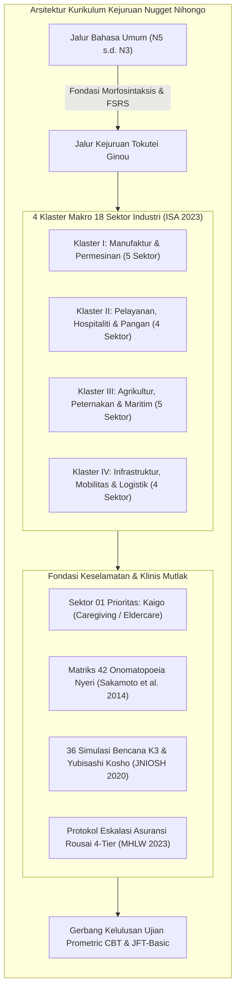
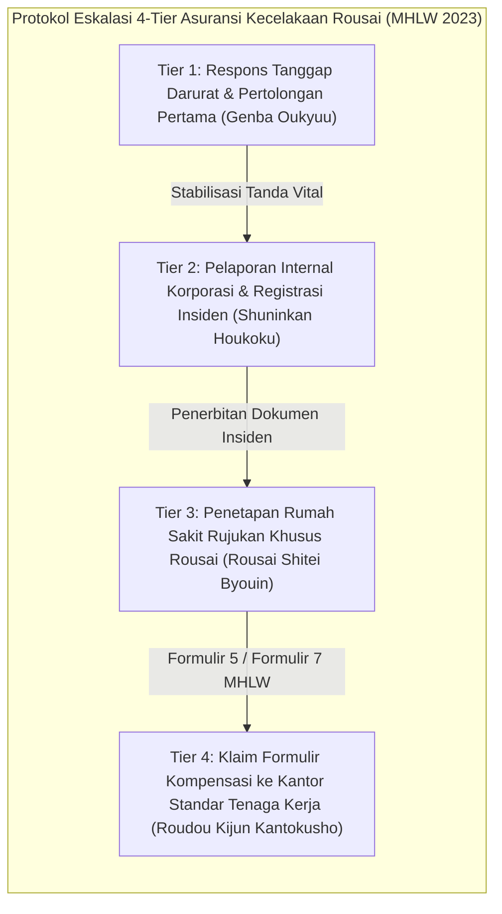

# SILABUS RESMI KURIKULUM KEJURUAN NUGGET NIHONGO · TOKUTEI GINOU (SSW 18 SEKTOR)
**Versi:** v1.0 (Corpus v30 Canonical Revision) · **Status:** AUTHORITATIVE & CANONICAL  
**Target Program:** Tokutei Ginou 1-gō & 2-gō (Specified Skilled Worker / SSW Sektor 01 s.d. 18) & EPA Caregiver  
**Landasan Teoretis & Empiris:**
- Standar Kompetensi Imigrasi Jepang & Prometric CBT (ISA 2023 [VS-05]; Japan Foundation 2019 [VS-06])
- Speech Level Shift & Pragmatic Adaptation in Eldercare (Pramesti et al. 2019 [VS-29])
- 42-Item Clinical Pain Onomatopoeia Diagnostic Matrix (Sakamoto et al. 2014 [VS-36]; Okuda 2018 [VS-38])
- Standar Komunikasi Medis & Pelaporan Insiden SBAR (JNIOSH 2020 [VS-39]; Pronovost et al. 2006 [VS-35])
- Protokol Keselamatan Kerja K3 & Zero-Accident Yubisashi Kosho (JNIOSH 2020 [VS-39])
- Protokol Eskalasi Asuransi Kompensasi Kecelakaan Kerja Rousai (MHLW 2023 [VS-40])
- Empat Untaian Paul Nation untuk Pelatihan Vokasional Cepat (Nation 2007 [CA-34], 2016 [CA-32])
- Algoritma Free Spaced Repetition Scheduling (Ye et al. 2022 [SR-10], Su et al. 2023 [SR-11])
- Testing Effect & Simulasi Interaktif (Roediger & Karpicke 2006 [TE-02]; Karpicke & Roediger 2008 [TE-01])

---

## 1. KERANGKA PEDAGOGIS KEJURUAN TOKUTEI GINOU (SSW)

Kurikulum Kejuruan Nugget Nihongo dirancang secara khusus untuk menjawab kebutuhan mendesak puluhan ribu tenaga kerja terampil Indonesia yang menempuh jalur visa *Tokutei Ginou 1-gō* dan *2-gō*. Berbeda dengan pembelajaran bahasa Jepang umum, kurikulum kejuruan ini memadukan **kompetensi bahasa fungsional tempat kerja dengan keselamatan nyawa K3 (*Anzen Dai-ichi*)**:



### 1.1 Tiga Pilar Utama Pedagogi Kejuruan
1. **Dual-Track Cognitive Load Integration:** Pembelajar menguasai tata bahasa umum (N5–N4 sebagai syarat minimum dan N3 sebagai jembatan Tokutei Ginou 2-gō) sambil secara paralel menyerap terminologi teknis, kanji keselamatan (*kiken, chuui, kinshi*), dan formula komunikasi standar industri.
2. **Speech Level Shift Pragmatis (Pramesti et al. 2019 [VS-29]):** Menghilangkan kekakuan formal yang dapat mengancam hubungan interpersonal di tempat kerja:
   - Di panti lansia (*Kaigo*): Menyeimbangkan salam hormat formal (*Keigo*) dengan sentuhan santai ramah (*Tameguchi/Koe-kake*) untuk membangun kedekatan emosional (*rapport*) dengan lansia demensia.
   - Di bengkel manufaktur & konstruksi: Menguasai bahasa instruksi lugas cepat (*Kantan Meiryou*) dan seruan konfirmasi keselamatan tanpa jeda.
3. **Standarisasi Pelaporan Insiden Kritis SBAR (JNIOSH 2020 [VS-39]):** Seluruh pembelajar dilatih menggunakan urutan baku:
   - **S (Situation):** Apa insiden darurat yang sedang terjadi detik ini?
   - **B (Background):** Riwayat atau kondisi awal yang mendahului insiden.
   - **A (Assessment):** Evaluasi klinis/teknis sementara penutur.
   - **R (Recommendation):** Tindakan darurat yang diusulkan atau bantuan yang diminta dari atasan/tenaga medis.

---

## 2. TAKSONOMI 18 SEKTOR INDUSTRI DALAM 4 KLASTER MAKRO

Sesuai regulasi resmi Badan Pelayanan Imigrasi Jepang (*Immigration Services Agency of Japan / ISA 2023 [VS-05]*), kurikulum mengoperasionalkan seluruh 18 bidang keahlian yang terbagi ke dalam 4 Klaster Makro:

### KLASTER I: INDUSTRI, PERMESINAN & MANUFAKTUR (5 SEKTOR)
> **Karakteristik Lingkungan:** Pabrik perakitan presisi tinggi, jalur pengelasan logam, bahaya terjepit mesin press (*hasamare-maki-komare*), penggunaan cairan kimia pelarut, dan debu industri.

| Sektor | Kode | Deskripsi Bidang | Fokus Terminologi & K3 Kunci |
|---|---|---|---|
| **Sektor 02** | `SSW-MFG-01` | **Manufaktur Permesinan Industri (産業機械製造業)** | Pengoperasian mesin bubut NC, machining center, pembacaan gambar teknik (*seizu*), toleransi mikrometer, pencegahan jari terjepit (*maki-komare*). |
| **Sektor 03** | `SSW-MFG-02` | **Pengecoran & Pengolahan Logam (金属鋳造・鍛造・プレス)** | Peleburan logam cair suhu tinggi (*youyuu-kinzoku*), cetakan pasir, debu silika, luka bakar termal (*yakedo*), ventilasi gas beracun. |
| **Sektor 04** | `SSW-MFG-03` | **Listrik, Elektronik & Informasi (電気電子情報関連産業)** | Solder presisi (*handazuke*), perakitan papan sirkuit PCB, pencegahan lonjakan arus elektrostatis (ESD), bahaya sengatan listrik (*kanden*). |
| **Sektor 05** | `SSW-MFG-04` | **Pengelasan & Fabrikasi Pelat (溶接・板金加工)** | Pengelasan busur TIG/MIG, percikan api (*hibana*), masker pernapasan gas racun, kacamata pelindung cahaya busur (*choukou-megane*). |
| **Sektor 06** | `SSW-MFG-05` | **Manufaktur Tekstil & Pakaian (繊維・衣服製造業)** | Mesin jahit industri berkecepatan tinggi, jarum patah (*oribari*), pencegahan tertusuk, inspeksi detektor logam benang. |

---

### KLASTER II: PELAYANAN, HOSPITALITI & PANGAN (4 SEKTOR)
> **Karakteristik Lingkungan:** Higienitas pangan mutlak (HACCP), sanitasi bakteri (Norovirus, Salmonella), layanan pelanggan standar tinggi (*Omotenashi*), dan bahaya tergelincir di lantai dapur (*tentou*).

| Sektor | Kode | Deskripsi Bidang | Fokus Terminologi & K3 Kunci |
|---|---|---|---|
| **Sektor 07** | `SSW-SRV-01` | **Industri Jasa Makanan & Restoran (外食業)** | Penerimaan tamu (*Gakuseki annai*), konfirmasi alergi bahan pangan (*arerugii hyouji*), manajemen suhu oven/minyak goreng mendidih, penanganan komplain pelanggan. |
| **Sektor 08** | `SSW-SRV-02` | **Pengolahan Makanan & Minuman (飲食料品製造業)** | Jalur sterilisasi HACCP, pembekuan cepat (*kyuusoku reitou*), pengalengan, pencegahan kontaminasi benda asing (*ibutsu kon'nyuu*), pelabelan tanggal kadaluarsa. |
| **Sektor 09** | `SSW-SRV-03` | **Industri Perhotelan & Penginapan (宿泊業)** | Sambutan lobi (*Front desk*), etika kamar tradisional (*Ryokan omotenashi*), penanganan reservasi telepon (*Kenjougo*), manajemen linen & kebersihan kamar. |
| **Sektor 10** | `SSW-SRV-04` | **Pembersihan Gedung & Sanitasi (ビルクリーニング)** | Penggunaan mesin polisher lantai, penanganan bahan kimia pembersih keras (*enkei senzai*), pencegahan jatuh dari tangga kerja, pemilahan limbah medis/domestik. |

---

### KLASTER III: AGRIKULTUR, PETERNAKAN & MARITIM (5 SEKTOR)
> **Karakteristik Lingkungan:** Pekerjaan luar ruangan (*outdoor*), bahaya sengatan panas (*heatstroke / netchuushou*), pengoperasian traktor/mesin potong rumput, dan keselamatan di atas kapal laut.

| Sektor | Kode | Deskripsi Bidang | Fokus Terminologi & K3 Kunci |
|---|---|---|---|
| **Sektor 11** | `SSW-AGR-01` | **Pertanian Tanaman Pangan & Sayur (耕種農業)** | Pembudidayaan rumah kaca (*hausu saibai*), penyemprotan pestisida berstandar APD, panen sortir mutu, hidrasi pencegah *netchuushou*. |
| **Sektor 12** | `SSW-AGR-02` | **Peternakan Sapi, Babi & Unggas (畜産農業)** | Manajemen pakan ternak (*esa-yari*), sanitasi kandang pencegah wabah penyakit menular (*kousei busshitsu*), pencegahan terjepit/tertendang ternak besar. |
| **Sektor 13** | `SSW-MAR-01` | **Perikanan Tangkap Laut (漁業・底曳網・延縄)** | Penarikan jaring laut dalam, pengoperasian derek kapal (*winch*), pemakaian jaket pelampung (*raifu jaketto*), pencegahan jatuh ke laut (*rakuka*). |
| **Sektor 14** | `SSW-MAR-02` | **Budidaya Biota Perairan (養殖業)** | Budidaya tiram, rumput laut, mutiara, pemberian pakan ikan karamba apung, penanganan es pendingin ikan. |
| **Sektor 15** | `SSW-FOR-01` | **Kehutanan & Penebangan Kayu (林業・伐採加工)** | Pengoperasian gergaji mesin (*chainsaw*), penumbangan pohon terarah (*batsu-sai*), pencegahan tertimpa pohon tumbang, medan terjal lereng gunung. |

---

### KLASTER IV: INFRASTRUKTUR, MOBILITAS & LOGISTIK (4 SEKTOR)
> **Karakteristik Lingkungan:** Pekerjaan ketinggian ekstrim (*koujo sagyou*), bahaya tertimpa material runtuh (*toukai*), titik buta kendaraan besar (*shikaku*), dan regulasi transportasi publik.

| Sektor | Kode | Deskripsi Bidang | Fokus Terminologi & K3 Kunci |
|---|---|---|---|
| **Sektor 16** | `SSW-INF-01` | **Konstruksi Bangunan & Sipil (建設業)** | Pemasangan perancah (*scaffolding / ashiba*), sabuk pengaman ganda (*anzen-tai / full harness*), penanganan beton basah, sinyal tangan derek (*tamakake*). |
| **Sektor 17** | `SSW-INF-02` | **Galangan Kapal & Mesin Kelautan (造船・舶用工業)** | Pengelasan lambung kapal, perakitan pelat baja raksasa di dok kering, ruang tertutup minim oksigen (*sanso ketsubou*), ventilasi gas asetilen. |
| **Sektor 18** | `SSW-LOG-01` | **Transportasi Darat: Truk, Bus & Taksi (自動車運送業)** | Pengecekan pra-jalan (*shiryou tenken*), tes kadar alkohol napas (*arukooru chekku*), navigasi peta, komunikasi etis penumpang lansia/disabilitas. |
| **Sektor 19** | `SSW-LOG-02` | **Penerbangan & Penanganan Darat (航空・空港グランドハンドリング)** | Pengisian bagasi pesawat (*loading*), panduan marshalling pesawat di apron (*rampu sagyou*), pencegahan tersedot turbin jet (*engine intake*), keselamatan landas pacu. |

---

## 3. SEKTOR 01 PRIORITAS UTAMA: KAIGO (CLINICAL CARE & ELDERCARE)

Sektor Kaigo memegang porsi terbesar tenaga kerja perawat lansia asal Indonesia di Jepang (termasuk skema EPA dan SSW). Komunikasi di panti lansia memiliki paradoks sosiolinguistik yang sangat halus per penelitian Pramesti et al. (2019) [VS-29]:

### 3.1 Speech Level Shift & Konsep Koe-kake
1. **Prinsip Koe-kake (声かけ):** Pantang menyentuh tubuh lansia atau memindahkan kursi roda tanpa melakukan sapaan verbal dan izin terlebih dahulu:
   - `〇〇様、おはようございます。これからベッドを起こしますね。(〇〇-sama, ohayou gozaimasu. Kore kara beddo wo okoshimasu ne!)`
2. **Pergeseran Register Santun Ramah:** Caregiver Indonesia dilatih memadukan salam hormat pembuka dengan ajakan lembut bersufiks `〜ね (ne)` dan `〜ましょうか (mashou ka)` untuk meredakan kecemasan lansia penderita demensia (*Ninchishou*).

---

### 3.2 Dekoding Matriks 42 Onomatopoeia Nyeri (Sakamoto et al. 2014 [VS-36]; Okuda 2018 [VS-38])

Lansia di Jepang jarang mendeskripsikan penyakit menggunakan istilah klinis medis Latin/Kanji; mereka mengekspresikannya melalui kata tiruan sensasi (*gitaigo/giongo*). Pemahaman akurat atas onomatopoeia nyeri merupakan pembeda antara penanganan observasi biasa dengan rujukan ambulans darurat:

| No | Kata Sensasi Nyeri | Karakteristik Fisiologis | Implikasi Klinis & Tindakan Medis |
|---|---|---|---|
| 1 | **チクチク (chikuchiku)** | Rasa menusuk jarum halus di permukaan kulit | Iritasi dermatologis, ruam popok, serat baju tajam. Periksa permukaan kulit. |
| 2 | **ズキズキ (zukizuki)** | Nyeri berdenyut vaskular seirama detak jantung | Migrain, peradangan pulpa gigi parah, abses terbuka. Ukur tekanan darah segera. |
| 3 | **キリキリ (kirikiri)** | Kram melilit hebat menembus lambung | Gastritis akut, ulkus lambung, spasme usus. Hentikan asupan makanan padat. |
| 4 | **ヒリヒリ (hirihiri)** | Sensasi terbakar panas perih pada kulit ari | Luka bakar air panas, abrasi gesekan, infeksi jamur. Kompres air dingin steril. |
| 5 | **ジンジン (jinjin)** | Rasa nyeri membara yang merambat konstan | Radang sendi artritis akut, pembekuan sirkulasi darah, pasca-fraktur tulang. |
| 6 | **ズーン (zuun)** | Nyeri tumpul berat menekan dari dalam organ | Perdarahan dalam panggul, trauma organ dalam, konstipasi fekal impaksi. |
| 7 | **ムズムズ (muzumuzu)** | Gatal merayap di bawah permukaan kulit | Alergi obat, pruritus senilis, sindrom kaki gelisah. Laporkan ke dokter. |
| 8 | **クラクラ (kurakura)** | Pusing melayang anemia / vertigo ringan | Hipotensi ortostatik mendadak saat berdiri. Baringkan kepala posisi datar. |
| 9 | **グルグル (guruguru)** | Pusing berputar hebat disorientasi ruang | Gangguan labirin telinga dalam, vertigo perifer, stroke batang otak. Rujuk darurat! |
| 10 | **ゼーゼー (zeezee)** | Mengi kasar berat saat mengeluarkan napas | Obstruksi bronkus, serangan asma bronkiale, edema paru kardiogenik. Oksigen darurat! |
| 11 | **ヒューヒュー (hyuuhyuu)** | Suara siulan bernada tinggi di saluran napas atas | Tersedak benda asing (*goen*), laringospasme. Manuver Heimlich seketika! |
| 12 | **ゴホゴホ (gohogoho)** | Batuk berdahak basah berat tersumbat | Pneumonia aspirasi (*goen-sei haien*). Posisikan setengah duduk (*Fowler*). |
| 13 | **ギシギシ (gishigishi)** | Gesekan kaku keras pada persendian lutut | Osteoartritis degeneratif sendi. Pasang bantalan penyangga gerak. |
| 14 | **コチコチ (kochikochi)** | Otot kaku mengeras seperti papan | Rigor otot lanjut, dehidrasi berat, syok tetanus. Segera cek elektrolit. |
| 15 | **ビリビリ (biribiri)** | Sengatan nyeri elektrik merambat di saraf | Hernia nukleus pulposus (HNP), neuralgia pasca-herpes. Hindari tekukan punggung. |
| 16 | **ドンドン (dondon)** | Dentuman benturan tumpul berirama | Hipertensi ensefalopati krisis, trauma kepala terbentur ranjang. |
| 17 | **モヤモヤ (moyamoya)** | Ketidaknyamanan dada yang tak terdefinisi | Iskemia miokard awal / angina pectoris. Rekam EKG dalam 10 menit! |
| 18 | **チクン (chikun)** | Tusukan tajam sesaat | Gigitan serangga atau tusukan jarum infus terlepas. |
| 19 | **ヒリッ (hirit)** | Perih menyengat kilat saat terkena air | Robekan kulit tipis (*skin tear*). Bersihkan dengan larutan garam faali. |
| 20 | **ズキッ (zukit)** | Sentakan nyeri tajam tiba-tiba di kepala | Aneurisma serebral atau neuralgia trigeminal. Pantau refleks pupil mata. |
| 21 | **ガンガン (gangan)** | Kepala terasa seperti dihantam palu godam | Pendarahan subaraknoid (*stroke hemoragik*). Rujuk 119 ambulans segera! |
| 22 | **ボーッ (boot)** | Kesadaran berkabut mengantuk disorientasi | Hipoglikemia diabetik, keracunan CO, ensefalopati hepatik. Tes gula darah! |
| 23 | **ふらふら (furafura)** | Keseimbangan tubuh goyah hampir ambruk | Ataksia serebelar, kelelahan dehidrasi berat. Papah ke kursi roda ber-rem. |
| 24 | **ぞくぞく (zokuzoku)** | Menggigil kedinginan dari dalam tulang | Fase awal demam sepsis bakterial, pneumonia. Selimuti dan ukur suhu badan. |
| 25 | **ひやり (hiyari)** | Keringat dingin mengucur mendadak | Syok kardiogenik, penurunan perfusi jaringan masif. Monitor tanda vital! |
| 26 | **ネバネバ (nebaneba)** | Dahak/lendir liat kental menyumbat tenggorokan | Dehidrasi saluran napas. Lakukan fisioterapi dada dan suction lendir. |
| 27 | **カサカサ (kasakasa)** | Kulit kering pecah-pecah seperti sisik ikan | Kerusakan barier kulit lansia. Oleskan pelembab heparoid secara rutin. |
| 28 | **パンパン (panpan)** | Edema bengkak meregang kencang pada tungkai | Gagal jantung kongestif, gagal ginjal terminal, trombosis vena dalam (DVT). |
| 29 | **ピリピリ (piripiri)** | Rasa gatal perih menyengat saraf tepi | Gejala prodromal herpes zoster sebelum ruam melepuh keluar. Isolasi kontak. |
| 30 | **カチカチ (kachikachi)** | Feses mengeras membatu menyumbat rektum | Fekaloma koprostasis. Lakukan evakuasi manual jari (*teki-ben*) sesuai SOP. |
| 31 | **シクシク (shikushiku)** | Nyeri perut bawah merengek tumpul konstan | Sistitis infeksi kandung kemih, divertikulitis usus. Uji urin residu. |
| 32 | **ピクピク (pikupiku)** | Kedutan otot fasikulasi involunter | Hipomagnesemia, spasme saraf fasialis, kelelahan neuromuskular. |
| 33 | **ヒクヒク (hikuhiku)** | Spasme diafragma / cegukan tak terkontrol | Iritasi saraf frenikus, distensi lambung masif. Beri minum air hangat sedikit. |
| 34 | **ギューッ (gyuut)** | Dada seperti dicengkeram dan diremas besi | Infark miokard akut (*Serangan Jantung Koroner*). Panggil perawat & kode darurat! |
| 35 | **キューッ (kyuut)** | Kram menyempit tiba-tiba di ulu hati | Spasme pilorus atau kolesistitis bilier. Pantau warna feses dan ikterus mata. |
| 36 | **ツーン (tsuun)** | Sensasi menusuk tajam merambat ke hidung | Aspirasi cairan asam lambung masuk ke nasofaring. Lakukan reposisi kepala. |
| 37 | **ゴロゴロ (gorogoro)** | Bunyi cairan lendir beriak di paru-paru | Penumpukan sekret jalan napas pada pasien terminal (*death rattle*). Suction segera. |
| 38 | **グツグツ (gutsugutsu)** | Perut bergolak penuh gas dan cairan | Diare infeksius akut, enteritis bakteri. Waspadai penularan Norovirus! |
| 39 | **モリモリ (morimori)** | Ketegangan benjolan abnormal di lipat paha | Hernia inguinalis strangulata. Jangan ditekan keras; rujuk bedah segera! |
| 40 | **ピリッ (pirit)** | Sengatan tajam sesaat saat menekuk jari | Trigger finger tenosinovitis, kompresi saraf medianus carpal tunnel. |
| 41 | **ドクドク (dokudoku)** | Darah memancar deras dari luka robek | Pendarahan arteri terbuka. Lakukan penekanan langsung steril (*chokusetsu appaku*). |
| 42 | **タラタラ (taratara)** | Darah mengalir konstan menetes tanpa henti | Pendarahan vena kapiler. Balut tekan dengan kassa gulung steril. |

---

## 4. SISTEM 36 SIMULASI BENCANA K3 & YUBISASHI KOSHO (JNIOSH 2020)

Untuk menjamin *Zero Accident (Saigai Zero)*, kurikulum mengintegrasikan 36 skenario mitigasi bencana dan simulasi bahaya di tempat kerja (*Kiken Yochi Kunren / KYK*):

### 4.1 Protokol Point-and-Call (指差し呼称 / Yubisashi Kosho)
Setiap tindakan kritis diwajibkan melakukan konfirmasi visual, fisik (telunjuk lurus), dan vokal:
1. **Langkah 1:** Arahkan jari telunjuk tangan kanan lurus ke sasaran objek verifikasi.
2. **Langkah 2:** Tarik tangan ke telinga kanan sambil mengambil napas.
3. **Langkah 3:** Hentakkan tangan lurus ke sasaran sambil meneriakkan status:  
   *`[Nama Objek] + Yoshi! (〇〇、ヨシ！)`*  
   Contoh: *Bureeki, Yoshi! (Rem terkunci, OK!)*; *Anzen-tai, Yoshi! (Sabuk aman, OK!)*.

---

### 4.2 Matriks 36 Skenario Simulasi K3 Lintas Sektor

```
[BENCANA-01 s.d. 09: KLASTER I MANUFAKTUR & PERMESINAN]
- K3-01: Jari terjepit roller penggiling mesin press (挟まれ・巻き込まれ) -> Tombol E-Stop & SBAR
- K3-02: Percikan cairan logam cair mengenai pelindung wajah (溶融金属飛散)
- K3-03: Kebocoran tabung gas asetilen pengelasan (ガス漏れ・爆発火災)
- K3-04: Sengatan listrik kabel terkelupas basah (感電災害)
- K3-05: Paparan pelarut organik tiner tanpa masker karbon aktif (有機溶剤中毒)
- K3-06: Benda kerja mental dari mesin bubut berputar kecepatan tinggi (飛来・落下)
- K3-07: Ledakan debu aluminium di ruang filter blower (粉塵爆発)
- K3-08: Luka sayat pelat baja tajam tanpa sarung tangan kawat (切創事故)
- K3-09: Jarum mesin jahit menembus kuku jari operator tekstil (針刺し切傷)

[BENCANA-10 s.d. 18: KLASTER II PELAYANAN & PANGAN]
- K3-10: Lansia tersedak kue beras mochi di ruang makan panti (誤嚥窒息) -> Heimlich
- K3-11: Lansia jatuh dari tempat tidur saat transfer mandiri (ベッド転倒・骨折)
- K3-12: Minyak goreng fryer 180°C tersiram ke lengan koki restoran (高温油熱傷)
- K3-13: Lantai dapur basah berminyak memicu staf tergelincir (滑り転倒・頭部打撲)
- K3-14: Kebocoran bahan kimia klorin sanitasi toilet gedung (塩素ガス中毒)
- K3-15: Kontaminasi silang alergen kacang pada pesanan pelanggan (食物アレルギー発症)
- K3-16: Staf terperangkap di dalam gudang freezer beku -25°C (冷凍室閉じ込め)
- K3-17: Jari teriris mesin slicer pemotong daging otomatis (スライサー切断)
- K3-18: Wabah gastroenteritis Norovirus staf dapur massal (ノロウイルス集団感染)

[BENCANA-19 s.d. 27: KLASTER III AGRIKULTUR & MARITIM]
- K3-19: Serangan sengatan panas heatstroke akut di dalam greenhouse 42°C (熱中症重症化)
- K3-20: Traktor pembalik tanah terbalik menindih kaki operator di lereng (トラクター横転)
- K3-21: Keracunan semprotan pestisida organofosfat terbawa angin (農薬中毒)
- K3-22: Anak buah kapal tersapu ombak badai ke laut bebas (海中転落・落水)
- K3-23: Kaki terlilit tali tambat kapal di mesin winch penarik (ロープ巻き込まれ)
- K3-24: Tertusuk duri beracun ikan pari karamba apung (有毒魚刺傷)
- K3-25: Tendangan keras sapi perah mengenai dada peternak (牛の蹴り飛ばし)
- K3-26: Penebang kayu tertimpa dahan pohon patah memantul (伐倒木直撃)
- K3-27: Keracunan gas amonia kotoran kandang babi tertutup (硫化水素・アンモニア中毒)

[BENCANA-28 s.d. 36: KLASTER IV INFRASTRUKTUR & MOBILITAS]
- K3-28: Pekerja jatuh dari perancah lantai 5 akibat tali pengaman putus (足場墜落)
- K3-29: Tertimpa runtuhan dinding galian tanah parit fondasi (土砂崩壊・埋没)
- K3-30: Muatan pelat baja crane lepas dari ikatan tali sling (玉掛けワイヤー破断)
- K3-31: Pekerja pingsan akibat kekurangan oksigen di dasar tangki dok kapal (酸素欠乏症)
- K3-32: Tabrakan forklift mundur mengenai pejalan kaki di blindspot gudang (フォークリフト激突)
- K3-33: Sopir bus pingsan mendadak akibat serangan jantung saat melaju (運転手急病発症)
- K3-34: Ban truk tronton pecah meledak saat pengisian angin bengkel (タイヤ破裂飛散)
- K3-35: Petugas apron tersedot area bahaya turbin mesin jet pesawat (ジェットエンジン吸い込み)
- K3-36: Percikan api gerinda menyambar sisa uap bensin tangki kapal (可燃性蒸気引火爆発)
```

---

## 5. PROTOKOL ESKALASI ASURANSI KECELAKAAN KERJA ROUSAI 4-TIER (MHLW 2023 [VS-40])

Seluruh pekerja berhak mendapatkan perlindungan penuh atas Asuransi Kompensasi Kecelakaan Tenaga Kerja (*Roudousha Saigai Hoshou Hoken / Rousai Hoken*). Nugget Nihongo membekali pembelajar dengan keterampilan komunikasi eskalasi hak hukum 4 tingkatan:



### Rincian 4 Tingkatan Eskalasi
- **Tier 1 (Genba Oukyuu - 現場応急):**
  - Menghentikan mesin (*Hijou Teishi*), memanggil bantuan tim (*Dare ka kite kudasai!*), melakukan penekanan luka darah steril atau CPR, dan menelpon ambulans **119**.
- **Tier 2 (Shuninkan Houkoku - 主任官報告):**
  - Pelaporan lisan seketika kepada pimpinan regu (*Kumichou/Koujou-chou*) menggunakan format SBAR. Melarang keras pihak manajemen menutupi kecelakaan (*Rousai Kakushi adalah tindak pidana kejahatan ketenagakerjaan!*).
- **Tier 3 (Rousai Shitei Byouin - 労災指定病院):**
  - Saat tiba di rumah sakit, pekerja wajib menyatakan dengan tegas: *`Rousai de onegai shimasu (Tolong daftarkan ini sebagai kecelakaan kerja Rousai)`*. **Jangan menggunakan kartu asuransi kesehatan biasa (*Hokenshou*)**, agar seluruh biaya pengobatan 100% ditanggung negara tanpa biaya pribadi.
- **Tier 4 (Roudou Kijun Kantokusho - 労働基準監督署):**
  - Pengisian dokumen resmi Formulir 5 (*Youshiki Dai 5-gou* untuk biaya medis pengobatan) dan Formulir 7 (*Youshiki Dai 7-gou* untuk kompensasi upah cuti sakit 80% gaji pokok). Jika perusahaan menolak menandatangani, pekerja didampingi serikat pekerja atau lembaga pendukung terdaftar (*Touroku Shien Kikan*) untuk mengajukan langsung ke dinas ketenagakerjaan setempat.

---

## 6. METRIK EVALUASI KELULUSAN KEJURUAN (PROMETRIC CBT GATES)

| Parameter Evaluasi | Standar Ambang Batas | Instrumen Validasi |
|---|---|---|
| **Kosakata Teknis Kejuruan** | $\ge 1,200$ Istilah Spesifik Sektor Terpilih | FSRS Specialized Technical Vocab Battery |
| **Kanji K3 & Keselamatan** | $\ge 150$ Karakter Kanji Regulasi Industri | K3 Signboard Morphological Decoder |
| **Dekoding Onomatopoeia Nyeri** | 100% Benar pada 42 Matriks Nyeri Sakamoto | Clinical Audio-Visual Symptom Test |
| **Simulasi Bencana K3** | Mampu Mengeksekusi Prosedur SBAR pada 36 Kasus | Interactive Branching Disaster Simulator |
| **Verifikasi Yubisashi Kosho** | Refleks Ketukan Tangan & Seruan $\le 2\text{ detik}$ | Interactive Webcam/Audio Motion Capture Engine |
| **Kelulusan Prometric CBT** | $\ge 80\%$ Skor pada Simulasi CBT Resmi Sektor | Prometric CBT Skill Exam Suite |
