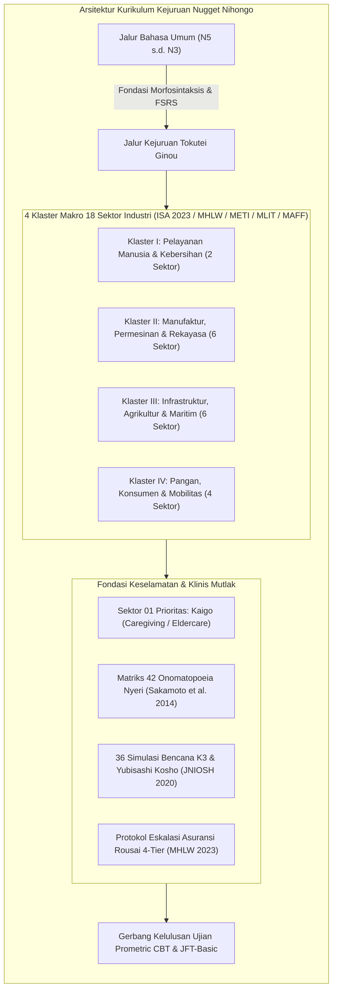
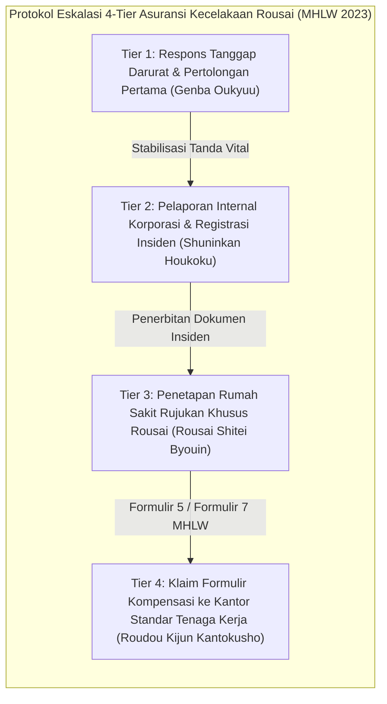

# SILABUS RESMI KURIKULUM KEJURUAN NUGGET NIHONGO · TOKUTEI GINOU (SSW 18 SEKTOR)
**Versi:** v2.0 (Corpus v30 Canonical Revision — Official Ministry & Testing Agency Curation)  
**Status:** AUTHORITATIVE & CANONICAL MASTER SYLLABUS  
**Target Program:** Tokutei Ginou 1-gō & 2-gō (Specified Skilled Worker / SSW Sektor 01 s.d. 18), EPA Caregiver, & 2027 Ikusei Shūrō Pipeline  
**Dasar Kurasi Primer:** 93 Buku Teks Resmi, Kisi-Kisi, dan Bank Soal Ujian Nasional Pemerintah Jepang (`reference-books/ssw/` & `ssw-catalog.json`)  
**Landasan Teoretis & Empiris:**
- Standar Kompetensi Imigrasi Jepang & Prometric CBT (ISA 2023 [VS-05]; Japan Foundation 2019 [VS-06])
- Needs Analysis & Language for Specific Purposes (Hutchinson & Waters 1987 [VS-01]; Dudley-Evans & St John 1998 [VS-02]; Basturkmen 2006 [VS-03]; Long 2005 [VS-04])
- Technical Lexicon Stratification (Nation & Hwang 1995 [VS-09]; Chung & Nation 2003 [VS-10]; Coxhead 2018 [VS-11])
- Speech Level Shift & Pragmatic Adaptation in Eldercare (Pramesti et al. 2019 [VS-29]; Noyama 2012 [VS-08]; Kamata & Tanaka 2021 [VS-12]; Ogawa 2012 [VS-24])
- Hospitality Pragmatics & Omotenashi (Pratama & Srimulyani 2024 [VS-30]; Sari & Kastuti 2023 [VS-34])
- HOU-REN-SO Cross-Cultural Communication in Manufacturing (Mustaqim & Priventa 2026 [VS-31]; Supriatnaningsih et al. 2024 [VS-33])
- 42-Item Clinical Pain Onomatopoeia Diagnostic Matrix (Sakamoto et al. 2014 [VS-36]; Doizaki et al. 2015 [VS-37]; Okuda 2018 [VS-38])
- Standar Komunikasi Medis & Pelaporan Insiden SBAR (JNIOSH 2020 [VS-39]; Pronovost et al. 2006 [VS-35])
- Protokol Keselamatan Kerja K3 & Zero-Accident Yubisashi Kosho (JNIOSH 2020 [VS-39]; JAIM 2024 [VS-40]; JAC 2024 [VS-41])
- Protokol Eskalasi Asuransi Kompensasi Kecelakaan Kerja Rousai (MHLW 2023 [VS-40])
- Empat Untaian Paul Nation untuk Pelatihan Vokasional Cepat (Nation 2007 [CA-34], 2016 [CA-32])
- Algoritma Free Spaced Repetition Scheduling (Ye et al. 2022 [SR-10], Su et al. 2023 [SR-11])
- Testing Effect & Simulasi Interaktif (Roediger & Karpicke 2006 [TE-02]; Karpicke & Roediger 2008 [TE-01])

---

## 1. KERANGKA PEDAGOGIS KEJURUAN TOKUTEI GINOU (SSW)

Kurikulum Kejuruan Nugget Nihongo dirancang secara khusus untuk menjawab kebutuhan mendesak puluhan ribu tenaga kerja terampil Indonesia yang menempuh jalur visa *Tokutei Ginou 1-gō* dan *2-gō*. Berbeda dengan pembelajaran bahasa Jepang umum, kurikulum kejuruan ini memadukan **kompetensi bahasa fungsional tempat kerja dengan keselamatan nyawa K3 (*Anzen Dai-ichi*)**:



### 1.1 Tiga Pilar Utama Pedagogi Kejuruan
1. **Dual-Track Cognitive Load Integration:** Pembelajar menguasai tata bahasa umum (N5–N4 sebagai syarat minimum dan N3 sebagai jembatan Tokutei Ginou 2-gō) sambil secara paralel menyerap terminologi teknis, kanji keselamatan (*kiken, chuui, kinshi*), dan formula komunikasi standar industri.
2. **Speech Level Shift Pragmatis (Pramesti et al. 2019 [VS-29]):** Menghilangkan kekakuan formal yang dapat mengancam hubungan interpersonal di tempat kerja:
   - Di panti lansia (*Kaigo*): Menyeimbangkan salam hormat formal (*Keigo*) dengan sentuhan santai ramah (*Tameguchi/Koe-kake*) untuk membangun kedekatan emosional (*rapport*) dengan lansia demensia.
   - Di bengkel manufaktur & konstruksi: Menguasai bahasa instruksi lugas cepat (*Kantan Meiryou*) dan seruan konfirmasi keselamatan tanpa jeda.
3. **Standarisasi Pelaporan Insiden Kritis SBAR (JNIOSH 2020 [VS-39]):** Seluruh pembelajar dilatih menggunakan urutan baku:
   - **S (Situation):** Apa insiden darurat yang sedang terjadi detik ini?
   - **B (Background):** Riwayat atau kondisi awal yang mendahului insiden.
   - **A (Assessment):** Evaluasi klinis/teknis sementara penutur.
   - **R (Recommendation):** Tindakan darurat yang diusulkan atau bantuan yang diminta dari atasan/tenaga medis.

---

## 2. TAKSONOMI 18 SEKTOR INDUSTRI DALAM 4 KLASTER MAKRO

Sesuai regulasi resmi Badan Pelayanan Imigrasi Jepang (*Immigration Services Agency of Japan / ISA 2023 [VS-05]*), kurikulum mengoperasionalkan seluruh 18 bidang keahlian yang terbagi ke dalam 4 Klaster Makro yang didukung oleh 93 buku teks dan bank soal resmi (`reference-books/ssw/`):

```
[TOKUTEI GINOU 18-SECTOR MACRO-CLUSTER ECOSYSTEM]
│
├── KLASTER I: CARE & HUMAN SERVICES (PELAYANAN & KEBERSIHAN)
│   ├── Sektor 01: Nursing Care / Eldercare (介護 - Kaigo) [MHLW / Prometric]
│   └── Sektor 02: Building Cleaning Management (ビルクリーニング) [MHLW / JBMA / Pearson VUE]
│
├── KLASTER II: INDUSTRIAL MANUFACTURING & ENGINEERING (MANUFAKTUR & REKAYASA)
│   ├── Sektor 03: Machine Parts & Tooling (素形材産業 - Sokeizai) [METI / JAIM]
│   ├── Sektor 04: Industrial Machinery (産業機械製造業) [METI / JAIM]
│   ├── Sektor 05: Electrical & Electronics (電気電子情報関連産業) [METI / JAIM]
│   ├── Sektor 06: Automobile Maintenance (自動車整備業) [MLIT / JASPA / Prometric]
│   ├── Sektor 07: Shipbuilding & Marine Machinery (造船・舶用工業) [MLIT / ClassNK]
│   └── Sektor 08: Aviation Industry (航空業: グランドハンドリング・機体整備) [MLIT JCAB / JAEA]
│
├── KLASTER III: INFRASTRUCTURE, PRIMARY PRODUCTION & FORESTRY (INFRASTRUKTUR & SUMBER DAYA)
│   ├── Sektor 09: Construction Industry (建設業: 土木・建築・ライフライン) [MLIT / JAC / Prometric]
│   ├── Sektor 10: Agriculture: Crop Cultivation (農業: 耕種農業) [MAFF / ASAT / Prometric]
│   ├── Sektor 11: Agriculture: Livestock Farming (農業: 畜産農業) [MAFF / ASAT / Prometric]
│   ├── Sektor 12: Fishery & Aquaculture (漁業: 漁業・養殖業) [MAFF / Suisankai / Prometric]
│   ├── Sektor 13: Forestry Industry (林業: 育林・伐倒) [MAFF / Forestry Agency] [2024 Expansion]
│   └── Sektor 14: Timber & Wood Processing (木材産業: 製材・合板) [MAFF / Forestry Agency] [2024 Expansion]
│
└── KLASTER IV: CONSUMER SERVICES, FOOD & MOBILITY (PANGAN, HOSPITALITI & TRANSPORTASI)
    ├── Sektor 15: Food & Beverage Manufacturing (飲食料品製造業) [MAFF / OTAFF / Prometric]
    ├── Sektor 16: Food Service / Restaurant (外食業) [MAFF / JFnet / OTAFF / Prometric]
    ├── Sektor 17: Accommodation & Hospitality (宿泊業) [JTA & MLIT / CAIPT / Prometric]
    └── Sektor 18: Automobile Transport & Logistics (自動車運送業: トラック・バス・タクシー) & Railway (鉄道) [MLIT]
```

### 2.1 Direktori Lengkap 19 Dokumen Silabus Sektor Tokutei Ginou Resmi (SSW Suite)

Setiap sektor telah dioperasionalkan secara terpisah dalam dokumen silabus mendalam berkurasi penuh di direktori [`corpus/sections/synthesis/syllabi/ssw/`](file:///c:/Users/Timedoor/Downloads/nugget%20nihonggo%20project/nugget-nihongo-research/corpus/sections/synthesis/syllabi/ssw/):

| No | Kode Sektor | Sektor Industri Resmi | Lembaga Penguji & CBT | Tautan Dokumen Silabus Lengkap |
|---|---|---|---|---|
| 01 | `SSW-CARE-01` | Nursing Care / Eldercare (介護) | MHLW / Prometric (2 Ujian: Skills + JPN) | [`SSW-01-KAIGO-ELDERCARE-SYLLABUS.md`](file:///c:/Users/Timedoor/Downloads/nugget%20nihonggo%20project/nugget-nihongo-research/corpus/sections/synthesis/syllabi/ssw/SSW-01-KAIGO-ELDERCARE-SYLLABUS.md) |
| 02 | `SSW-CLEAN-01` | Building Cleaning Management (ビルクリーニング) | JBMA / Pearson VUE CBT 2025 | [`SSW-02-BUILDING-CLEANING-SYLLABUS.md`](file:///c:/Users/Timedoor/Downloads/nugget%20nihonggo%20project/nugget-nihongo-research/corpus/sections/synthesis/syllabi/ssw/SSW-02-BUILDING-CLEANING-SYLLABUS.md) |
| 03 | `SSW-MFG-01` | Machine Parts & Tooling / Sokeizai (素形材産業) | METI / JAIM & Prometric (80m CBT) | [`SSW-03-SOKEIZAI-TOOLING-SYLLABUS.md`](file:///c:/Users/Timedoor/Downloads/nugget%20nihonggo%20project/nugget-nihongo-research/corpus/sections/synthesis/syllabi/ssw/SSW-03-SOKEIZAI-TOOLING-SYLLABUS.md) |
| 04 | `SSW-MFG-02` | Industrial Machinery Manufacturing (産業機械製造業) | METI / JAIM & Prometric (80m CBT) | [`SSW-04-INDUSTRIAL-MACHINERY-SYLLABUS.md`](file:///c:/Users/Timedoor/Downloads/nugget%20nihonggo%20project/nugget-nihongo-research/corpus/sections/synthesis/syllabi/ssw/SSW-04-INDUSTRIAL-MACHINERY-SYLLABUS.md) |
| 05 | `SSW-MFG-03` | Electrical & Electronics (電気電子情報関連産業) | METI / JAIM & Prometric (80m CBT) | [`SSW-05-ELECTRICAL-ELECTRONICS-SYLLABUS.md`](file:///c:/Users/Timedoor/Downloads/nugget%20nihonggo%20project/nugget-nihongo-research/corpus/sections/synthesis/syllabi/ssw/SSW-05-ELECTRICAL-ELECTRONICS-SYLLABUS.md) |
| 06 | `SSW-AUTO-01` | Automobile Repair & Maintenance (自動車整備業) | MLIT / JASPA & Prometric | [`SSW-06-AUTOMOBILE-MAINTENANCE-SYLLABUS.md`](file:///c:/Users/Timedoor/Downloads/nugget%20nihonggo%20project/nugget-nihongo-research/corpus/sections/synthesis/syllabi/ssw/SSW-06-AUTOMOBILE-MAINTENANCE-SYLLABUS.md) |
| 07 | `SSW-SHIP-01` | Shipbuilding & Marine Machinery (造船・舶用工業) | MLIT / ClassNK (4 Kejuruan) | [`SSW-07-SHIPBUILDING-MARINE-SYLLABUS.md`](file:///c:/Users/Timedoor/Downloads/nugget%20nihonggo%20project/nugget-nihongo-research/corpus/sections/synthesis/syllabi/ssw/SSW-07-SHIPBUILDING-MARINE-SYLLABUS.md) |
| 08 | `SSW-AVIA-01` | Aviation Industry (航空業: Ramp & Maint.) | MLIT JCAB / JAEA & Prometric | [`SSW-08-AVIATION-INDUSTRY-SYLLABUS.md`](file:///c:/Users/Timedoor/Downloads/nugget%20nihonggo%20project/nugget-nihongo-research/corpus/sections/synthesis/syllabi/ssw/SSW-08-AVIATION-INDUSTRY-SYLLABUS.md) |
| 09 | `SSW-CONST-01` | Construction Industry (建設業: 土木・建築・設備) | MLIT / JAC & Prometric (3 Tracks d/k/l) | [`SSW-09-CONSTRUCTION-INDUSTRY-SYLLABUS.md`](file:///c:/Users/Timedoor/Downloads/nugget%20nihonggo%20project/nugget-nihongo-research/corpus/sections/synthesis/syllabi/ssw/SSW-09-CONSTRUCTION-INDUSTRY-SYLLABUS.md) |
| 10 | `SSW-AGRI-01` | Agriculture: Crop Cultivation (農業: 耕種農業) | MAFF / ASAT & Prometric | [`SSW-10-AGRICULTURE-CROP-FARMING-SYLLABUS.md`](file:///c:/Users/Timedoor/Downloads/nugget%20nihonggo%20project/nugget-nihongo-research/corpus/sections/synthesis/syllabi/ssw/SSW-10-AGRICULTURE-CROP-FARMING-SYLLABUS.md) |
| 11 | `SSW-AGRI-02` | Agriculture: Livestock Farming (農業: 畜産農業) | MAFF / ASAT & Prometric | [`SSW-11-AGRICULTURE-LIVESTOCK-SYLLABUS.md`](file:///c:/Users/Timedoor/Downloads/nugget%20nihonggo%20project/nugget-nihongo-research/corpus/sections/synthesis/syllabi/ssw/SSW-11-AGRICULTURE-LIVESTOCK-SYLLABUS.md) |
| 12 | `SSW-FISH-01` | Fishery & Aquaculture (漁業・養殖業) | MAFF / Suisankai & Prometric | [`SSW-12-FISHERIES-AQUACULTURE-SYLLABUS.md`](file:///c:/Users/Timedoor/Downloads/nugget%20nihonggo%20project/nugget-nihongo-research/corpus/sections/synthesis/syllabi/ssw/SSW-12-FISHERIES-AQUACULTURE-SYLLABUS.md) |
| 13 | `SSW-FOREST-01` | Forestry Industry (林業: 育林・伐倒) | MAFF / Forestry Agency (Linya-chou) | [`SSW-13-FORESTRY-INDUSTRY-SYLLABUS.md`](file:///c:/Users/Timedoor/Downloads/nugget%20nihonggo%20project/nugget-nihongo-research/corpus/sections/synthesis/syllabi/ssw/SSW-13-FORESTRY-INDUSTRY-SYLLABUS.md) |
| 14 | `SSW-TIMBER-01` | Timber & Wood Processing (木材産業: 製材・合板) | MAFF / Forestry Agency & JAWIC | [`SSW-14-TIMBER-PROCESSING-SYLLABUS.md`](file:///c:/Users/Timedoor/Downloads/nugget%20nihonggo%20project/nugget-nihongo-research/corpus/sections/synthesis/syllabi/ssw/SSW-14-TIMBER-PROCESSING-SYLLABUS.md) |
| 15 | `SSW-FOOD-01` | Food & Beverage Manufacturing (飲食料品製造業) | MAFF / OTAFF & Prometric (Ver 5.1) | [`SSW-15-FOOD-MANUFACTURING-SYLLABUS.md`](file:///c:/Users/Timedoor/Downloads/nugget%20nihonggo%20project/nugget-nihongo-research/corpus/sections/synthesis/syllabi/ssw/SSW-15-FOOD-MANUFACTURING-SYLLABUS.md) |
| 16 | `SSW-REST-01` | Food Service / Restaurant (外食業) | MAFF / JFnet & OTAFF / Prometric | [`SSW-16-FOOD-SERVICE-RESTAURANT-SYLLABUS.md`](file:///c:/Users/Timedoor/Downloads/nugget%20nihonggo%20project/nugget-nihongo-research/corpus/sections/synthesis/syllabi/ssw/SSW-16-FOOD-SERVICE-RESTAURANT-SYLLABUS.md) |
| 17 | `SSW-HOSP-01` | Accommodation & Hospitality (宿泊業) | MLIT JTA / CAIPT & Prometric | [`SSW-17-HOSPITALITY-ACCOMMODATION-SYLLABUS.md`](file:///c:/Users/Timedoor/Downloads/nugget%20nihonggo%20project/nugget-nihongo-research/corpus/sections/synthesis/syllabi/ssw/SSW-17-HOSPITALITY-ACCOMMODATION-SYLLABUS.md) |
| 18 | `SSW-TRANS-01` | Automobile Transport: Truck, Bus, Taxi (自動車運送) | MLIT / JTA & NBA & Prometric | [`SSW-18-AUTOMOBILE-TRANSPORT-SYLLABUS.md`](file:///c:/Users/Timedoor/Downloads/nugget%20nihonggo%20project/nugget-nihongo-research/corpus/sections/synthesis/syllabi/ssw/SSW-18-AUTOMOBILE-TRANSPORT-SYLLABUS.md) |
| 19 | `SSW-RAIL-01` | Railway Operations & Rolling Stock (鉄道業) | MLIT / RMA & JTOA & Prometric | [`SSW-19-RAILWAY-OPERATIONS-SYLLABUS.md`](file:///c:/Users/Timedoor/Downloads/nugget%20nihonggo%20project/nugget-nihongo-research/corpus/sections/synthesis/syllabi/ssw/SSW-19-RAILWAY-OPERATIONS-SYLLABUS.md) |

---

## 3. RINGKASAN SILABUS SEKTOR UTAMA BERDASARKAN DOKUMEN PRIMER RESMI

---

### KLASTER I: CARE & HUMAN SERVICES (PELAYANAN & KEBERSIHAN)

#### 3.1 Sektor 01: Nursing Care / Eldercare (介護 - Kaigo)
- **Kementerian & Lembaga Penguji:** Kementerian Kesehatan, Tenaga Kerja, dan Kesejahteraan (MHLW / 厚生労働省), Silver Service Association & Prometric.
- **Buku Teks & Rujukan Resmi:**
  - `Kaigo_Skills_Textbook_Rev2_JA.pdf` (Revisi ke-2 MHLW, 276 halaman) & `Kaigo_Skills_Textbook_Rev2_ID.pdf`.
  - `Kaigo_Japanese_Textbook_JA.pdf` & `Kaigo_Japanese_Textbook_ID_Multi.pdf` (50 halaman).
  - `Kaigo_Vocabulary_Glossary_ID.pdf` (Kamus Glosarium Resmi MHLW).
  - `Kaigo_Skills_Exam_Sample_JA.pdf` & `Kaigo_Japanese_Exam_Sample_JA.pdf`.
- **Spesifikasi Ujian Prometric CBT:**
  1. *Ujian Evaluasi Keterampilan Kaigo (介護特定技能評価試験 - 技能):* 45 soal, 60 menit, ambang kelulusan $\ge 60\%$. Bahasa Jepang (dengan furigana) atau Bahasa Indonesia. 4 ranah: Dasar Keperawatan (介護の基本), Mekanisme Tubuh & Jiwa (こころとからだのしくみ), Komunikasi (コミュニケーション技術), Bantuan Hidup (生活支援技術).
  2. *Ujian Evaluasi Bahasa Jepang Kaigo (介護日本語評価試験):* 15 soal, 30 menit, ambang kelulusan $\ge 60\%$. Bahasa Jepang dengan furigana. 3 ranah: Kosakata Kaigo (介護のことば), Percakapan & Koe-kake (介護の会話・声かけ), Dokumen Kaigo (介護の文書).
- **Modul Kurikulum:**
  - *Modul 1: Etika & Hak Asasi Lansia:* Dukungan penentuan mandiri (*jiko kettei no shien*), menjaga martabat (*songen no hoji*), privasi dan rasa malu (*shuuchishin*).
  - *Modul 2: Fisiologi Penuaan & Demensia:* Penurunan sensori penglihatan/pendengaran, perubahan suhu tubuh, mekanisme demensia (*ninchishou*), pencegahan jatuh (*tentou boushi*).
  - *Modul 3: Kinesiology & Mekanika Tubuh:* Basis tumpuan (*shijikitoumen*), pusat gravitasi rendah, teknik alih baring dan transfer ranjang ke kursi roda (*ijou kaijo*).
  - *Modul 4: Bantuan Eliminasi, Mandi & Makan:* Etika toilet, penggantian popok (*omutsu koukan*), mandi seishiki (*seishiki*), pencegahan tersedak/aspirasi (*goen boushi*), posisi duduk semi-fowler.
- **Kosakata Teknis Layer 2:**
  - 誤嚥 (*goen* [0]) — Tersedak aspirasi makanan ke trakea (Bahaya: Pneumonia aspirasi fatal)
  - 移乗 (*ijou* [0]) — Pemindahan posisi ranjang-kursi roda (Bahaya: Jatuh patah tulang)
  - 褥瘡 (*jokusou* [0]) — Luka dekubitus / borok tirah baring (Bahaya: Nekrosis jaringan)
  - 申し送り (*moushiokuri* [0]) — Operan dinas klinis antar-shift (Bahaya: Miskomunikasi medis)
  - 脱健着患 (*dakken-chakukan* [0]) — Buka baju dari sisi sehat, pakai dari sisi sakit (SOP Hemiplegia)

---

#### 3.2 Sektor 02: Building Cleaning Management (ビルクリーニング分野)
- **Kementerian & Lembaga Penguji:** MHLW (厚生労働省) / Asosiasi Pemeliharaan Gedung Jepang (JBMA / 公益社団法人 全国ビルメンテナンス協会) & Pearson VUE CBT.
- **Buku Teks & Rujukan Resmi:**
  - `Building_Cleaning_Exam_Guide_ID.pdf` (Panduan Peserta JBMA Bahasa Indonesia).
  - `Building_Cleaning_Exam_Sample_2025_JA.pdf` (Spesifikasi CBT 2025 JBMA & Pearson VUE, 15 halaman).
  - `Building_Cleaning_Past_Exam_Questions_JA.pdf` (Kumpulan Soal Ujian Tertulis Asli JBMA).
- **Spesifikasi Ujian Pearson VUE CBT (Mulai 10 Maret 2025):**
  - Ujian Teori (学科試験): 20 soal, 20 menit, ambang kelulusan $\ge 60\%$.
  - Ujian Praktik (実技試験): 30 soal simulasi visual layar komputer, 30 menit, ambang kelulusan $\ge 60\%$.
  - Bahasa: Bahasa Jepang dengan teks berfurigana lengkap.
- **Modul Kurikulum:**
  - *Modul 1: Pembersihan Lantai Elastis & Karpet:* Penyapuan miring, dry mopping, wet mopping 8 langkah, pemolesan single-disc (*porisshaa*), ekstraksi karpet.
  - *Modul 2: Penanganan Bahan Kimia Pembersih:* Deterjen netral pH 7 (*chuusei senzai*) vs asam (*sansei senzai*) vs alkali (*arukari-sei*), rasio pengenceran (*kishaku bairitsu*).
  - *Modul 3: Keselamatan K3 Gedung Mutlak:* **MAZERU NA KIKEN (混ぜるな危険)** — Larangan keras mencampur disinfektan klorin (*ensokei*) dengan zat asam karena melepaskan gas klorin beracun mematikan. Sabuk pengaman kerja ketinggian (*full harness*), APD kacamata kimia (*bougomegane*).
  - *Modul 4: Pengelolaan Limbah Medis & Sanitasi Toilet:* Pemisahan sampah umum vs sampah infeksius (*kansensei haikibutsu*) berlabel biohazard kuning/merah.
- **Kosakata Teknis Layer 2:**
  - 希釈倍率 (*kishaku bairitsu* [0]) — Rasio pengenceran zat kimia pembersih
  - 剥離作業 (*hakuri sagyou* [0]) — Pengupasan lapisan lilin lantai lama (Bahaya: Licin ekstrem)
  - ポリッシャー (*porisshaa* [1]) — Mesin pemoles putar lantai elektrik
  - 塩素系漂白剤 (*ensokei hyouhakuzai* [0]) — Disinfektan natrium hipoklorit pemutih
  - 感染性廃棄物 (*kansensei haikibutsu* [0]) — Wadah limbah medis infeksius berbahaya

---

### KLASTER II: INDUSTRIAL MANUFACTURING & ENGINEERING (MANUFAKTUR & REKAYASA)

#### 3.3 Sektor 03, 04, 05: Industrial Product Manufacturing (工業製品製造業分野 - Sokeizai, Kikai, Denki)
- **Kementerian & Lembaga Penguji:** Kementerian Ekonomi, Perdagangan dan Industri (METI / 経済産業省) / Organisasi SDM Manufaktur Internasional (JAIM / 一般社団法人工業製品製造技能人材機構) & Prometric CBT.
- **Buku Teks & Rujukan Resmi (17 Divisi JAIM):**
  - `Manufacturing_Machining_Metal_Textbook_JA.pdf` (169 halaman) & `ID` (Divisi 01: Permesinan Logam).
  - `Manufacturing_Electrical_Assembly_Textbook_JA.pdf` (198 halaman) & `ID` (Divisi 02: Perakitan Listrik/Elektronik).
  - `Manufacturing_Surface_Treatment_Textbook_JA.pdf` (207 halaman) & `ID` (Divisi 03: Perlakuan Permukaan Logam).
  - `Manufacturing_Machining_Sample_Exam_JA.pdf`, `Electrical_Assembly_Sample_Exam_JA.pdf`, `Surface_Treatment_Sample_Exam_JA.pdf`.
- **Spesifikasi Ujian Prometric CBT:**
  - Total Waktu: 80 menit.
  - Jumlah Soal: 40 soal (Ujian Teori / 学科: 30 soal; Ujian Praktik / 実技: 10 soal).
  - Ambang Kelulusan: Teori $\ge 65\%$ ($\ge 20$ dari 30 soal); Praktik $\ge 60\%$ ($\ge 6$ dari 10 soal).
- **Modul Kurikulum:**
  - *Modul 1: Pemesinan Logam (機械金属加工):* Mesin bubut (*semban*), mesin frais (*furaisuban*), mesin gerinda (*kensakuban*), kecepatan potong, cairan pendingin (*sessakuyu*), toleransi ukuran (*sumpou kousa*), deburring (*baritori*), pembacaan gambar teknik JIS (*seizu*).
  - *Modul 2: Perakitan Listrik & Elektronik (電気電子機器組立て):* Papan sirkuit cetak (*PCB / kiban jissou*), solder bebas timbal (*en-furi handazuke*), jembatan solder (*handa burijji*), pelepasan muatan elektrostatis (*ESD*), uji kontinuitas (*doutsuu kensa*), crimping kabel (*atchaku*).
  - *Modul 3: Perlakuan Permukaan (金属表面処理):* Bak elektroplating (*mekki-sou*), degreasing (*dasshi*), anodisasi aluminium (*youkyoku sanka*), netralisasi pH air limbah (*chuuwa*), gas beracun sianida dan asam kromat.
  - *Modul 4: K3 Panel Kontrol Universal (操作盤):* E-Stop jamur merah (*hijou teishi*), zero-point return (*genten fukki*), auto/manual cycle, poka-yoke jig, interlock bypass violation.
- **Kosakata Teknis Layer 2:**
  - 非常停止 (*hijou teishi* [0]) — Tombol Emergency Stop (Tindakan: Tekan seketika saat darurat)
  - 切削油 (*sessakuyu* [3]) — Cairan pendingin pemotongan mesin
  - はんだブリッジ (*handa burijji* [4]) — Cacat korsleting jembatan solder timah antar-pin
  - めっき槽 (*mekki-sou* [0]) — Tangki bak kimia cairan pelapis elektroplating
  - チョコ停 (*choko-tei* [0]) — Mesin macet sejenak (< 5 menit) karena posisi part miring

---

#### 3.4 Sektor 06: Automobile Maintenance & Repair (自動車整備分野)
- **Kementerian & Lembaga Penguji:** Kementerian Pertanahan, Infrastruktur, Transportasi dan Pariwisata (MLIT / 国土交通省) / Federasi Perbaikan Mobil Jepang (JASPA / 一般社団法人 日本自動車整備振興会連合会) & Prometric CBT.
- **Buku Teks & Rujukan Resmi:**
  - `Automobile_Mechanic_Guidelines_MLIT.pdf` (Pedoman Resmi Kurikulum Mekanik MLIT, 45 halaman).
  - `Automobile_Mechanic_Applicant_Guide_ID.pdf` (Panduan Peserta Ujian JASPA Bahasa Indonesia).
  - `Automobile_Theory_Sample_Exam_1_JA.pdf`, `Practical_Sample_Exam_1_JA.pdf`, `Sample_Exam_2_JA.pdf`, `Exam_Answers_JA.pdf`.
- **Spesifikasi Ujian Prometric CBT:**
  - Ujian Teori (学科試験): 30 soal (format True/False ○× pada layar CBT). Waktu 60 menit. Ambang kelulusan $\ge 60\%$. Dilengkapi istilah teknis berbahasa Inggris berdampingan dengan Katakana.
  - Ujian Praktik (実技試験): 3 set studi kasus diagnostik mesin, rem, dan kelistrikan. Ambang kelulusan $\ge 60\%$.
- **Modul Kurikulum:**
  - *Modul 1: Sistem Penggerak & Mesin (エンジン・動力伝達):* Siklus 4-tak bensin (hisap, kompresi, kerja, buang), mesin diesel common-rail, knocking engine (*karikari*), sistem pelumasan oil pump, radiator cap, pendingin thermostat.
  - *Modul 2: Sasis, Kemudi & Rem (シャシ・ブレーキ):* Rem cakram (*disuku bureeki*), rem tromol (*doramu bureeki*), master silinder, pendarahan minyak rem (*ea-nuki*), sudut kemudi, keausan ban (*taiya mamou*).
  - *Modul 3: Kelistrikan & Elektronik Mobil (電装品・制御):* Alternator pengisian, motor starter, baterai aki, sekring (*hyuuzu*), pembacaan multimeter digital, sensor O2.
  - *Modul 4: Perkakas Presisi & K3 Bengkel:* Kunci momen torsi (*toruku renchi*), dongkrak hidrolik lantai dan penyangga pengaman (*uma / safety stand*), dilarang masuk ke bawah mobil tanpa penyangga ganda!
- **Kosakata Teknis Layer 2:**
  - 点火プラグ (*tenka puragu* [4]) — Busi pemantik api ruang bakar
  - トルクレンチ (*toruku renchi* [4]) — Kunci torsi presisi pengencang baut roda/silinder
  - エア抜き (*ea-nuki* [0]) — Pembuangan angin palsu pada saluran hidrolik rem
  - 馬・リジットラック (*uma / rijittorakku* [1]) — Dongkrak penyangga pengaman mekanis roda mobil
  - バッテリー比重 (*batterii hijuu* [5]) — Berat jenis cairan elektrolit aki mobil

---

#### 3.5 Sektor 07: Shipbuilding & Marine Machinery (造船・舶用工業分野)
- **Kementerian & Lembaga Penguji:** Biro Maritim MLIT (海事局) / Nippon Kaiji Kyokai (ClassNK / 一般財団法人 日本海事協会).
- **Buku Teks & Rujukan Resmi:**
  - `Shipbuilding_Welding_Sample_Exam_JA.pdf` & `Shipbuilding_Welding_Practical_Guide_JA.pdf`.
  - `Shipbuilding_Machining_Sample_Exam_JA.pdf` & `Shipbuilding_Machining_Practical_Guide_JA.pdf`.
  - `Shipbuilding_Finishing_Sample_Exam_JA.pdf` & `Shipbuilding_Ironwork_Sample_Exam_JA.pdf`.
- **Spesifikasi Ujian ClassNK:**
  - 4 Sub-Bidang Spesialisasi: Pengelasan (溶接), Pemesinan (機械加工), Finishing (仕上げ), Fabrikasi Besi (鉄工).
  - Ujian Teori (学科): 30 soal, format ○× dan pilihan diagram. Ambang kelulusan $\ge 60\%$.
  - Ujian Praktik (実技): Evaluasi dimensi las pelat kapal, visual weld test, inspeksi cacat las. Ambang kelulusan $\ge 60\%$.
- **Modul Kurikulum:**
  - *Modul 1: Teknik Pengelasan Kapal (溶接):* Las busur manual (SMAW), las semi-otomatis CO2 gas shield, posisi las (datar, horizontal, vertikal), las sudut fillet (*suminiku yousetsu*), cacat las undercut, porositas gas (*buroohooru*), terak (*suragu*).
  - *Modul 2: Fabrikasi Besi Lambung Kapal (鉄工):* Penandaan pelat (*marking / gyouji*), pemotongan gas oksi-asetilen, pelurusan panas (*yakiire*), pembengkokan pelat baja tebal.
  - *Modul 3: Finishing & Permesinan Mesin Kapal (仕上げ・機械加工):* Pemasangan poros baling-baling propeller, perakitan pompa bilga, katup laut (*sea-chest*), alignment poros mesin diesel kapal.
  - *Modul 4: K3 Ruang Terbatas Galangan:* Bahaya kekurangan oksigen (*sanso ketsubou*) di dasar tangki lambung ganda (*double bottom*), ventilasi gas asetilen wajib, pemakaian sabuk full-harness di dok kering.
- **Kosakata Teknis Layer 2:**
  - すみ肉溶接 (*suminiku yousetsu* [0]) — Pengelasan sudut pelat baja lambung kapal
  - 溶接欠陥 (*yousetsu kekkan* [4]) — Cacat las (retak, undercut, penetrasi kurang)
  - 酸素欠乏症 (*sanso ketsuboushou* [0]) — Hipoksia asfiksia akibat ruang tertutup minim oksigen
  - 船殻ブロック (*senkaku burokku* [4]) — Blok modular baja badan kapal
  - スラグ巻き込み (*suragu makikomi* [5]) — Cacat terak terperangkap di dalam logam las

---

#### 3.6 Sektor 08: Aviation Industry (航空分野 - Ground Handling & Maintenance)
- **Kementerian & Lembaga Penguji:** Biro Penerbangan Sipil Jepang (JCAB) & MLIT / Asosiasi Teknisi Penerbangan Jepang (JAEA / 公益社団法人 日本航空技術協会) & Prometric CBT.
- **Buku Teks & Rujukan Resmi:**
  - `Aviation_Ground_Handling_Safety_Textbook_JA.pdf` (26 halaman) & `Operations_Textbook_JA.pdf` (52 halaman).
  - `Aviation_Maintenance_Basic_Skills_Textbook_EN_JA.pdf` & `Safety_Textbook_EN_JA.pdf`.
  - `Aviation_Ground_Handling_Sample_Exam_JA.pdf` & `Aviation_Maintenance_Sample_Exam_JA.pdf`.
- **Spesifikasi Ujian Prometric CBT:**
  - Ground Handling CBT: 40 soal, 60 menit, ambang kelulusan $\ge 65\%$.
  - Aircraft Maintenance CBT: 40 soal, 60 menit, ambang kelulusan $\ge 65\%$.
- **Modul Kurikulum:**
  - *Modul 1: Keselamatan Ramp & Apron Bandara:* Zona bahaya mesin jet menyedot (*engine ingestion zone*), semburan jet blast, batas kecepatan kendaraan darat (GSE) di apron 15–30 km/jam, ID card pass bandara dilarang dipinjamkan!
  - *Modul 2: Operasi Ground Support Equipment (GSE):* Traktor penarik kargo (*towing tractor*), belt loader conveyer bagasi, kontainer kargo Unit Load Device (ULD), kunci pengaman bay pesawat.
  - *Modul 3: Penanganan Bagasi & Label Tag Internasional:* Pembacaan tag bagasi maskapai dalam Bahasa Inggris (mis. JAL, ANA, Garuda), penanganan kargo rapuh (*Fragile / kowaremono*), segregasi barang berbahaya (Dangerous Goods).
  - *Modul 4: Keterampilan Mekanik Pesawat Dasar:* Pemasangan kawat pengaman baut (*safety wire / lockwire*), pin pembelah (*cotter pin*), kunci momen torsi, pencegahan Foreign Object Debris (FOD).
- **Kosakata Teknis Layer 2:**
  - ランプエリア (*rampu eria* [4]) — Area apron sisi udara pergerakan pesawat dan GSE
  - ジェットエンジン吸い込み (*jetto enjin suikomi* [6]) — Bahaya maut tersedot pusaran turbin mesin jet
  - 外国物体損傷・FOD (*FOD / gaikoku buttai sons кра*) — Kerusakan mesin akibat serpihan benda asing di landas pacu
  - セーフティワイヤー (*seefutii waiyaa* [5]) — Kawat puntir pengaman anti-longgar baut penerbangan
  - 荷崩れ防止 (*nikuzure boushi* [0]) — Pengikatan jaring kargo pencegah muatan kontainer ambruk

---

### KLASTER III: INFRASTRUCTURE, PRIMARY PRODUCTION & FORESTRY (INFRASTRUKTUR & SUMBER DAYA)

#### 3.7 Sektor 09: Construction Industry (建設分野)
- **Kementerian & Lembaga Penguji:** MLIT / Organisasi SDM Keterampilan Konstruksi Jepang (JAC / 一般社団法人 建設技能人材機構) & Prometric CBT.
- **Buku Teks & Rujukan Resmi:**
  - `Construction_Common_Safety_Text2_JA.pdf` (Keselamatan Umum, K3 & Budaya Kerja Proyek, 18 halaman).
  - `Construction_Civil_Theory_Text1d_JA.pdf` & Terjemahan ID `Text14d_ID.pdf` & Praktik `Text57d_ID.pdf` (Teknik Sipil / 土木).
  - `Construction_Building_Theory_Text1k_JA.pdf` & Terjemahan ID `Text14k_ID.pdf` & Praktik `Text57k_ID.pdf` (Arsitektur / 建築).
  - `Construction_Lifeline_Theory_Text1l_JA.pdf` & Terjemahan ID `Text14l_ID.pdf` & Praktik `Text57l_ID.pdf` (Fasilitas / 設備).
  - `Construction_Theory_Sample_JA.pdf`, `Sample_ID.pdf`, dan contoh soal praktik bilingual ketiga subkategori.
- **Spesifikasi Ujian Prometric CBT:**
  - Ujian Teori (学科試験): 30 soal pilihan ganda, 60 menit, ambang kelulusan $\ge 60\%$. Bahasa Jepang (dengan furigana) dan terjemahan Bahasa Indonesia.
  - Ujian Praktik (実技試験): Terbagi sesuai 3 sub-divisi (Sipil kode `d`, Gedung kode `k`, Utilitas kode `l`).
- **Modul Kurikulum:**
  - *Modul 1: Keselamatan K3 Konstruksi Mutlak:* Sabuk pengaman jatuh (*full harness*), tali ganda hook (*nicho-gake*), perancah (*ashiba*), helm proyek (*chinstrap / agohimo*), morning assembly (*chourei*), pelarangan power-harassment, jam kerja standar (8 jam/hari, 40 jam/minggu).
  - *Modul 2: Teknik Sipil (土木 - Doboku):* Penggalian tanah (*doko*), pencegahan dinding tanah parit longsor (*dosha houkai boushi*), pengecoran beton basah (*nama-kon*), pemadatan jalan raya, retaining wall.
  - *Modul 3: Arsitektur Gedung (建築 - Kenchiku):* Rangka baja dan kayu, bekisting panel, pelat dinding luar (*saidingu*), waterproofing atap, plester semen.
  - *Modul 4: Jalur Kehidupan & Utilitas (設備 - Lifeline):* Pipa air bersih/kotor, instalasi pipa gas (uji kebocoran gas beracun/mudah terbakar), kabel listrik konduit, saluran ventilasi HVAC.
  - *Modul 5: Sinyal Crane & Pengikatan Beban (玉掛け - Tamakake):* Sinyal tangan derek, pemeriksaan tali kawat sling, larangan berdiri di bawah beban gantung!
- **Kosakata Teknis Layer 2:**
  - フルハーネス (*furu haanesu* [3]) — Sabuk pengaman tubuh pencegah jatuh dari ketinggian
  - 玉掛け (*tamakake* [0]) — Prosedur pengikatan beban ke kait derek kran
  - 足場点検 (*ashiba tenken* [4]) — Inspeksi kekokohan dan pagar pengaman perancah kerja
  - 土砂崩壊 (*dosha houkai* [0]) — Longsor runtuhan tanah galian parit fondasi
  - 朝礼・KYK (*chourei / KYK* [0]) — Apel pagi keselamatan dan latihan prediksi bahaya proyek

---

#### 3.8 Sektor 10 & 11: Agriculture: Crop Cultivation & Livestock (農業分野 - 耕種 & 畜産)
- **Kementerian & Lembaga Penguji:** MAFF (農林水産省) / Kamar Dagang Pertanian Nasional (NCA / 一般社団法人 全国農業会議所 / ASAT) & Prometric CBT.
- **Buku Teks & Rujukan Resmi:**
  - `Agri_Crop_Farming_Textbook_JA.pdf` (105 halaman) & `Agri_Crop_Farming_Textbook_ID.pdf` (Pertanaman Hortikultura).
  - `Agri_Livestock_Textbook_JA.pdf` (158 halaman) & `Agri_Livestock_Textbook_ID.pdf` (Peternakan Hewan).
  - `Agri_Japanese_Textbook_JA.pdf` (68 halaman) & `Agri_Japanese_Textbook_ID.pdf` (Bahasa Jepang Pertanian).
  - `Agri_SSW2_Crop_Farming_JA.pdf`, `Agri_SSW2_Livestock_JA.pdf`, `Agri_SSW2_Safety_Common_JA.pdf`.
  - `Agri_Exam_Sample_Questions_JA.pdf` (29 halaman bank soal resmi).
- **Spesifikasi Ujian Prometric CBT:**
  - Ujian Pengukuran Keterampilan Pertanaman (耕種農業) & Peternakan (畜産農業): CBT 60 menit, ambang kelulusan $\ge 60\%$.
  - Format Soal: True/False (○×) dan 3 pilihan bergambar.
- **Modul Kurikulum:**
  - *Modul 1: Budidaya Tanaman & Sayuran (耕種農業):* Pencegahan kerusakan tanah akibat monokultur berulang (*rensaku shougai no boushi*), pengelolaan pupuk (Nitrogen, Fosfor, Kalium), rumah kaca greenhouse (*hausu saibai*), bahan tirai dalam (*fushokufu* / kain non-woven, film keras, jaring angin), pencegahan serangan hama penyakit.
  - *Modul 2: Keamanan Penggunaan Pestisida (農薬安全使用):* Insektisida (*sasshizai*), fungisida (*sakkinzai*), herbisida (*josouzai*), rasio takaran pengenceran, masa tunggu sebelum panen, APD masker respirator dan kacamata saat penyemprotan.
  - *Modul 3: Peternakan Sapi, Babi & Unggas (畜産農業):* Pemerahan susu sapi (*sakunyuu*), mastitis radang ambing, sanitasi kandang, biosekuriti pencegahan flu burung dan demam babi Afrika, penanganan kotoran ternak, pencegahan tertendang atau terjepit sapi.
  - *Modul 4: K3 Mesin Traktor & Panas Terik:* Bahaya traktor terguling di pematang miring, pemakaian tangga lipat stepladder (*kyatatsu*) segitiga dengan pengunci, pencegahan sengatan panas (*netchuushou*) di rumah kaca 40°C.
- **Kosakata Teknis Layer 2:**
  - 連作障害 (*rensaku shougai* [4]) — Penurunan kesuburan akibat menanam tanaman sejenis terus menerus
  - 施肥管理 (*sehi kanri* [0]) — Manajemen pemupukan tanah unsur hara N-P-K
  - 搾乳機 (*sakunyuuki* [3]) — Mesin otomatis pemerah susu sapi perah
  - 防疫対策 (*boueki taisaku* [4]) — Tindakan karantina biosekuriti kandang hewan
  - 脚立安全使用 (*kyatatsu anzen shiyou* [0]) — Prosedur aman berpijak pada tangga lipat (dilarang pijak anak teratas!)

---

#### 3.9 Sektor 12: Fisheries & Aquaculture (漁業分野 - 漁業 & 養殖業)
- **Kementerian & Lembaga Penguji:** Badan Perikanan Jepang (Fisheries Agency / 水産庁 / MAFF) / Asosiasi Perikanan Jepang Raya (Suisankai / 一般社団法人 大日本水産会) & Prometric CBT.
- **Buku Teks & Rujukan Resmi (Revisi Terbaru 2025):**
  - `Fisheries_General_Textbook_2025_JA.pdf` (46 halaman) & Terjemahan ID `Fisheries_General_Textbook_ID.pdf`.
  - `Fisheries_Safety_Textbook_2025_JA.pdf` (12 halaman) & Terjemahan ID `Fisheries_Safety_Textbook_ID.pdf`.
  - `Fisheries_SSW1_Sample_Exam_JA.pdf` & `Fisheries_SSW2_Sample_Exam_JA.pdf`.
- **Spesifikasi Ujian Suisankai Prometric CBT:**
  - SSW 1 dan SSW 2 (Ujian Keterampilan Tingkat Lanjut).
  - Ujian Teori (学科): Format ○× True/False. Ambang kelulusan $\ge 60\%$.
  - Ujian Praktik (実技): Identifikasi visual foto spesies ikan laut dan alat tangkap. Ambang kelulusan $\ge 60\%$.
- **Modul Kurikulum:**
  - *Modul 1: Operasi Penangkapan Ikan Laut (漁業一般):* Perikanan pantai (*engan gyogyou*), perikanan lepas pantai (*okiai*), jaring trawl dasar (*sokobikiami*), pukat cincin (*makiami*), rawai laut dalam (*haenawa*), pancing cumi-cumi (*ika-tsuri*).
  - *Modul 2: Budidaya Perairan (養殖業):* Budidaya tiram pasifik (*magaki*), rumput laut nori, ikan yellowtail bプレイ (*buri*), kakap merah (*madai*), manajemen pakan pelet, pembersihan jaring karamba apung.
  - *Modul 3: Keselamatan Pelayaran & Maritim:* Pemakaian jaket pelampung keselamatan (*raifu jaketto*) wajib 100% di atas geladak kapal, tali pengaman, pencegahan jatuh ke laut (*kaichuu tenraku*), hipotermia air dingin, suar darurat dan radio EPIRB.
  - *Modul 4: Pengenalan Spesies Ikan & Kesegaran:* Identifikasi visual spesies komersial (Suzuki, Magaki, Buri, Maguro, Sake, Tai, Sanma), teknik pembunuhan saraf (*ike-jime*), pengawetan es (*hyouzou*).
- **Kosakata Teknis Layer 2:**
  - 救命胴衣 (*kyuumei doui* [3]) — Jaket pelampung keselamatan laut wajib
  - 底曳網 (*sokobikiami* [3]) — Jaring pukat dasar laut penangkap ikan demersal
  - 延縄 (*haenawa* [0]) — Tali pancing rawai panjang berkait ganda ratusan meter
  - 海中転落 (*kaichuu tenraku* [0]) — Bahaya maut jatuh terhempas ombak ke laut bebas
  - 活け締め (*ike-jime* [0]) — Teknik penusukan saraf instan penjaga mutu kesegaran daging ikan

---

#### 3.10 Sektor 13: Forestry Industry (林業分野) [2024 Cabinet Expansion]
- **Kementerian & Lembaga Penguji:** Badan Kehutanan Jepang (Forestry Agency / 林野庁 / MAFF) / Asosiasi Kehutanan Jepang (JAFCO).
- **Buku Teks & Rujukan Resmi:**
  - `Forestry_Skills_Textbook_Vol1_JA.pdf` (244 halaman) & `ID` (Silvikultur, Penanaman, Pemeliharaan).
  - `Forestry_Skills_Textbook_Vol2_JA.pdf` (244 halaman) & `ID` (Penebangan Kayu, Chainsaw, Mesin Traktor).
- **Spesifikasi Ujian Evaluasi Kehutanan:**
  - Ujian Teori (学科): 30 soal, 60 menit, ambang kelulusan $\ge 60\%$.
  - Ujian Praktik (実技): Demonstrasi teknik penebangan pohon berarah, pemotongan ranting, dan perawatan rantai chainsaw.
- **Modul Kurikulum:**
  - *Modul 1: Silvikultur & Penanaman Hutan (育林):* Penanaman bibit pohon aras Jepang (*sugi*) dan cemara (*hinoki*), pembersihan gulma semak (*shitagari*), pemangkasan cabang (*edauchi*), penjarangan pohon (*kambatsu*).
  - *Modul 2: Teknik Penebangan Pohon Terarah (伐倒作業):* Pembuatan takik rebah arah jatuh (*ukeguchi* sudut 30°–45°, kedalaman 1/4 diameter), potongan punggung (*oiguchi* sejajar lebih tinggi dari takik), mempertahankan engsel kayu penahan (*tsuru* - つる), dilarang memotong habis engsel kayu!
  - *Modul 3: Pengoperasian & Keselamatan Chainsaw (チェンソー):* Fenomena tendangan balik mematikan (*kickback* pada ujung bilah pemandu guide bar), rantai anti-kickback, penguncian rem rantai seketika (*chain brake*), pemeriksaan busi dan pelumasan oli rantai.
  - *Modul 4: Zona Aman & APD Kehutanan:* Jalur evakuasi penyelamatan (*taihi basho*) membentuk sudut 45 derajat menyerong ke belakang dari arah rebah pohon, radius bahaya 2x tinggi pohon steril dari manusia! APD celana pelindung serat penahan gergaji (*chaps*), helm visor jaring kawat, pelindung telinga (*earmuffs*), sepatu bot sol paku (*supaiku buatsu*).
- **Kosakata Teknis Layer 2:**
  - 伐倒 (*battou* [0]) — Tindakan penebangan penumbangan pohon hutan
  - 受け口・追い口 (*ukeguchi / oiguchi* [0]) — Takik hadap arah jatuh dan potongan punggung pendorong
  - つる（弦） (*tsuru* [0]) — Engsel kayu penahan kendali arah rebah pohon (Dilarang dipotong habis!)
  - キックバック (*kikkubakku* [3]) — Tendangan balik gergaji mesin ke arah wajah/leher operator
  - 退避場所 (*taihi basho* [4]) — Titik pelarian aman serong 45 derajat di belakang pohon tumbang

---

#### 3.11 Sektor 14: Timber & Wood Processing (木材産業分野) [2024 Cabinet Expansion]
- **Kementerian & Lembaga Penguji:** Badan Kehutanan Jepang (林野庁 / MAFF) / Federasi Industri Kayu Jepang (Zenmokuren).
- **Buku Teks & Rujukan Resmi:**
  - `Timber_Industry_Textbook_JA.pdf` (66 halaman) & `Timber_Industry_Textbook_ID.pdf`.
- **Spesifikasi Ujian Evaluasi Industri Kayu:**
  - Ujian Teori (学科): 30 soal pilihan ganda CBT, 60 menit, ambang kelulusan $\ge 60\%$.
  - Ujian Praktik (実技): Pengukuran dimensi balok kayu, deteksi cacat mata kayu (*fushi*), penanganan gergaji mesin.
- **Modul Kurikulum:**
  - *Modul 1: Proses Penggerajian Kayu Gelondongan (製材):* Pengupasan kulit kayu mesin debarker (*baakaa*), pembelahan batang kayu gergaji pita besar (*obinokoban*), pemotongan sisi (*edger*), pemilahan mutu balok konstruksi.
  - *Modul 2: Pengeringan Kayu (木材乾燥):* Kadar air kayu (*gansuiritsu*), pengeringan alami (*tennen kansou*) vs pengeringan buatan tungku uap kiln (*jinkou kansou*), pencegahan kayu melengkung (*sori*) dan retak pecah (*ware*).
  - *Modul 3: Industri Kayu Lapis Plywood & Komposit (合板・集成材):* Pengupasan lembaran vinir mesin rotary bubut, pengeleman resin tahan air, pengepresan panas hidrolik (*netsuatsu*), kayu rekayasa CLT (*Cross-Laminated Timber*).
  - *Modul 4: K3 Mesin Pemotong Kayu:* Pemasangan pisau pembelah anti-jepit (*wariha*), cakar pencegah kayu mental (*kickback prevention pawls*), ventilasi hisap debu serbuk kayu pencegah ledakan debu (*funjin bakuhatsu*).
- **Kosakata Teknis Layer 2:**
  - 製材工場 (*seizai koujou* [4]) — Pabrik pengolahan penggerajian kayu gelondongan
  - 含水率 (*gansuiritsu* [3]) — Persentase kadar air di dalam serat kayu
  - 帯鋸盤 (*obinokoban* [4]) — Mesin gergaji pita baja pemotong kayu berdiameter besar
  - 割刃 (*wariha* [0]) — Pisau pelindung pembelah kayu pencegah mata gergaji terjepit
  - 木材乾燥釜 (*mokuzai kansougama* [5]) — Tungku kiln ruang pengeringan kayu terkontrol

---

### KLASTER IV: CONSUMER SERVICES, FOOD & MOBILITY (PANGAN, HOSPITALITI & TRANSPORTASI)

#### 3.12 Sektor 15: Food & Beverage Manufacturing (飲食料品製造業分野)
- **Kementerian & Lembaga Penguji:** MAFF (農林水産省) / Organisasi Penilaian Pangan Asing (OTAFF / 一般社団法人 外国人食品産業技能評価機構) & Prometric CBT.
- **Buku Teks & Rujukan Resmi:**
  - `Inshoku_Manufacturing_Textbook_Ver5_JA.pdf` (MAFF/OTAFF Ver 5.1) & `Inshoku_Manufacturing_Textbook_ID.pdf`.
  - `Inshoku_Manufacturing_Exam_Sample_JA.pdf` (Bank Soal Ujian Teori OTAFF).
- **Spesifikasi Ujian OTAFF Prometric CBT:**
  - Ujian Tokutei Ginou 1-gō & 2-gō: 40 soal (Teori 30 soal + Praktik 10 soal). Ambang kelulusan $\ge 65\%$.
- **Modul Kurikulum:**
  - *Modul 1: Higienitas Pabrik Makanan Standar HACCP:* Perencanaan Hazard Analysis Critical Control Point (HACCP), pemantauan titik kendali kritis (CCP: suhu pemanasan, sterilisasi uap), pencatatan log harian.
  - *Modul 2: Sanitasi Diri & Prosedur Masuk Lini Produksi:* Urutan pemakaian seragam bersih (jaring rambut -> topi -> jaket berkaret pergelangan -> celana -> sepatu boot), air shower pembersih debu serat, cuci tangan 2 tahap bersabun antibakteri, semprotan alkohol 70%.
  - *Modul 3: Manajemen Alergen & Pencegahan Benda Asing:* Detektor logam (*kinzoku kenshutsu-ki*), sinar X (*X-sen kensa*), pemilahan bahan alergi (kacang, susu, telur, gandum, udang, kepiting, soba).
  - *Modul 4: K3 Mesin Industri Makanan:* Pencegahan jari teriris mesin slicer (*suraisaa*), bahaya terjepit roller konveyor, penanganan cairan pembersih kimia asam/basa perpipaan CIP (*Clean-In-Place*).
- **Kosakata Teknis Layer 2:**
  - 衛生管理計画 (*eisei kanri keikaku* [0]) — Dokumen rencana manajemen kebersihan HACCP
  - 異物混入 (*ibutsu konnyuu* [0]) — Masuknya kontaminasi benda asing (rambut, logam, serangga)
  - 金属検出機 (*kinzoku kenshutsuki* [5]) — Mesin sensor detektor serpihan logam dalam kemasan
  - 殺菌工程 (*sakkin koutei* [4]) — Tahap proses sterilisasi mikroorganisme menggunakan panas
  - CIP洗浄 (*shii-ai-pii senjou* [0]) — Pembersihan otomatis sirkulasi tertutup pipa produksi makanan

---

#### 3.13 Sektor 16: Food Service Industry / Restaurant (外食業分野)
- **Kementerian & Lembaga Penguji:** MAFF (農林水産省) / Asosiasi Layanan Makanan Jepang (JFnet / 一般社団法人 日本フードサービス協会) & OTAFF / Prometric CBT.
- **Buku Teks & Rujukan Resmi:**
  - `Gaishoku_Customer_Service_Textbook_JA.pdf` & `ID` (Pelayanan Pelanggan Ver 1.1, 50 halaman).
  - `Gaishoku_Food_Preparation_Textbook_JA.pdf` & `ID` (Pengolahan Makanan Dapur Ver 1.1, 49 halaman).
  - `Gaishoku_Hygiene_Control_Textbook_JA.pdf` & `ID` (Manajemen Kebersihan Restoran Ver 1.2, 45 halaman).
- **Spesifikasi Ujian OTAFF/JFnet Prometric CBT:**
  - Ujian Tokutei Ginou 1-gō & 2-gō: 45 soal, 60 menit, ambang kelulusan $\ge 65\%$.
- **Modul Kurikulum:**
  - *Modul 1: Pelayanan Pelanggan Standar Jepang (接客全般):* Salam pembuka (*Irasshaimase*), konfirmasi jumlah tamu, pengantaran ke meja (*o-seki e go-annai*), pencatatan pesanan, konfirmasi alergen makanan wajib (*arerugii kakunin*), penyajian hidangan, penanganan kasir (uang tunai, cashless, kartu kredit), etika menangani keluhan (*kureemu taiou*).
  - *Modul 2: Persiapan & Pengolahan Makanan Dapur (調理):* Penggunaan pisau dapur (*gyuutou, santoku, deba*), teknik potong sayur, metode pemanasan (rebus, goreng deep-fryer 180°C, panggang, tumis), pengukuran suhu inti makanan ($\ge 75^\circ\text{C}$ selama $\ge 1\text{ menit}$ untuk daging/ayam; $\ge 85^\circ\text{C}$ selama $\ge 90\text{ detik}$ untuk kerang-kerangan bivalvia pencegah Norovirus).
  - *Modul 3: Manajemen Kebersihan & Higienitas (衛生管理):* 3 Prinsip Pencegahan Keracunan Makanan: Tidak menempelkan (*tsukena-i*), tidak membiakkan (*fuyasana-i*), memusnahkan (*yattsukeru*). Prosedur cuci tangan 6 langkah, pemilahan talenan pisau menurut bahan baku (daging merah, ikan mentah, sayuran matang).
  - *Modul 4: K3 Area Dapur Restoran:* Bahaya lantai basah licin berminyak (*suberi tentou*), luka bakar cipratan minyak mendidih fryer, jari teriris pisau mesin slicer pemotong daging.
- **Kosakata Teknis Layer 2:**
  - アレルギー表示 (*arerugii hyouji* [0]) — Label konfirmasi bahan pemicu alergi makanan konsumen
  - 中心温度計 (*chuushin ondokei* [5]) — Termometer tusuk pengukur suhu inti daging saat dimasak
  - 交差汚染 (*kousa osen* [4]) — Kontaminasi silang antara makanan mentah dan makanan matang
  - ノロウイルス (*norouirusu* [4]) — Patogen virus gastroenteritis penular keracunan makanan massal
  - 食中毒予防 (*shokuchuudoku yobou* [0]) — Tiga pilar pencegahan wabah keracunan makanan restoran

---

#### 3.14 Sektor 17: Accommodation & Hospitality (宿泊業分野)
- **Kementerian & Lembaga Penguji:** Badan Pariwisata Jepang (JTA / 観光庁) & MLIT / Pusat Ujian Keterampilan Industri Akomodasi (CAIPT / 一般社団法人 宿泊業技能試験センター) & Zenryoren / Prometric CBT.
- **Buku Teks & Rujukan Resmi:**
  - `Hospitality_SSW1_Textbook_JA.pdf` (52 halaman) & Terjemahan Resmi ID `Hospitality_SSW1_Textbook_ID.pdf`.
  - `Hospitality_SSW2_Textbook_JA.pdf` (Tingkat Lanjut 2-gō).
  - `Hospitality_Terminology_Glossary_JA.pdf` (Glosarium Resmi CAIPT).
  - `Hospitality_Past_Exam_Questions_JA.pdf` (Kumpulan Soal Asli CAIPT).
- **Spesifikasi Ujian CAIPT Prometric CBT:**
  - Tokutei Ginou 1-gō & 2-gō: 30 soal, 45 menit, ambang kelulusan $\ge 65\%$. Format ○× dan pilihan ganda.
- **Modul Kurikulum:**
  - *Modul 1: Layanan Front Desk Hotel & Ryokan (フロント業務):* Kontrak akomodasi (*shukuhaku keiyaku*), prosedur check-in, pendaftaran kartu tamu, verifikasi paspor tamu asing wajib undang-undang, penyerahan kunci kamar dan kartu info (*rooming card*), penitipan koper (*baggage claim*), check-out dan struk pembayaran.
  - *Modul 2: Perencanaan, Pemasaran & Reservasi (企画・広報業務):* Sistem pemesanan online (OTA), situs metasearch perbandingan harga, revenue management, pembedaan tarif standar (*rack rate*) vs tarif paket (*package rate*).
  - *Modul 3: Housekeeping & Kebersihan Kamar (客室清掃・点検):* Prosedur merapikan tempat tidur (*bed making*), penggantian sprei linen bersih, sanitasi unit bathroom, penataan amenities, prosedur barang tertinggal tamu (*lost and found / wasuremono*).
  - *Modul 4: Tanggap Darurat & Evakuasi Bencana Hotel:* Panduan evakuasi gempa bumi (*jishin hinan yuudou*), alarm kebakaran kamar, pintu darurat tahan api, pertolongan tamu cidera.
- **Kosakata Teknis Layer 2:**
  - 宿泊約款 (*shukuhaku yakkan* [4]) — Syarat dan ketentuan kontrak resmi penginapan hotel
  - 避難誘導 (*hinan yuudou* [4]) — Pemanduan tamu menuju jalur evakuasi saat gempa/kebakaran
  - 遺失物・忘れ物 (*ishitsubutsu / wasuremono* [0]) — Manajemen barang berharga tamu yang tertinggal di kamar
  - ルーミングカード (*ruumingu kaado* [4]) — Kartu informasi nomor kamar dan fasilitas hotel untuk tamu
  - 稼働率 (*kadouritsu* [3]) — Tingkat okupansi keterisian kamar hotel (*occupancy rate*)

---

#### 3.15 Sektor 18: Automobile Transport & Railway (自動車運送業分野 & 鉄道分野) [2024 Expansion]
- **Kementerian & Lembaga Penguji:** Biro Angkutan Jalan & Biro Kereta Api MLIT (国土交通省) / ClassNK, JTA (Truk), NBA (Bus), JTOA (Taksi), RMA (Sarana Kereta Api).
- **Buku Teks & Rujukan Resmi:**
  - `Transport_Truck_Driver_Textbook_JA.pdf` (JTA, 242 halaman).
  - `Transport_Bus_Driver_Textbook_JA.pdf` (NBA, 68 halaman).
  - `Transport_Taxi_Driver_Sample_Exam_JA.pdf` (Bank Soal Ujian Staf Stasiun / 運輸係員 JTOA).
  - `Railway_Rolling_Stock_Theory_Sample_JA.pdf` & `Practical_Sample_JA.pdf` (Bank Soal Perawatan Sarana Kereta RMA).
- **Spesifikasi Ujian Transportasi & Kereta Api:**
  - Ujian Pengemudi Truk, Bus, Taksi: CBT 60 menit, ambang kelulusan $\ge 60\%$.
  - Ujian Sarana Kereta Api (RMA) & Staf Stasiun (JTOA): Teori ○× + Praktik visual diagnostik.
- **Modul Kurikulum:**
  - *Modul 1: Transportasi Truk Kargo (トラック運転者):* Pemeriksaan harian kendaraan pra-jalan (*shiryou tenken*), tes kadar alkohol napas (*arukooru chekku*), regulasi waktu kerja pengemudi (maksimal 9 jam mengemudi sehari, wajib istirahat 30 menit setiap 4 jam mengemudi terus-menerus), pengikatan muatan kargo (*nikuzure boushi*), pencegahan tabrakan blind spot saat belok kiri.
  - *Modul 2: Transportasi Bus Penumpang (バス運転者):* Etika pengemudi bus rute perkotaan & pariwisata, akselerasi dan pengereman halus mencegah penumpang jatuh terpelanting di dalam bus, memastikan seluruh penumpang duduk sebelum bus melaju, pengoperasian ramp kursi roda disabilitas.
  - *Modul 3: Transportasi Taksi (タクシー運転者):* Pengoperasian taksimeter, navigasi rute tercepat aman, komunikasi santun dengan penumpang lansia, penanganan bagasi koper di bagasi belakang.
  - *Modul 4: Perawatan Sarana Kereta Api (鉄道・車両整備 - RMA):* Pemeriksaan bogie sasis roda (*daisha*), sepatu rem (*seirinshi*), bantalan pegas udara, uji ketukan suara martil (*daon kensa*) memeriksa kekencangan baut, pin pembelah (*waripin*), inspeksi pantograf listrik.
  - *Modul 5: Staf Stasiun & Keselamatan Operasi (鉄道・運輸係員 - JTOA):* Sinyal perkeretaapian (berhenti, hati-hati, waspada, jalan), tanda marka (*hyoushiki*), tombol darurat peron penghenti kereta (*ressha hijou teishi botan*), pencegahan penumpang jatuh ke rel.
- **Kosakata Teknis Layer 2:**
  - 点呼・アルコール検査 (*tenko / arukooru kensa* [0]) — Apel pra-jalan dan pengujian kadar alkohol napas
  - 車内事故防止 (*shanai jiko boushi* [0]) — Pencegahan insiden penumpang terjatuh di dalam bus saat melaju
  - 固縛・ラッシング (*kobaku / rasshingu* [0]) — Pengikatan rantai tali pengaman muatan kargo truk
  - 打音検査 (*daon kensa* [0]) — Pemeriksaan keretakan/kelonggaran baut roda kereta dengan resonansi suara palu
  - 列車非常停止ボタン (*ressha hijou teishi botan* [7]) — Tombol darurat di tiang peron stasiun kereta api

---

## 4. SISTEM 36 SIMULASI BENCANA K3 & PROTOKOL YUBISASHI KOSHO (JNIOSH 2020)

Untuk menjamin *Zero Accident (Saigai Zero)* di seluruh 18 sektor, kurikulum mengintegrasikan 36 skenario mitigasi bencana dan simulasi bahaya di tempat kerja (*Kiken Yochi Kunren / KYK*):

### 4.1 Protokol Point-and-Call (指差し呼称 / Yubisashi Kosho)
Setiap tindakan kritis diwajibkan melakukan konfirmasi visual, fisik (telunjuk lurus), dan vokal:
1. **Langkah 1:** Arahkan jari telunjuk tangan kanan lurus ke sasaran objek verifikasi.
2. **Langkah 2:** Tarik tangan ke telinga kanan sambil mengambil napas.
3. **Langkah 3:** Hentakkan tangan lurus ke sasaran sambil meneriakkan status:  
   *`[Nama Objek] + Yoshi! (〇〇、ヨシ！)`*  
   Contoh: *Bureeki, Yoshi! (Rem terkunci, OK!)*; *Anzen-tai, Yoshi! (Sabuk aman, OK!)*.

---

### 4.2 Matriks 36 Skenario Simulasi K3 Lintas 18 Sektor

```
[BENCANA-01 s.d. 09: KLASTER I & II MANUFAKTUR & PERMESINAN]
- K3-01: Jari terjepit roller penggiling mesin press (挟まれ・巻き込まれ) -> Tombol E-Stop & SBAR
- K3-02: Percikan cairan logam cair mengenai pelindung wajah (溶融金属飛散)
- K3-03: Kebocoran tabung gas asetilen pengelasan (ガス漏れ・爆発火災)
- K3-04: Sengatan listrik kabel terkelupas basah (感電災害)
- K3-05: Paparan pelarut organik tiner tanpa masker karbon aktif (有機溶剤中毒)
- K3-06: Benda kerja mental dari mesin bubut berputar kecepatan tinggi (飛来・落下)
- K3-07: Ledakan debu aluminium di ruang filter blower (粉塵爆発)
- K3-08: Luka sayat pelat baja tajam tanpa sarung tangan kawat (切創事故)
- K3-09: Jarum mesin jahit menembus kuku jari operator tekstil (針刺し切傷)

[BENCANA-10 s.d. 18: KLASTER I & IV PELAYANAN, HOSPITALITI & PANGAN]
- K3-10: Lansia tersedak kue beras mochi di ruang makan panti (誤嚥窒息) -> Heimlich
- K3-11: Lansia jatuh dari tempat tidur saat transfer mandiri (ベッド転倒・骨折)
- K3-12: Minyak goreng fryer 180°C tersiram ke lengan koki restoran (高温油熱傷)
- K3-13: Lantai dapur basah berminyak memicu staf tergelincir (滑り転倒・頭部打撲)
- K3-14: Pencampuran pemutih klorin dan pembersih asam melepaskan gas klorin beracun (塩素ガス中毒)
- K3-15: Kontaminasi silang alergen kacang pada pesanan pelanggan (食物アレルギー発症)
- K3-16: Staf terperangkap di dalam gudang freezer beku -25°C (冷凍室閉じ込め)
- K3-17: Jari teriris mesin slicer pemotong daging otomatis (スライサー切断)
- K3-18: Wabah gastroenteritis Norovirus staf dapur massal (ノロウイルス集団感染)

[BENCANA-19 s.d. 27: KLASTER III AGRIKULTUR, PERIKANAN & KEHUTANAN]
- K3-19: Serangan sengatan panas heatstroke akut di dalam greenhouse 42°C (熱中症重症化)
- K3-20: Traktor pembalik tanah terbalik menindih kaki operator di lereng (トラクター横転)
- K3-21: Keracunan semprotan pestisida organofosfat terbawa angin (農薬中毒)
- K3-22: Anak buah kapal tersapu ombak badai ke laut bebas (海中転落・落水)
- K3-23: Kaki terlilit tali tambat kapal di mesin winch penarik (ロープ巻き込まれ)
- K3-24: Tertusuk duri beracun ikan pari karamba apung (有毒魚刺傷)
- K3-25: Tendangan keras sapi perah mengenai dada peternak (牛の蹴り飛ばし)
- K3-26: Penebang kayu tertimpa dahan pohon patah memantul akibat kickback gergaji mesin (伐倒木直撃)
- K3-27: Keracunan gas amonia kotoran kandang babi tertutup (硫化水素・アンモニア中毒)

[BENCANA-28 s.d. 36: KLASTER III & IV INFRASTRUKTUR, TRANSPORTASI & MARITIM]
- K3-28: Pekerja jatuh dari perancah lantai 5 akibat tali pengaman putus (足場墜落)
- K3-29: Tertimpa runtuhan dinding galian tanah parit fondasi (土砂崩壊・埋没)
- K3-30: Muatan pelat baja crane lepas dari ikatan tali sling (玉掛けワイヤー破断)
- K3-31: Pekerja pingsan akibat kekurangan oksigen di dasar tangki dok kapal (酸素欠乏症)
- K3-32: Tabrakan forklift mundur mengenai pejalan kaki di blindspot gudang (フォークリフト激突)
- K3-33: Sopir bus pingsan mendadak akibat serangan jantung saat melaju (運転手急病発症)
- K3-34: Ban truk tronton pecah meledak saat pengisian angin bengkel (タイヤ破裂飛散)
- K3-35: Petugas apron tersedot area bahaya turbin mesin jet pesawat (ジェットエンジン吸い込み)
- K3-36: Percikan api gerinda menyambar sisa uap bensin tangki kapal (可燃性蒸気引火爆発)
```

---

## 5. PROTOKOL ESKALASI ASURANSI KECELAKAAN KERJA ROUSAI 4-TIER (MHLW 2023 [VS-40])

Seluruh pekerja berhak mendapatkan perlindungan penuh atas Asuransi Kompensasi Kecelakaan Tenaga Kerja (*Roudousha Saigai Hoshou Hoken / Rousai Hoken*). Nugget Nihongo membekali pembelajar dengan keterampilan komunikasi eskalasi hak hukum 4 tingkatan:



### Rincian 4 Tingkatan Eskalasi
- **Tier 1 (Genba Oukyuu - 現場応急):**
  - Menghentikan mesin (*Hijou Teishi*), memanggil bantuan tim (*Dare ka kite kudasai!*), melakukan penekanan luka darah steril atau CPR, dan menelpon ambulans **119**.
- **Tier 2 (Shuninkan Houkoku - 主任官報告):**
  - Pelaporan lisan seketika kepada pimpinan regu (*Kumichou/Koujou-chou*) menggunakan format SBAR. Melarang keras pihak manajemen menutupi kecelakaan (*Rousai Kakushi adalah tindak pidana kejahatan ketenagakerjaan!*).
- **Tier 3 (Rousai Shitei Byouin - 労災指定病院):**
  - Saat tiba di rumah sakit, pekerja wajib menyatakan dengan tegas: *`Rousai de onegai shimasu (Tolong daftarkan ini sebagai kecelakaan kerja Rousai)`*. **Jangan menggunakan kartu asuransi kesehatan biasa (*Hokenshou*)**, agar seluruh biaya pengobatan 100% ditanggung negara tanpa biaya pribadi.
- **Tier 4 (Roudou Kijun Kantokusho - 労働基準監督署):**
  - Pengisian dokumen resmi Formulir 5 (*Youshiki Dai 5-gou* untuk biaya medis pengobatan) dan Formulir 7 (*Youshiki Dai 7-gou* untuk kompensasi upah cuti sakit 80% gaji pokok). Jika perusahaan menolak menandatangani, pekerja didampingi serikat pekerja atau lembaga pendukung terdaftar (*Touroku Shien Kikan*) untuk mengajukan langsung ke dinas ketenagakerjaan setempat.

---

## 6. METRIK EVALUASI KELULUSAN KEJURUAN (PROMETRIC CBT GATES)

| Parameter Evaluasi | Standar Ambang Batas | Instrumen Validasi | Sumber Primer Acuan |
|---|---|---|---|
| **Kosakata Teknis Kejuruan** | $\ge 1,200$ Istilah Spesifik Sektor Terpilih | FSRS Specialized Technical Vocab Battery | Buku Teks Resmi MHLW, MAFF, MLIT, METI |
| **Kanji K3 & Keselamatan** | $\ge 150$ Karakter Kanji Regulasi Industri | K3 Signboard Morphological Decoder | Buku K3 Resmi JAC, JAIM, MHLW |
| **Dekoding Onomatopoeia Nyeri** | 100% Benar pada 42 Matriks Nyeri Sakamoto | Clinical Audio-Visual Symptom Test | Sakamoto et al. (2014) [VS-36] |
| **Simulasi Bencana K3** | Mampu Mengeksekusi Prosedur SBAR pada 36 Kasus | Interactive Branching Disaster Simulator | JNIOSH Technical Report [VS-39] |
| **Verifikasi Yubisashi Kosho** | Refleks Ketukan Tangan & Seruan $\le 2\text{ detik}$ | Interactive Touch & Audio Engine | Pedoman JAIM 2024 & JAC 2024 |
| **Kelulusan Ujian Prometric CBT** | Skor $\ge 60\%–65\%$ pada Simulasi Bank Soal Resmi | Prometric CBT Skill Exam Suite | 93 Bank Soal Resmi (`reference-books/ssw/`) |
