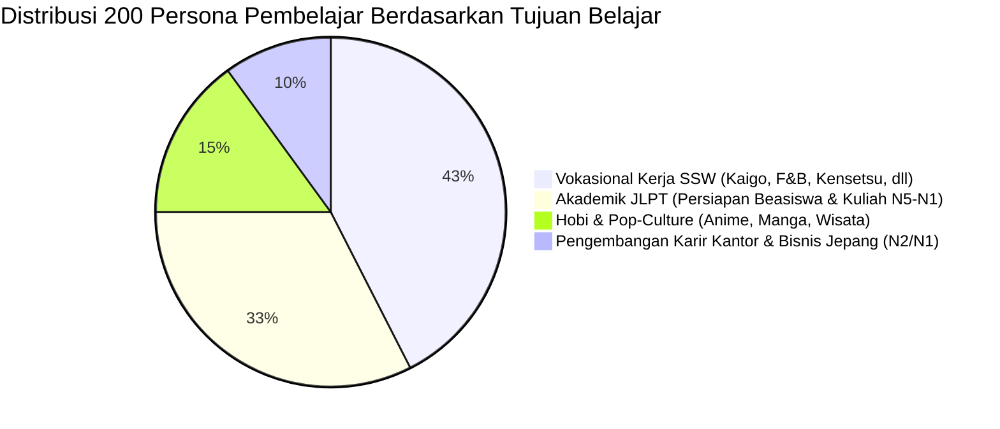

# 👥 Profil 200 Persona Pembelajar Indonesia (Learner Personas)
> **Nugget Nihongo — Demografi, Kebutuhan Kognitif & Target Kemahiran**  
> **Dasar Perancangan:** Processability Theory (Pienemann 1998) & L1 SLA Contrastive Analysis

---

## 1. Distribusi Demografis & Segmentasi Pembelajar
Korpus pengujian otomatis Nugget Nihongo didukung oleh **200 profil persona sintetis penutur Indonesia** yang mencerminkan spektrum nyata pengguna di seluruh Nusantara:

---

## 2. Matriks Profil Perangkat & Kondisi Jaringan
Untuk menjamin aplikasi bekerja tanpa cacat bagi seluruh kalangan masyarakat Indonesia:

| Kategori Perangkat | Persentase | Karakteristik Kunci | Pengamanan Sistem di Nugget Nihongo |
| :--- | :---: | :--- | :--- |
| **Ponsel Terjangkau / Layar Sempit** | 45% | Layar 320px–375px (Android murah, iPhone SE), RAM 2–3GB, memori terbatas. | Zero horizontal blowout, auto-eviction recovery, kuota LocalStorage < 5MB. |
| **Ponsel Modern Standar** | 40% | Layar 390px–430px (Galaxy A/S, iPhone 12–16), jaringan 4G fluktuatif. | PWA offline-first hibrida, pre-caching audio, touch target $\ge 40$px. |
| **Tablet & Desktop / Laptop** | 15% | Layar 768px–1920px+, dipakai saat belajar di kamar kos atau lab bahasa. | Split-screen Dokkai wacana panjang, shortcut keyboard ('F' Furigana, 'R' Romaji). |

---

## 3. Matriks Interferensi Bahasa Ibu (L1 Dialectal Nuances)
Penutur bahasa Indonesia memiliki kebiasaan artikulasi kedaerahan yang dipetakan langsung ke dalam modul *Pitch Accent* dan deteksi kesalahan:
- **Dialek Jawa (Jawa Tengah & Timur):** Kecenderungan vokal berat pada konsonan bersuara ($b, d, g$), kesulitan membedakan vokal panjang (*chou-on*) vs konsonan ganda (*soku-on*).
- **Dialek Sunda:** Potensi tertukarnya pelafalan huruf $f$ dan $p$ pada kata serapan Katakana.
- **Dialek Batak & Indonesia Timur:** Pola intonation naik-turun yang tajam (*staccato rhythm*), membutuhkan panduan visual kontur nada Tokyo (*Atamadaka, Nakadaka, Odaka, Heiban*).

---

## 4. Filosofi Psikologis: "Malu-Awareness" & Comfort Learning
Berdasarkan riset afektif Krashen (1982), pembelajar Indonesia memiliki tingkat *anxiety* (kecemasan salah berbicara) yang sangat tinggi:
1. **Peniadaan Hukuman Nyawa (*No Hearts Penalty*):** Pembelajar bebas mencoba dan salah tanpa rasa takut akunnya terkunci atau disuruh menunggu 5 jam untuk belajar lagi.
2. **Peniadaan Papan Peringkat Kompetitif Publik:** Menghilangkan rasa minder dan cemas tertinggal dari orang lain; fokus belajar 100% pada progres pribadi harian.
3. **Senpai Aoi & Sensei Nugget:** Maskot tutor yang selalu menyemangati dengan nada ramah, sabar, dan memberikan alasan logis di balik setiap kesalahan (Lapis 2 & 4 pembahasan 5 lapis).
