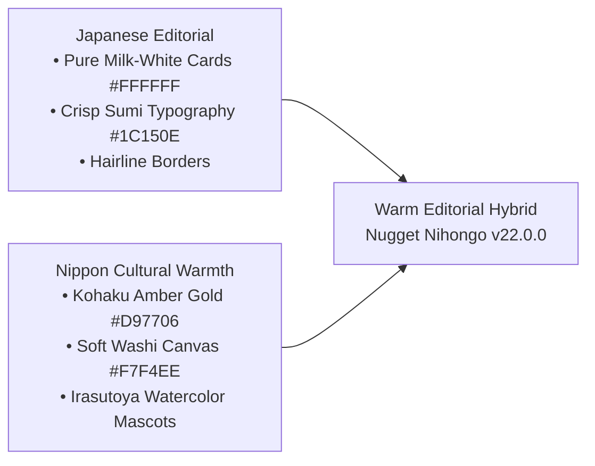

# 🎨 Warm Editorial Hybrid Design System Specification
> **Nugget Nihongo — Authoritative Visual Design Language & Component Tokens**  
> **Status:** PRODUCTION ACTIVE · **Version:** v22.0.0  
> **Rujukan Keputusan:** [`ADR-010`](../07-architecture-decisions-adr/ADR-010-WARM-EDITORIAL-HYBRID-DESIGN.md) & [`palette-exploration-mockups.md`](../../brain/e46eb17e-6306-48c3-ba61-94e55e386f72/palette-exploration-mockups.md)

---

## 1. Filosofi Desain: "Warm Editorial Hybrid"
Menggabungkan kebersihan, ketajaman, dan keterbacaan kanji maksimal dari **Japanese Editorial (Gaya Buku Teks & Majalah Tokyo)** dengan kehangatan **emas Nugget / Kohaku Amber (`#D97706`)** dan ilustrasi cat air otentik karya Takashi Mifune (*Irasutoya*).

---

## 2. Palet Token Warna Kanvas & Kontras WCAG

### ☀️ Light Mode (Siang Hari)
| Token Nama | Hex Code | Rasio Kontras | Peran Antarmuka |
| :--- | :---: | :---: | :--- |
| `--bg` (Canvas) | `#F7F4EE` | — | Latar belakang kertas beras lembut (*Washi Wash*), anti-silau. |
| `--surface` (Card) | `#FFFFFF` | — | Kartu belajar putih susu murni (*Pure Milk White*), mengapung tegas. |
| `--surface-2` | `#EFE9DF` | — | Kontainer sekunder, kotak input, pill segmen tidak aktif. |
| `--text` | `#1C150E` | $14.8:1$ (AAA) | Teks utama, kanji, dan judul paragraf. |
| `--text-muted` | `#3D3124` | $8.8:1$ (AAA) | Teks penjelas sekunder, arti bahasa Indonesia, furigana. |
| `--accent` (Nugget Gold) | `#D97706` | $4.8:1$ (AA) | Tombol CTA utama, status aktif, lencana pencapaian. |
| `--border-theme` | `rgba(45,35,25,0.08)` | — | Garis batas tipis *hairline* bernuansa hangat lembut. |

### 🌙 Dark Mode (Malam Hari — *Warm Sumi & Makie Gold*)
| Token Nama | Hex Code | Rasio Kontras | Peran Antarmuka |
| :--- | :---: | :---: | :--- |
| `--bg` (Canvas) | `#121110` | — | Latar arang pernis Jepang pekat (*Warm Sumi*), hemat baterai OLED. |
| `--surface` (Card) | `#1A1816` | — | Permukaan kartu arang dalam, ramah mata belajar tengah malam. |
| `--surface-2` | `#24211E` | — | Kontainer sekunder gelap dan laci navigasi nomor. |
| `--text` | `#F5EFE6` | $14.2:1$ (AAA) | Teks putih gading lembut, tanpa silau cahaya biru. |
| `--text-muted` | `#D5CBBF` | $9.5:1$ (AAA) | Teks sekunder dan transkrip pendukung. |
| `--accent` (Makie Gold) | `#F59E0B` | $9.1:1$ (AAA) | Tombol aksi keemasan bercahaya dan indikator streak. |
| `--border-theme` | `rgba(245,158,11,0.14)`| — | Garis batas tipis pernis emas *Makie*. |

---

## 3. Delapan Warna Tradisi Jepang (*Nippon Colors*)

| Warna Tradisional | Hex Code | Representasi & Peran Status |
| :--- | :---: | :--- |
| **Kohaku (琥珀)** | `#D97706` / `#F59E0B` | **Brand Primary (Nugget Gold):** Tombol utama, streak harian, lencana kehormatan. |
| **Tokiwa (常磐)** | `#059669` / `#10B981` | **Success / Passed:** Jawaban benar, cap kelulusan Hanko, indikator penguasaan materi. |
| **Shu-iro (朱色)** | `#DC2626` / `#EF4444` | **Danger / Error / Streak Fire:** Peringatan salah, tombol remedial, api streak menyala. |
| **Asagi (浅葱)** | `#0284C7` / `#0EA5E9` | **Listening / Water:** Kontrol pemutar audio Choukai, visualizer gelombang suara. |
| **Fuji-murasaki (藤紫)** | `#7C3AED` / `#8B5CF6` | **Cultural / Keigo:** Modul tata krama, etika kerja gemba, kanji tingkat tinggi N1. |
| **Yamabuki (山吹)** | `#EAB308` | **Warning / Focus:** Timer CBT 3 menit tersisa, indikator ragu-ragu di laci soal. |
| **Gofun (白粉)** | `#FFFFFF` | **Pure Milk White:** Permukaan kartu belajar mengapung di tema terang. |
| **Sumi (墨)** | `#121110` / `#1C150E` | **Tinta Arang Tradisional:** Tulisan kanji tajam dan latar belakang tema malam. |

---

## 4. Tipografi & Japanese CJK Guidelines
1. **Font UI Utama:** `'DM Sans'`, `-apple-system`, `sans-serif` (bersih, proporsi modern).
2. **Font Teks Jepang & Kanji:** `'BIZ UDGothic'`, `sans-serif` (standar Universal Design Morisawa yang terbukti paling mudah dibaca oleh pemula, difungsikan dengan atribut `lang="ja"`).
3. **Furigana RubyText Ratio:** `<rt>` menggunakan ukuran `0.65em` dengan penempatan `[ruby-position:over]` dan perataan garis dasar `align-baseline`.
4. **Google BudouX Semantic Line Breaking:** Menggunakan pemenggal frasa alami (*Bunsetsu*) untuk mencegah pemotongan kata kanji secara canggung di layar sempit ponsel.

---

## 5. Micro-Animations & Ergonomi Sentuh
- **Elevasi Kartu:** `.card-interactive-lift` (transisi transform `-translate-y-0.5` dan box-shadow lembut saat disentuh atau diarahkan kursor).
- **Umpan Balik Taktil:** `active:scale-95` pada seluruh tombol, pill filter, dan modal trigger.
- **Ambang Batas Sentuh:** Seluruh elemen interaktif wajib memenuhi $\ge 40\times 40$px (`min-h-[40px]` atau `min-w-[40px]`).
- **Aksesibilitas:** Menghormati `@media (prefers-reduced-motion: reduce)` dengan mematikan transform berlebih bagi pengguna sensitif gerak.
