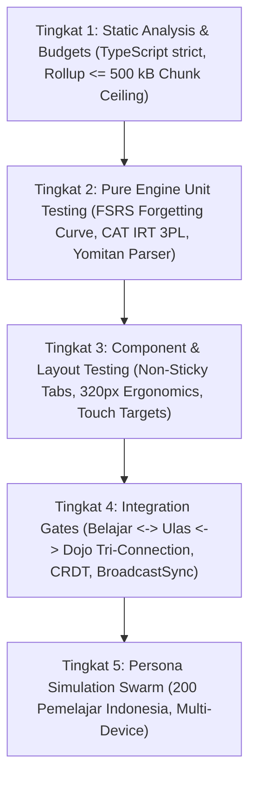

# 🏗️ QA Architecture & Quality Gates — Nugget Nihongo

## 1. Piramida Pengujian Multi-Tingkat (Multi-Tier Testing Pyramid)

---

## 2. Master Regression Orchestrator Architecture

- **Pusat Eksekusi**: `tests/master-regression-orchestrator.js`
- **Mekanisme**: Menjalankan setiap suite uji dalam proses Node.js terisolasi via `spawnSync`, menangkap output stdout/stderr, mengukur durasi milidetik, dan meneruskan exit code `0` (lulus) atau `1` (gagal).
- **Protokol Kegagalan**: Jika ada satu pun suite yang gagal, seluruh proses berakhir dengan exit code `1` dan mencetak jejak tumpukan kesalahan secara eksplisit.
- **Waktu Eksekusi Total**: ~60 detik untuk 157 suite regresi menyeluruh (75.000+ asersi).

---

## 3. Production Release Gate Protocol

Sebelum kode dapat didistribusikan ke environment produksi (`https://nugget-nihongo.pages.dev/`), wajib memenuhi 5 gerbang pelepasan:

1. **Gate 1: Master Orchestrator Exit 0**: Seluruh 157 suite regresi kumulatif lulus 100% tanpa ada suite yang dilewati.
2. **Gate 2: Persona Simulation 100%**: Seluruh 200 persona pemelajar Indonesia berhasil menempuh 4 pilar kurikulum tanpa error.
3. **Gate 3: Production Build Clean**: `npm run build` berhasil tanpa peringatan TypeScript atau error bundler.
4. **Gate 4: Chunk Budget Ceiling**: Seluruh 62 chunk JavaScript berada dalam batas aman `<= 500 kB`.
5. **Gate 5: PWA Service Worker Ready**: Service worker dan PwaUpdateBanner siap dengan mekanisme cache-busting otomatis.
